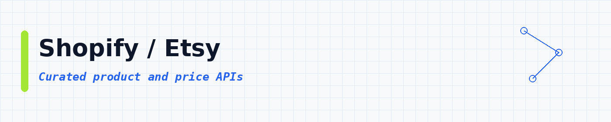
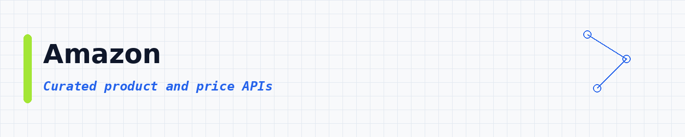
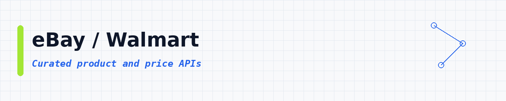
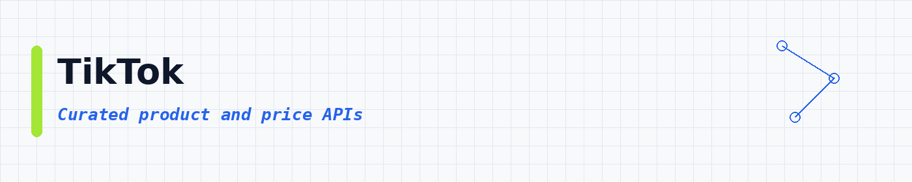
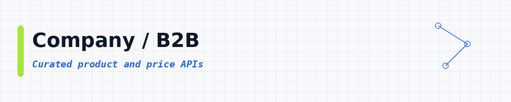

# Price Tracking APIs: Watch Product Prices and Stock in Any Online Store

 

 
 
 

 <a href="#top-10-most-popular">Top 10</a> ·
 <a href="#table-of-contents">Categories</a>

Want to know when a product gets cheaper, or sells out? Give one of these APIs a product link, and it brings back the price, stock and photos from the store. **21,531 ready-to-use APIs**, sorted by real users so the best ones come first.

These product and price tracking APIs help you monitor ecommerce prices, stock and catalogs. Use them as an Amazon scraper, Shopify and Etsy scraper, eBay and Walmart price tracker, AliExpress, Shopee and Temu product scraper, and review scraper for dropshipping, price comparison and repricing. Each API runs in the cloud and exports JSON, CSV or Excel.

---

## Collection statistics

| Metric | Count |
|--------|-------|
| **Track Products & Prices APIs** | **21,531** |
| **Categories** | **18** |
| **Last updated** | 2026-11-02 |

---

## What is a product and price API?

A product and price API is a tool you call to pull catalog facts from online stores. Things like title, price, stock, seller and images. You give it a product URL, ASIN or search. It gives you clean rows you can save as CSV or JSON.

People also call this a price scraper, an ecommerce API or a product data API. Same idea: watch products and prices without copying them by hand.

---

## What can you build?

These **21,531 ready-to-use product and price APIs** help you pull store data into your own apps. You can:

- Watch competitor prices on Amazon, Shopify and other shops
- Pull full product catalogs with variants and SKUs
- Check stock and buy-box style signals
- Compare marketplace sellers and ratings
- Build price history charts for a SKU list
- Collect product images and descriptions
- Export clean CSV or JSON for pricing tools

Pick an API below, open it, try a small run, then export the results.

---

## ⭐ Star This Repository

If this API list helped you, please give it a star! ⭐

Your support helps other people discover this resource and keeps the list updated and growing.

---

## Table of contents

- [Other / General](#other-general) : **7,584**
- [Reviews / Brand](#reviews-brand) : **3,194**
- [SEO / SERP](#seo-serp) : **2,793**
- [Shopify / Etsy](#shopify-etsy) : **1,513**
- [Amazon](#amazon) : **1,327**
- [Email / Phone](#email-phone) : **1,215**
- [AI / Agents / MCP](#ai-agents-mcp) : **786**
- [Real Estate](#real-estate) : **731**
- [eBay / Walmart](#ebay-walmart) : **606**
- [Google / Maps](#google-maps) : **444**
- [TikTok](#tiktok) : **302**
- [Jobs / Recruiting](#jobs-recruiting) : **300**
- [Company / B2B](#company-b2b) : **210**
- [Facebook / Meta](#facebook-meta) : **191**
- [News / Content](#news-content) : **177**
- [Instagram](#instagram) : **90**
- [LinkedIn](#linkedin) : **44**
- [X / Twitter](#x-twitter) : **24**

---

## Top 10 most popular

| API | What it does | Users | Rating | Price |
|-----|-------------|-------|--------|-------|
| [Twitter (X.com) Scraper Unlimited: No Limits](https://apify.com/apidojo/twitter-scraper-lite?fpr=data) | Introducing Twitter Scraper Unlimited, the most comprehensive Twitter data extraction solution available. Our enterprise-grade scraper offe… | 58.1K | 4.76 | Pay per event |
| [Facebook Ad Library Scraper](https://apify.com/curious_coder/facebook-ads-library-scraper?fpr=data) | Scrape ads from facebook ads library search results and facebook pages. Cost: $0.75 per 1K ads | 49.6K | 4.80 | Pay per event |
| [Facebook Ads Library Scraper](https://apify.com/apify/facebook-ads-scraper?fpr=data) | Extract advertising data from Facebook, Instagram, WhatsApp, Threads. Get ads, publishers, prices, reach estimates, impressions, links, ima… | 49.3K | 3.99 | Pay per event |
| [Traffic Generator (Youtube, Web, Etsy, Behance and many more!)](https://apify.com/epctex/traffic-generator?fpr=data) | Maximize your website's performance and visibility with our Traffic Generator. Drive targeted traffic, simulate page views, and stress-test… | 45.4K | 4.25 | Pay per event |
| [Amazon Product Scraper](https://apify.com/junglee/Amazon-crawler?fpr=data) | Use this Amazon scraper to collect data based on URL and country from the Amazon website. Extract product information without using the Ama… | 29.9K | 4.16 | Pay per event |
| [OpenRouter](https://apify.com/apify/openrouter?fpr=data) | You can use any AI LLM model without accounts in AI providers. Use this API as a proxy for all requests. Use pay-per-event pricing to pay o… | 23.0K | 4.92 | Pay per event |
| [Amazon Reviews Scraper](https://apify.com/junglee/amazon-reviews-scraper?fpr=data) | Amazon scraper to extract reviews from Amazon products. Scrape and download detailed reviews without using the Amazon API, including rating… | 16.9K | 4.07 | Pay per event |
| [E-commerce Scraping Tool](https://apify.com/apify/e-commerce-scraping-tool?fpr=data) | Scrape data from e-commerce websites with E-commerce Scraping Tool. Scrape almost any retail site in minutes, extract e-commerce data and u… | 16.0K | 4.31 | Pay per event |
| [Tripadvisor Scraper](https://apify.com/maxcopell/tripadvisor?fpr=data) | This unofficial Tripadvisor API is a data extraction tool able to get data on hotels, restaurants, things to do, vacation rentals, attracti… | 15.3K | 4.93 | Pay per event |
| [Amazon Scraper](https://apify.com/junglee/free-amazon-product-scraper?fpr=data) | Gets you product data from Amazon. Unofficial API. Scrapes and downloads product information without using the Amazon API, including review… | 14.9K | 4.67 | Pay per event |

---

## Other / General

**7,584 APIs in this category** | [View all →](lists/other-general.md)

| API | What it does | Users | Rating | Price |
|-----|-------------|-------|--------|-------|
| [E-commerce Scraping Tool](https://apify.com/apify/e-commerce-scraping-tool?fpr=data) | Scrape data from e-commerce websites with E-commerce Scraping Tool. Scrape almost any retail site in minutes, extract e-commerce data and u… | 16.0K | 4.31 | Pay per event |
| [AliExpress Product Details Scraper](https://apify.com/piotrv1001/aliexpress-product-details-scraper?fpr=data) | AliExpress scraper for product pages: paste product URLs, IDs or share links and get every variant with its price and stock, discounts, rat… | 6.1K | n/a | Pay per event |
| [1688.com Products Scraper](https://apify.com/devcake/1688-com-products-scraper?fpr=data) | Fast 1688.com scraper for bulk pricing tiers, supplier badges, product specs, and demand metrics. Filter by best-selling to find proven pro… | 5.2K | 5.00 | Pay per event |
| [1688 Products Wholesale Scraper: Full Supplier Details](https://apify.com/parsebird/1688-wholesale-scraper?fpr=data) | Scrape 1688 wholesale products, supplier details, tiered prices, MOQ, SKUs, shipping, certifications, dropship signals, and images. Export… | 4.4K | 5.00 | Pay per event |
| [1688 Product Details Scraper](https://apify.com/blueskyscraper/1688-product-details-scraper?fpr=data) | Scrape full 1688.com product pages by URL or ID: price range in CNY and USD, minimum order, stock, units sold, variants with images, specif… | 3.2K | 5.00 | Pay per event |
| [Shopee Scraper: All In One](https://apify.com/xtracto/shopee-scraper?fpr=data) | All-in-one Shopee scraper to extract product, search, category, and shop data across multiple countries. fast, lightweight, and no browser… | 3.2K | 4.09 | Pay per event |
| [Google Flights API](https://apify.com/johnvc/Google-Flights-Data-Scraper-Flight-and-Price-Search?fpr=data) | Google Flights API for extracting flight search data. Search one-way, round-trip, and multi-city itineraries. Filter by price, stops, airli… | 3.0K | 4.05 | Pay per event |
| [Pinterest Scraper \| All-In-One](https://apify.com/fatihtahta/pinterest-scraper-search?fpr=data) | Scrape Pinterest profiles, pins and boards into clean JSON. Get titles, descriptions, images/video, creator + board info, links, domains, t… | 2.9K | 5.00 | Pay per event |
| [WooCommerce Scraper ⭐5.0](https://apify.com/jupri/woocommerce?fpr=data) | 💫 Scrape WooCommerce and WordPress websites | 2.5K | 3.65 | Pay per event |
| [Mercadolivre Scraper (Brasil português)](https://apify.com/karamelo/mercadolivre-scraper-brasil-portugues?fpr=data) | MercadoLivre Scraper para produtos e ofertas do dia é uma ferramenta de web scraping de última geração, criada para o site brasileiro Merca… | 2.2K | 4.79 | Pay per event |
| [AliExpress Scraper](https://apify.com/epctex/aliexpress-scraper?fpr=data) | Effortlessly extract descriptions, images, feedback, questions, prices, and shipping information from AliExpress. Customize country, langua… | 2.1K | 4.97 | Pay per event |
| [Naver Shopping Product Detail Scraper (네이버쇼핑) - Specs](https://apify.com/zen-studio/naver-product-detail-scraper?fpr=data) | Scrape complete Naver Shopping product data by link or ID: price, discount, stock, specification tables, every seller's price, six months o… | 2.1K | n/a | Pay per event |
| [Shopee Product Detail Scraper: Cheapest](https://apify.com/xtracto/shopee-product-detail?fpr=data) | Scrape full product detail from Shopee by Shop ID + Item ID or product URL. Returns rich data: price variants, stock, images, attributes, s… | 1.7K | n/a | Pay per event |
| [Mercadolibre Scraper (español castellano)](https://apify.com/karamelo/mercadolibre-scraper-espanol-castellano?fpr=data) | El Mercadolibre Scraper es una herramienta de raspado web de última generación que te permite recolectar datos públicos de MercadoLibre de… | 1.5K | 5.00 | Pay per event |
| [Парсер объявлений Авито / Avito Scraper: телефоны и цены](https://apify.com/zen-studio/avito-listings-scraper?fpr=data) | Парсер объявлений Авито: телефоны продавцов в открытом виде, цены, характеристики, отзывы и координаты. 76 категорий: авто, недвижимость, в… | 1.4K | 5.00 | Pay per event |
| [Shopee Scraper](https://apify.com/best_scraper/shopee-scraper?fpr=data) | All-in-one unofficial shopee scraper support almost all of the endpoint you need to scrape the shopee data. You can scrape product sales, d… | 1.4K | 3.28 | Pay per event |
| [JD.com Product Scraper: Bulk SKU & URL Details](https://apify.com/bakos_bence/jd-com-products?fpr=data) | Scrape JD.com product pages by SKU or URL: titles, prices when exposed, images, shop metadata. Unofficial: not affiliated with JD.com. | 1.3K | n/a | Pay per event |
| [Alibaba Products Scraper](https://apify.com/devcake/alibaba-products-scraper?fpr=data) | Extract wholesale full product data, and pricing from Alibaba.com for sourcing and market research. Filter by price range, MOQ, Trade Assur… | 1.1K | 2.94 | Pay per event |
| [Vinted Smart Scraper: Cross-Country Arbitrage Scanner](https://apify.com/kazkn/vinted-smart-scraper?fpr=data) | Find profitable Vinted arbitrage across 26 markets, compare buy-low / sell-higher country price gaps, schedule deal alerts, monitor sellers… | 1.1K | 5.00 | Pay per event |
| [Skyscanner Flight Scraper API](https://apify.com/makework36/flight-price-scraper?fpr=data) | Compare flight prices from 7 sources in one API call: Google Flights, Kiwi, Travelpayouts, Ryanair, EasyJet, Wizz Air, Norwegian. Merged, d… | 999 | 1.00 | Pay per event |
| [AliExpress Scraper: Search Products, Prices & Ratings](https://apify.com/thirdwatch/aliexpress-product-scraper?fpr=data) | Scrape and monitor AliExpress products, prices, discounts, ratings, sales, images, and selling points. Get only new or price-changed listin… | 974 | 5.00 | Pay per event |
| [Yupoo Images Downloader](https://apify.com/pizani/yupoo-images-downloader?fpr=data) | Efficiently download and zip all product images from any Yupoo album. Ideal for suppliers, importers, and e-commerce automation. | 894 | 5.00 | Pay per event |
| [Kickstarter Scraper](https://apify.com/epctex/kickstarter-scraper?fpr=data) | The ultimate and most all-encompassing Kickstarter tool you'll ever discover. With powerful search features, you can instantly locate and a… | 887 | 5.00 | Pay per event |
| [Google Flights Scraper: Most Comprehensive](https://apify.com/kaix/google-flights-scraper?fpr=data) | 🔥 ~$0.05/1K flights 🔥 Search one-way, round-trip, and multi-city flights, compare flexible dates and destinations, and add optional booking… | 886 | n/a | Pay per event |
| [🔍🚗 Mobile.de Scraper (PPR)](https://apify.com/3x1t/mobile-de-scraper-ppr?fpr=data) | Effortlessly scrape car data from Germany's largest vehicle marketplace, Mobile.de. Get access to millions of entries of cars, motorbikes,… | 867 | 4.00 | Pay per event |
| [🔍🚗 Mobile.de Scraper](https://apify.com/3x1t/mobile-de-scraper?fpr=data) | Effortlessly scrape car data from Germany's largest vehicle marketplace, Mobile.de. Get access to millions of entries of cars, motorbikes,… | 856 | 5.00 | Free |
| [Leboncoin Monitoring Scraper](https://apify.com/saswave/advanced-leboncoin-scraper?fpr=data) | $0.8 / 1000 results. Leboncoin scraper. Collect product from any search website leboncoin.fr Advanced Web crawler for ecommerce leboncoin.… | 803 | 5.00 | Pay per event |
| [Mercado Libre Scraper](https://apify.com/trudax/mercadolibre-scraper?fpr=data) | MercadoLibre Scraper enables you to extract data about products, sellers, and listings present on this marketplace. | 793 | 2.89 | Pay per event |
| [Eventbrite Scraper: Event & Organizer Data](https://apify.com/aitorsm/eventbrite?fpr=data) | Efficiently scrape and extract Eventbrite event data for market research, lead generation, and event aggregation. This Eventbrite Scraper p… | 756 | 5.00 | Pay per event |
| [Xiaohongshu (RedNote) Scraper: Notes, Users & Search](https://apify.com/sian.agency/xiaohongshu-rednote-scraper?fpr=data) | Xiaohongshu + RedNote (Little Red Book) scraper: note details, user profiles, full note catalogs, comments, search across notes and users.… | 741 | 5.00 | Pay per event |
| [Sports Betting Odds Scraper: NFL, NBA, MLB, NHL, Soccer, Golf](https://apify.com/seemuapps/sports-odds-scraper?fpr=data) | Scrape betting odds with opening and current lines: moneyline, spread, totals, draws: for NFL, NBA, MLB, NHL, soccer, UFC and PGA golf outr… | 738 | n/a | Pay per event |
| [Google Travel Hotel Prices](https://apify.com/vittuhy/google-travel-hotel-prices?fpr=data) | This API extracts real-time pricing information for a given hotel across multiple dates and provides comprehensive price comparisons from v… | 734 | 5.00 | Pay per event |
| [Leboncoin Scraper (API) Pro 🇫🇷 - Annonces & Prix](https://apify.com/clearpath/leboncoin-api?fpr=data) | Leboncoin.fr Scraper API: Extract classified ads with prices, locations, seller info, and photos. Filter by category, price range, and area… | 726 | 4.96 | Pay per event |
| [Alibaba Scraper \| Products, Suppliers & MOQ](https://apify.com/piotrv1001/alibaba-listings-scraper?fpr=data) | Scrape Alibaba search results: prices, MOQ, units sold, supplier, country, Verified and Guaranteed badges, ratings and certifications. Filt… | 718 | 5.00 | Pay per event |
| [Allegro Fast Product Scraper](https://apify.com/e-commerce/allegro-fast-product-scraper?fpr=data) | Scrape product listings from Allegro category, search, and seller pages across allegro.pl, allegro.cz, and allegro.sk, including title, pri… | 701 | 4.86 | Pay per event |
| [Sitemap URL Extractor](https://apify.com/onescales/sitemap-url-extractor?fpr=data) | Provide a website link to a sitemap.xml and the app will extract and list all URLs in the sitemap as well as additional data in the sitemap… | 662 | 5.00 | Pay per event |
| [Gumroad Scraper](https://apify.com/muhammetakkurtt/gumroad-scraper?fpr=data) | Powerful Gumroad product scraper that extracts digital products, courses, and assets with advanced filtering options. Search by category, p… | 630 | 5.00 | Pay per event |
| [FlashScore Scraper Live](https://apify.com/statanow/flashscore-scraper-live?fpr=data) | Scrape FlashScore live scores, fixtures, results, odds, and match events across 16 sports. In historical mode, enrich each match with up to… | 623 | 5.00 | Pay per event |
| [Ticketmaster Scraper](https://apify.com/lhotanova/ticketmaster-scraper?fpr=data) | Scrapes events from Ticketmaster.com based on their categories, genres, location and date. Enhances Ticketmaster's built-in event search by… | 620 | 1.03 | Free |
| [Alibaba, 1688, AliExpress & Global Reverse Image Search API](https://apify.com/dev00/alibaba-1688-aliexpress-reverse-image-search-api?fpr=data) | Reverse image search across Alibaba, 1688 & AliExpress. Upload any product photo and get up to 100 matching supplier listings with prices,… | 604 | n/a | Pay per event |

[View all 7,584 in this section →](lists/other-general.md)

## Reviews / Brand

**3,194 APIs in this category** | [View all →](lists/reviews-brand.md)

| API | What it does | Users | Rating | Price |
|-----|-------------|-------|--------|-------|
| [Taobao 淘宝 Product Detail Scraper: SKUs, Prices, Reviews](https://apify.com/zen-studio/taobao-detail-scraper?fpr=data) | Extract SKUs, prices, attributes, optional reviews, images, videos, shop data, and category metadata from Taobao (淘宝) and Tmall (天猫) produc… | 10.0K | 5.00 | Pay per event |
| [Taobao Product Scraper](https://apify.com/pizani/taobao-product-scraper?fpr=data) | Extract detailed product data from Taobao, including title, price, reviews, specifications, images, options, and categories. Perfect for ma… | 9.3K | n/a | Pay per event |
| [Taobao & Tmall Scraper 淘宝 天猫 [Only $4] SKUs, Reviews, Sales](https://apify.com/memo23/taobao-scraper?fpr=data) | [Only $4 per 1000 products] Taobao 淘宝 and Tmall 天猫 products, no login: search in English or Chinese, sort by sales 销量 or price, Tmall only,… | 3.9K | n/a | Pay per event |
| [Trustpilot Reviews Scraper](https://apify.com/automation-lab/trustpilot?fpr=data) | Extract Trustpilot reviews with ratings, replies, reviewer info, and company data. Tiered per-review pricing applies, plus a $0.005 run sta… | 3.6K | 5.00 | Pay per event |
| [Google Shopping Insights](https://apify.com/epctex/google-shopping-scraper?fpr=data) | Unlock valuable insights from Google Shopping with our Data Extractor. Get reviews, descriptions, prices, merchant details, and affiliation… | 2.4K | 4.93 | Pay per event |
| [AliExpress Products Scraper](https://apify.com/devcake/aliexpress-products-scraper?fpr=data) | Scrape AliExpress search results to find best-selling products. Get prices, ratings, reviews, and order counts. | 2.0K | 5.00 | Pay per event |
| [Ozon.ru Product Scraper PRO \| Парсер товаров Ozon](https://apify.com/zen-studio/ozon-scraper-pro?fpr=data) | Full product data for any Ozon URL or search query: pricing, specs, variants, reviews, sellers, price history. Prices in 17 Russian cities.… | 1.4K | 4.70 | Pay per event |
| [Booking.com Scraper: Hotel Prices, Ratings & Availability](https://apify.com/santamaria-automations/booking-com-scraper?fpr=data) | Scrape Booking.com hotels for any destination and dates: price, rating, review score, availability, cancellation policy, address and GPS. 3… | 1.2K | n/a | Pay per event |
| [G2 Reviews & Products Scraper](https://apify.com/automation-lab/g2-scraper?fpr=data) | Scrape G2.com reviews, ratings, and product data. Extract NPS scores, reviewer sentiment, ease-of-use ratings, switching data, and product… | 1.1K | 5.00 | Pay per event |
| [Shopee Product Detail Scraper: Full Data, Stock & Reviews](https://apify.com/zen-studio/shopee-product-detail-scraper?fpr=data) | Scrape full Shopee product detail by URL: live price, discount, per-variant stock, units sold, ratings, specifications, brand, and category… | 919 | 5.00 | Pay per event |
| [Apple App Store Scraper](https://apify.com/automation-lab/apple-app-store-scraper?fpr=data) | Extract Apple App Store data: app details, ratings, reviews, and search results. Get app name, developer, price, rating, description, scree… | 845 | 5.00 | Pay per event |
| [Trustpilot Review Scraper: Ratings, Replies & Filters](https://apify.com/zen-studio/trustpilot-review-scraper?fpr=data) | Scrape Trustpilot reviews for any business. Get ratings, review text, reviewer details, company replies, and verification status. Filter by… | 808 | 5.00 | Pay per event |
| [Shopee Product Reviews Scraper: Full History & Filters](https://apify.com/zen-studio/shopee-product-reviews-scraper?fpr=data) | Scrape full Shopee product reviews by URL: complete review history with text, star and per-aspect sub-ratings, buyer photos and videos, the… | 731 | 4.00 | Pay per event |
| [AliExpress Product Scraper: Prices, Variants & Reviews](https://apify.com/zen-studio/aliexpress-scraper?fpr=data) | Extract AliExpress products with exact sales counts, prices, every variant with its own stock, seller stats, and buyer reviews with photos.… | 664 | n/a | Pay per event |
| [Fast Trustpilot Reviews Scraper API \| TrustScores & Reviews](https://apify.com/theagents/trustpilot-reviews?fpr=data) | Lightning-fast Trustpilot Reviews Scraper that extracts 100-200 reviews per second at just $0.50 per 1K reviews. Features custom mapping, s… | 656 | 5.00 | Pay per event |
| [Google Ads Transparency Scraper \| Bulk Ads](https://apify.com/xtech/google-ad-transparency-scraper?fpr=data) | Compare public Google ad creatives across advertisers and countries. Export deduplicated creative records, preview links, and available tim… | 632 | 3.01 | Pay per event |
| [Trendyol Scraper \| All-In-One](https://apify.com/fatihtahta/trendyol-scraper?fpr=data) | Extract structured Trendyol product data including prices, ratings, product reviews, Q&A, seller details, and promotion signals. Built for… | 578 | 5.00 | Pay per event |
| [🔥Vinted Scraper](https://apify.com/bebity/vinted-premium-actor?fpr=data) | 🚀 Vinted Data Scraper: Fast & Robust! 🔥 🛒 Items and catalogs 👥 User profiles with stats and balances 🏷️ Brands 🌟 Seamlessly integrate with… | 535 | 2.92 | Pay per event |
| [Temu Scraper (Products, Categories & Home Feed)](https://apify.com/hypebridge/temu-scraper?fpr=data) | Scrape Temu products, prices, ratings, review counts, images, video, SKU options, specifications and category taxonomy. Product, category a… | 530 | n/a | Pay per event |
| [Sephora Product Scraper: Prices, Stock, Shades & Ratings](https://apify.com/autofacts/sephora?fpr=data) | Sephora product data from 29 countries in one run: US, Canada, 9 EU countries, 6 Middle East markets, the UK, India and 10 Asia-Pacific mar… | 479 | 5.00 | Pay per event |
| [Fragrantica.com Scraper](https://apify.com/lexis-solutions/fragrantica?fpr=data) | Scrape fragrance data from Fragrantica: including perfume names, brands, notes, ratings, reviews, and images. Ideal for market research, ca… | 457 | 5.00 | Pay per event |
| [Shopee Product Detail](https://apify.com/gio21/shopee-product-detail?fpr=data) | Give it Shopee product URLs, get full product detail back: name, description, price, variants/SKUs, full image gallery, seller info, review… | 451 | 5.00 | Pay per event |
| [🕰️ Chrono24 Listings Scraper [From 💰$0.80/1K]](https://apify.com/misterkhan/chrono24-search-scraper?fpr=data) | Export luxury watch listings from Chrono24: zero proxy config required. Auto-paginates brand, model, and filtered search URLs at 60 listing… | 449 | n/a | Pay per event |
| [Meesho Reviews Scraper 🛍️](https://apify.com/easyapi/meesho-reviews-scraper?fpr=data) | Extract detailed product reviews from Meesho.com, including ratings, comments, review images, and author information. Perfect for market re… | 433 | 5.00 | Pay per event |
| [Yandex Market Scraper (Парсер Яндекс Маркет) - Product Data](https://apify.com/zen-studio/yandex-market-scraper-parser?fpr=data) | Парсер Яндекс Маркет: extract product data from Russia's largest marketplace. Prices, ratings, reviews, specs, seller info, images, and sto… | 425 | 5.00 | Pay per event |
| [Shopee Scraper: Product Data, Prices & Discounts, 11 Markets](https://apify.com/lergassy/shopee-scraper?fpr=data) | Shopee scraper and Shopee API alternative for product data from all 11 marketplaces: price, original price, discount, rating, shop name and… | 396 | 5.00 | Pay per event |
| [Unlimited Trustpilot Reviews Scraper](https://apify.com/saswave/unlimited-trustpilot-reviews-scraper?fpr=data) | $0.2 / 1000 results in 20 seconds, no proxies. Trustpilot reviews scraper handles requests at scale for faster output return and results. U… | 385 | 5.00 | Pay per event |
| [Alibaba Scraper](https://apify.com/lexis-solutions/alibaba-scraper?fpr=data) | The Alibaba Scraper is an efficient web crawling tool designed to scrape Alibaba, extracting product information, prices, and reviews. This… | 375 | 2.00 | Pay per event |
| [Yelp Reviews Scraper: Most Comprehensive](https://apify.com/kaix/yelp-reviews-scraper?fpr=data) | 🔥 ~$0.05/1K reviews 🔥 Scrape all reviews for any Yelp business. Full review text, ratings, author profiles, photos, reactions, owner replie… | 356 | n/a | Pay per event |
| [Meesho Product Search Scraper](https://apify.com/ecomscrape/meesho-product-search-scraper?fpr=data) | The Meesho.com Product Search Scraper extracts detailed product data from Meesho.com, including name, brand, description, price, rating sco… | 354 | n/a | Free |
| [Ozon.ru Product Reviews & Q&A Scraper \| Парсер отзывов Ozon](https://apify.com/zen-studio/ozon-product-reviews-scraper?fpr=data) | All reviews for any Ozon product: ratings, photos, videos, pros/cons, seller responses, and Q&A. Media gallery and questions included free.… | 354 | 5.00 | Pay per event |
| [Flipkart Product Scraper 🛒](https://apify.com/shahidirfan/Flipkart-Product-Scraper?fpr=data) | Extract detailed product data from Flipkart with ease. Capture essential information including prices, descriptions, images, and customer r… | 341 | 5.00 | Pay per event |
| [iHerb Scraper: Search, Products, Reviews & Monitor](https://apify.com/vaunted/iherb-scraper?fpr=data) | The ultimate iHerb API. Supports 4 modes: Search, Product Details, Reviews, and Real-Time Price Monitoring. Extract ingredients, nutrition,… | 341 | n/a | Pay per event |
| [AliExpress Reviews Scraper: No Login Required](https://apify.com/crowdpull/aliexpress-reviews-scraper?fpr=data) | Extract reviews from any AliExpress product. No login or cookies needed. Supports star ratings, review text, buyer country, images, and Sma… | 330 | 5.00 | Pay per event |
| [Farfetch Scraper](https://apify.com/autofacts/farfetch?fpr=data) | Scrape Farfetch luxury fashion: current and sale prices, designer, sizes, colours, stock status, images and every variant. Works on categor… | 317 | 5.00 | Pay per event |
| [🍴Uber Eats Scraper [RENTAL]](https://apify.com/borderline/ubereats-scraper?fpr=data) | Rental: Fast and cost-effective Uber Eats Scraper requiring just a search query and location or by url. Instantly retrieve comprehensive re… | 314 | 4.67 | Free |
| [iFood Restaurant Scraper](https://apify.com/yasmany.casanova/ifood-scraper?fpr=data) | Find restaurants in a nationwide index of 98,000+ iFood Brazil establishments, with address, opening hours and the public company registry,… | 307 | 5.00 | Pay per event |
| [Wildberries Products Search Scraper](https://apify.com/powerai/wildberries-products-search-scraper?fpr=data) | Scrape products from Wildberries.ru with automatic pagination and comprehensive product data extraction including prices, ratings, reviews,… | 287 | 2.42 | Pay per event |
| [Vinted Scraper: Search, Items, Prices & Profiles](https://apify.com/scrape.badger/vinted-scraper?fpr=data) | Scrape Vinted listings, item details, user profiles, and catalog data across 26 European markets. Filter by brand, price, color, condition.… | 280 | n/a | Pay per event |
| [Meesho Product Details Scraper](https://apify.com/ecomscrape/meesho-product-details-page-scraper?fpr=data) | The Meesho.com Product Details Scraper extracts detailed product data from Meesho.com, including name, brand, price, rating, image URLs, et… | 276 | 3.37 | Free |

[View all 3,194 in this section →](lists/reviews-brand.md)

## SEO / SERP

**2,793 APIs in this category** | [View all →](lists/seo-serp.md)

| API | What it does | Users | Rating | Price |
|-----|-------------|-------|--------|-------|
| [Taobao & Tmall Scraper: Products, Prices, Sellers & Reviews](https://apify.com/scrapesage/taobao-scraper?fpr=data) | Scrape Taobao and Tmall by keyword, category, product ID or shop. Prices in 13 currencies, seller DSR scores and credit level, buyer-rating… | 9.0K | n/a | Pay per event |
| [1688 Wholesale Products Scraper: 50+ Fields from 1688.com](https://apify.com/zen-studio/1688-wholesale-scraper?fpr=data) | Extract 50+ fields per product from 1688.com at 250+ products/minute. Tiered wholesale pricing, supplier verification, factory stats, drops… | 8.6K | 5.00 | Pay per event |
| [Douyin 抖音 Product Search Scraper: Price, Sales & Commission](https://apify.com/zen-studio/douyin-product-search-scraper?fpr=data) | Search Douyin Shop (抖音商城) products by keyword and extract price, monthly sales, a 30-day sales trend, positive-review ratio, shop name and… | 5.1K | 5.00 | Pay per event |
| [Taobao Tmall 淘宝 Product Scraper: Prices, SKUs, Reviews](https://apify.com/zen-studio/taobao-search-scraper?fpr=data) | Extract Taobao (淘宝) and Tmall (天猫) prices, SKUs, reviews, shop data, images, and attributes by keyword. Supports Chinese searches like 女装,… | 4.7K | 4.65 | Pay per event |
| [JD Products Scraper \| JD.com Prices, Brands and Barcodes](https://apify.com/silentflow/jd-products-scraper?fpr=data) | JD.com (京东) products scraper: search 京东商品 by keyword, shop page or SKU id and get the real CNY price, brand, model, UPC barcode, shop, revi… | 3.8K | n/a | Pay per event |
| [Shopee Search & Category Scraper: Cheapest](https://apify.com/xtracto/shopee-search?fpr=data) | Search Shopee products by keyword, category URL, or any Shopee listing URL. Optionally enrich each result with full product detail (price v… | 3.8K | 5.00 | Pay per event |
| [AliExpress Search Scraper](https://apify.com/kawsar/aliexpress-search-scraper?fpr=data) | AliExpress Search Scraper fetches product listings by keyword and returns prices, ratings, sold counts, and shipping details as structured… | 3.6K | n/a | Pay per event |
| [Shopee Scraper](https://apify.com/gio21/shopee-scraper?fpr=data) | Scrape Shopee product listings by keyword, category, or URL across Brazil, Singapore, Malaysia, Vietnam, Thailand, and Philippines. Returns… | 3.2K | 4.33 | Pay per event |
| [1688 Wholesale Scraper: Products, Pricing & Suppliers](https://apify.com/vulnv/1688-wholesale-scraper?fpr=data) | Scrape 1688.com wholesale products by keyword or offer ID. Get tiered pricing, MOQ, SKU variants, stock, supplier verification, dropship ch… | 2.9K | n/a | Pay per event |
| [Clutch.co Scraper: Company Search, Reviews & Portfolio Data](https://apify.com/epctex/clutchco-scraper?fpr=data) | $2 per 1,000 Clutch.co, The Leading Marketplace for Finding Business Services search results, or $0.002 each, with 8 fields per company. Fi… | 2.7K | 5.00 | Pay per event |
| [Temu Products Scraper](https://apify.com/crw/temu-products-scraper?fpr=data) | Extract product data from Temu by search keyword. Collect prices, discounts, ratings, sales counts, and images. Supports sort options inclu… | 2.3K | 5.00 | Pay per event |
| [Taobao & Tmall Scraper: Products, Prices, Shops & Ratings](https://apify.com/tortuga/taobao-scraper?fpr=data) | Scrape Taobao and Tmall products by keyword, category, shop or item URL: CNY prices, discounts, shop names, seller ratings, ship-from locat… | 2.3K | n/a | Pay per event |
| [Naver Shopping Scraper (네이버쇼핑) - Prices, Specs & Reviews](https://apify.com/zen-studio/naver-shopping-scraper?fpr=data) | Extract Naver Shopping products by keyword, link or category: prices, discounts, stock, ratings, review counts, sellers and images. 111 fie… | 2.3K | n/a | Pay per event |
| [JD.com 京东 Jingdong Scraper: Prices & Reviews](https://apify.com/zen-studio/jd-com-search-scraper?fpr=data) | Extract JD.com 京东 (Jingdong) product prices, images, shop data, attributes, and reviews by keyword. Supports Chinese searches like 苹果手机, 笔记… | 2.1K | n/a | Pay per event |
| [Pinterest Scraper \| Pins, Boards and Profiles](https://apify.com/silentflow/pinterest-scraper-ppr?fpr=data) | Pay per result Pinterest scraper. Extract pins, boards, users and search results. Pay only for the data you get - $0.002 per pin. 30+ data… | 1.5K | 5.00 | Pay per event |
| [Goofish Scraper 闲鱼 Xianyu (Idlefish) - Listings + Sellers](https://apify.com/zen-studio/goofish-xianyu-search-scraper?fpr=data) | Search Goofish 闲鱼 (Xianyu/Idlefish) listings by keyword or batches of keywords. Export prices, full descriptions, photos, condition, provin… | 1.5K | 1.00 | Pay per event |
| [Temu Products Scraper](https://apify.com/amit123/temu-products-scraper?fpr=data) | Scrapes product listings from Temu based on search keywords. Returns detailed data including title, price, discount, rating, sales, images,… | 1.4K | 3.51 | Pay per event |
| [Taobao Tmall Product Scraper](https://apify.com/sian.agency/taobao-tmall-product-scraper?fpr=data) | Scrape Taobao and Tmall into clean structured datasets: product details, full product pages with specs and variants, keyword search, shop c… | 1.4K | 4.44 | Pay per event |
| [Goofish Xianyu Search Scraper](https://apify.com/fetch_cat/goofish-xianyu-search-scraper?fpr=data) | Search Goofish (Xianyu) listings by keyword and export structured product, price, seller, location, image, category, and demand data. | 1.3K | 5.00 | Pay per event |
| [App Store Scraper (from $0.10/1,000 apps) - Apple iOS Data](https://apify.com/epctex/appstore-scraper?fpr=data) | Search the App Store by keyword, or look up apps by App Store ID, bundle ID, or developer ID. First 50 free, then $0.10/1,000 (search) or $… | 1.3K | 4.98 | Pay per event |
| [✨ Google Shopping Scraper](https://apify.com/damilo/google-shopping-apify?fpr=data) | ⚡ Lightning-fast Google Shopping scraper that captures live product listings straight from Google’s Shopping tab. Extract prices, ratings,… | 1.3K | 4.59 | Pay per event |
| [Shopee Product Scraper: Live Stock & Prices](https://apify.com/zen-studio/shopee-product-scraper?fpr=data) | Scrape Shopee products by keyword or URL across all 8 markets. Get live stock, price, discount, units sold, rating, and shop data, plus opt… | 1.2K | n/a | Pay per event |
| [Google Shopping Scraper](https://apify.com/burbn/google-shopping-scraper?fpr=data) | Scrape Google Shopping products by keyword and extract prices, ratings, reviews, seller/store info, offers, shipping & more. Ideal for pric… | 1.1K | 5.00 | Pay per event |
| [AliExpress Search Scraper \| Price Tracker & Best Sellers](https://apify.com/piotrv1001/aliexpress-listings-scraper?fpr=data) | Search AliExpress by keyword or paste search URLs and get product listings with price, original price, discount, rating and sales volume, i… | 1.1K | 4.95 | Pay per event |
| [Shopee Api Scraper](https://apify.com/chartedsea/shopee-api-scraper?fpr=data) | Query Shopee's unofficial API for product searches by keyword, category, or shop. Access detailed information including prices, orders, sto… | 1.0K | 5.00 | Pay per event |
| [MercadoLibre Scraper: Search, Products, Reviews, Q&A, Sellers](https://apify.com/sourabhbgp/mercadolibre-scraper?fpr=data) | Scrape MercadoLibre and Mercado Livre in 18 Latin American countries. Paste a keyword or URL and get up to 2,000 search results per query,… | 1.0K | 5.00 | Pay per event |
| [AliExpress Scraper: Products, Reviews & Sellers](https://apify.com/khadinakbar/aliexpress-all-in-one-scraper?fpr=data) | Scrape AliExpress listings, product details and customer reviews from a keyword or URL. Prices in your ship-to country's currency, orders a… | 825 | n/a | Pay per event |
| [AliExpress Scraper API: Products, Variants, Reviews & Sellers](https://apify.com/pro100chok/aliexpress-scraper?fpr=data) | Scrape AliExpress by keyword, category or URL. One row per product: price, discount, orders sold, rating, every SKU variant with live stock… | 765 | n/a | Pay per event |
| [Storeleads Scraper](https://apify.com/saswave/storeleads-scraper?fpr=data) | Storeleads scraper. Extract companies results from a search url. Get data about social network, name, monthly sales, visits, location, prod… | 721 | 4.98 | Pay per event |
| [Shopee Scraper \| All-In-One \| $30 / mo](https://apify.com/fatihtahta/shopee-scraper?fpr=data) | All-in-one Shopee scraper for 11 countries (ID, MY, TH, BR, SG, MX +). Scrape by keyword or URL. It bypasses blocks and captchas to extract… | 597 | 3.65 | Free |
| [AliExpress Product Scraper](https://apify.com/cloud9_ai/aliexpress-scraper?fpr=data) | Scrape product listings, prices, discounts, and seller info from AliExpress. Search by keyword or provide product URLs. Extract original pr… | 525 | 5.00 | Pay per event |
| [Naver Shopping Product Scraper](https://apify.com/delicious_zebu/naver-shopping-product-scraper?fpr=data) | Scrape Naver Shopping search results by keyword: product name, price and discount, seller and brand-store flag, shipping fee, rating, revie… | 491 | 4.99 | Pay per event |
| [Simple SEO Data Extractor](https://apify.com/onescales/simple-seo-data-extractor?fpr=data) | Grab SEO data from any webpage / URL and export the URL, Title Tag, Meta Description, Meta Keywords, Status Code, H1, H2, Canonical Tag and… | 487 | 5.00 | Pay per event |
| [Fiverr Scraper](https://apify.com/automation-lab/fiverr-scraper?fpr=data) | Scrape Fiverr gigs, seller profiles, packages, reviews, and pricing. Search by keyword or provide direct URLs. Export to JSON, CSV, Excel.… | 477 | 5.00 | Pay per event |
| [Mercado Livre Scraper](https://apify.com/gio21/mercado-livre-scraper?fpr=data) | Scrape products from Mercado Livre (mercadolivre.com.br) by keyword. Extract title, price, rating, reviews, seller, shipping, images, and p… | 458 | 5.00 | Pay per event |
| [Lazada Scraper](https://apify.com/dtrungtin/lazada-scraper?fpr=data) | Unofficial Lazada API to extract data from Lazada based on keywords or categories. Scrape prices, product descriptions, images, location, a… | 444 | n/a | Pay per event |
| [Fiverr Scraper: Gigs, Sellers, Packages & Pricing](https://apify.com/memo23/fiverr-scraper?fpr=data) | Scrape Fiverr gigs, sellers, packages, reviews and pricing: search by keyword or category, or paste gig / seller URLs. One row per gig: tit… | 430 | 4.86 | Pay per event |
| [1688 Product Scraper API: Prices, MOQ & Suppliers](https://apify.com/webdata_labs/1688-scraper?fpr=data) | Scrape 1688 by keyword, product URL or ID, and supplier shop. Get MOQ price tiers, English titles, supplier data, images, SKUs, and buying… | 424 | n/a | Pay per event |
| [MercadoLibre Scraper: Products, Prices & Reviews](https://apify.com/memo23/mercadolibre-scraper?fpr=data) | MercadoLibre and Mercado Livre scraper for Mexico, Brazil, Argentina, Colombia, Chile, Uruguay and Peru. Search a keyword, category or prod… | 417 | 5.00 | Pay per event |
| [MercadoLivre search $1/1000 results](https://apify.com/riseandcode/apify-mercadolivre-search?fpr=data) | Extract product listings from MercadoLivre / Mercado Libre search results in Brazil, Mexico, Argentina and 15 more Latin American countries… | 403 | 5.00 | Pay per event |

[View all 2,793 in this section →](lists/seo-serp.md)

## Shopify / Etsy

**1,513 APIs in this category** | [View all →](lists/shopify-etsy.md)

| API | What it does | Users | Rating | Price |
|-----|-------------|-------|--------|-------|
| [Etsy Scraper](https://apify.com/epctex/etsy-scraper?fpr=data) | Scrape valuable data from over 4 million Etsy sellers. Extract product details, descriptions, listed date, images, seller info, and more. C… | 5.6K | 4.20 | Pay per event |
| [Shopify Scraper: Products, Prices, Stock & Inventory](https://apify.com/autofacts/shopify?fpr=data) | A Shopify product scraper for any public Shopify store: every variant's price, SKU and stock status, with barcodes, real inventory counts,… | 2.4K | 4.19 | Pay per event |
| [Shopify Scraper](https://apify.com/pocesar/shopify-scraper?fpr=data) | Automate monitoring prices on the most popular solution for building online stores and selling products online. Crawl arbitrary Shopify-pow… | 2.4K | 1.00 | Free |
| [Shopify Store Leads Scraper: Emails, Phones & Ratings](https://apify.com/clearpath/shopify-store-leads?fpr=data) | Scrape Shopify store leads by keyword or category. Extract emails, phone numbers, addresses, ratings, and social links. Find storeleads for… | 1.9K | 4.39 | Pay per event |
| [🔥 Etsy Listings Scraper: Live Carts & Ads](https://apify.com/yumitori/etsy-listings-scraper?fpr=data) | Scrape Etsy listings by keyword with data no other scraper exposes: live cart counts, "X people bought in 24h" signals, Etsy Ads slot posit… | 1.6K | n/a | Pay per event |
| [Shopify Lead Scraper with 1M+ Email Database](https://apify.com/xmiso_scrapers/shopify-shops-email-leads-scraper?fpr=data) | scrape shopify powered shops for ecommerce email leads from merchantgenius and own scraped sources. | 1.5K | 4.23 | Pay per event |
| [Etsy Scraper](https://apify.com/automation-lab/etsy-scraper?fpr=data) | Scrape Etsy listings for handmade and vintage marketplace price monitoring. Extract names, prices, shops, ratings, images, and availability… | 1.2K | 5.00 | Pay per event |
| [Store Leads (14M E-Commerce Leads)](https://apify.com/ecommerce_leads/store-leads-14m-e-commerce-leads?fpr=data) | Store leads for Shopify,Woocommerce,Magento,Squarespace,Ecwid,BigCommerce,Opencart,Webflow,PrestaShop and Demandware with phones,emails,app… | 1.2K | 5.00 | Pay per event |
| [Shopify Products Scraper V2](https://apify.com/logie/shopify-products-scraper?fpr=data) | Our shopify website scraper is the perfect tool for anyone looking to get information on shopify websites. Use it to get products from any… | 1.0K | 4.33 | Free |
| [Shopify Products Scraper](https://apify.com/trovevault/shopify-products-scraper?fpr=data) | Scrape Shopify products with prices, real inventory counts when public, product and variant IDs, SKUs, barcodes and GTINs, named options, w… | 813 | 5.00 | Pay per event |
| [Shopify Extractor](https://apify.com/jupri/shopify-scraper?fpr=data) | 💫 Scrape Shopify e-commerce websites | 742 | n/a | Pay per event |
| [💰 Etsy Scraper: Product Research, Tags, Prices & Sales](https://apify.com/yumitori/etsy-search-scraper?fpr=data) | Etsy product research without the guesswork. Search any keyword and get every listing's tags, prices, views and demand: plus each shop's sa… | 692 | n/a | Pay per event |
| [Shopify Products Scraper](https://apify.com/dhrumil/shopify-products-scraper?fpr=data) | Scrape any shopify powered website / store and automate / monitor all products products in a structured form, including product title, pric… | 686 | 4.99 | Pay per event |
| [Etsy Product Search Scraper](https://apify.com/getdataforme/etsy-product-search-scraper?fpr=data) | Use this Crawler if you want to look for a specific product name instead of looking for a category. For example I want to buy phone then si… | 665 | 5.00 | Pay per event |
| [Yupoo Scraper](https://apify.com/yupoo-scraper/yupoo-scraper?fpr=data) | Yupoo scraper Tool. Scrapes entire stores, categories, or single albums: including titles, descriptions, images, and videos. Optionally ext… | 584 | 5.00 | Pay per event |
| [Etsy Reviews](https://apify.com/hello.datawizards/etsy-reviews?fpr=data) | Quickly extract detailed customer reviews from Etsy product listings. Perfect for Etsy sellers and analysts! | 575 | 5.00 | Pay per event |
| [Shopify Store Finder: URLs, emails & more](https://apify.com/igolaizola/shopify-store-finder?fpr=data) | Shopify Store Finder locates Shopify stores by keyword and returns structured data: ID, title, description, URL, contact emails, earliest p… | 565 | 5.00 | Pay per event |
| [Shopify & WooCommerce Database \| 70M+ Records, Emails & Phones](https://apify.com/apivault_labs/website-leads-database?fpr=data) | Discover indexed Shopify and ecommerce websites with available emails, phones and technology filters. Bulk export: JSON, CSV, Excel and API… | 533 | 5.00 | Pay per event |
| [Shopify Store Analyzer: No Login, Apps, Emails & Phones](https://apify.com/apivault_labs/shopify-store-analyzer?fpr=data) | Analyze public Shopify catalog and app signals; revenue and sales estimates are labeled assumptions. No login. Bulk export: JSON, CSV, Exce… | 445 | 5.00 | Pay per event |
| [Shopify Product Scraper](https://apify.com/webdatalabs/shopify-product-scraper?fpr=data) | Extract full product catalogues from any Shopify store with a public products.json feed: titles, prices, compare-at prices, discounts, pric… | 414 | 5.00 | Pay per event |
| [Etsy Product Scraper](https://apify.com/saswave/etsy-product-scraper?fpr=data) | Etsy scraper extract product details, descriptions, images, seller info, and more. Start from search url or product direct url. | 389 | n/a | Pay per event |
| [Etsy Shop Scraper](https://apify.com/axlymxp/etsy-shop-scraper?fpr=data) | Scrape Etsy shop profiles: Star Seller badge, total sales, ratings, location, and product listings. Search by keyword or look up a batch of… | 370 | 1.00 | Pay per event |
| [Etsy Keyword Research + Reverse Keyword Tool](https://apify.com/yumitori/etsy-keyword-tool?fpr=data) | Find the Etsy keywords actually worth chasing. Every term is scored on real demand (live carts, recent sales), competition and buyer intent… | 341 | n/a | Pay per event |
| [Etsy Search Scraper 2026](https://apify.com/devcake/etsy-search-scraper?fpr=data) | Scrape Etsy products by keyword, and by image. Extract listings with prices, ratings, images, and full product details including descriptio… | 327 | n/a | Pay per event |
| [Shopify AppStore Scraper](https://apify.com/applora/shopify-appstore-scraper?fpr=data) | A powerful APIs designed to extract comprehensive data from the Shopify App Store. This scraper can discover all available apps, collect de… | 325 | 4.07 | Pay per event |
| [Etsy Scraper: Products, Prices, Reviews & Shop Data](https://apify.com/khadinakbar/etsy-all-in-one-scraper?fpr=data) | Scrape Etsy product listings, prices, ratings, seller info, Star Seller & Bestseller badges, materials, tags, shop catalogs & customer revi… | 324 | n/a | Pay per event |
| [Etsy Shop Details Scraper](https://apify.com/getdataforme/etsy-shop-details-scraper?fpr=data) | Extract detailed Etsy shop data like ratings, sales, bios, and locations in structured JSON. Ideal for e-commerce insights, market research… | 320 | 5.00 | Pay per event |
| [Shopify App Store Scraper](https://apify.com/jungle_synthesizer/shopify-app-store-scraper-2?fpr=data) | Scrape apps from the Shopify App Store with pricing, ratings, developer info, and user reviews. Also scrapes the Shopify Theme Store: theme… | 279 | 1.00 | Pay per event |
| [Etsy Keywords Research Tool 🎯](https://apify.com/easyapi/etsy-keywords-research-tool?fpr=data) | 🔍 Unlock valuable keyword insights from Etsy's search data! Extract suggestions, related terms, and trending searches to optimize your Etsy… | 259 | 1.00 | Pay per event |
| [ETSY Crawler 🛒 ⭐5.0](https://apify.com/jupri/etsy-scraper?fpr=data) | 💫 All-in-One ETSY.com Scraper | 256 | 1.33 | Free |
| [Etsy Scraper: Search, Listings, Shops & Reviews](https://apify.com/sourabhbgp/etsy-scraper?fpr=data) | Scrape Etsy search results and full product details: prices, ratings, images, and every variation. Pull shop and seller profiles with sales… | 250 | n/a | Pay per event |
| [Etsy Scraper: Listings, Shops & Search Results](https://apify.com/cirkit/etsy-shop-product-scraper?fpr=data) | Scrape Etsy product listings, shop profiles, and search results. Get price, sales, reviews, photos, variants, shop info. 3 input modes. | 233 | 5.00 | Pay per event |
| [Etsy Shop Scraper](https://apify.com/hello.datawizards/etsy-shop-scraper?fpr=data) | Use the Etsy Shop Scraper to unlock the potential of Etsy’s marketplace for your business or research needs. Note: Usage cost and CPU Cost… | 233 | n/a | Pay per event |
| [Etsy Scraper Pro: Sale Prices & Discount Depth](https://apify.com/webdatalabs/etsy-scraper-pro?fpr=data) | Scrape Etsy search, category and market pages and get the struck-through original price on every discounted listing, so you can compute rea… | 230 | 3.83 | Pay per event |
| [Shopify Lead Scraper with 1M+ Email Database Monthly Rental](https://apify.com/xmiso_scrapers/shopify-shops-email-leads-scraper-flat-fee-monthly-rental?fpr=data) | If you need large amounts of rows, this version of shopify powered shops email leads from merchantgenius is designed for you. Scrape as muc… | 228 | 5.00 | Pay per event |
| [Etsy Review Scraper](https://apify.com/getdataforme/etsy-review-scraper?fpr=data) | The Etsy Review Scraper is an easy scraper to extract reviews from specified Etsy shop. The Etsy review scraper is easy to use, simply prov… | 220 | 5.00 | Pay per event |
| [Shopify App Store Scraper](https://apify.com/alwaysprimedev/shopify-app-store-scraper?fpr=data) | Scrape the Shopify App Store for app metadata, pricing tiers, ratings, reviews, and Built-for-Shopify badges. Designed for delta-tracking:… | 200 | n/a | Pay per event |
| [Shopify Product Scraper: Extract Product Data via JSON API](https://apify.com/linen_snack/shopify-product-scraper-extract-product-data-via-json-api?fpr=data) | Effortlessly scrape comprehensive product data (titles, descriptions, prices, variants, images, SKUs, inventory & more) from any Shopify st… | 196 | n/a | Pay per event |
| [Shopify Store Scraper](https://apify.com/webdatalabs/shopify-store-intelligence?fpr=data) | Deep-dive any Shopify store: full product catalogue, installed apps, theme, pricing strategy and tech stack, plus review coverage and avera… | 189 | 5.00 | Pay per event |
| [Shopify Review Scraper (Judge.me, Loox, Yotpo, Stamped + more)](https://apify.com/stanvanrooy6/shopify-review-scraper?fpr=data) | Scrape all reviews from any Shopify store. Auto-detects Judge.me, Loox, Yotpo, Okendo, Stamped.io, REVIEWS.io, Junip, Fera, Opinew, Rivyo,… | 187 | n/a | Pay per event |

[View all 1,513 in this section →](lists/shopify-etsy.md)

## Amazon

**1,327 APIs in this category** | [View all →](lists/amazon.md)

| API | What it does | Users | Rating | Price |
|-----|-------------|-------|--------|-------|
| [Amazon Product Scraper](https://apify.com/junglee/Amazon-crawler?fpr=data) | Use this Amazon scraper to collect data based on URL and country from the Amazon website. Extract product information without using the Ama… | 29.9K | 4.16 | Pay per event |
| [Amazon Reviews Scraper](https://apify.com/junglee/amazon-reviews-scraper?fpr=data) | Amazon scraper to extract reviews from Amazon products. Scrape and download detailed reviews without using the Amazon API, including rating… | 16.9K | 4.07 | Pay per event |
| [Amazon Scraper](https://apify.com/junglee/free-amazon-product-scraper?fpr=data) | Gets you product data from Amazon. Unofficial API. Scrapes and downloads product information without using the Amazon API, including review… | 14.9K | 4.67 | Pay per event |
| [Amazon Reviews Scraper](https://apify.com/axesso_data/amazon-reviews-scraper?fpr=data) | Our Amazon Reviews Scraper extracts real-time reviews from Amazon, including ratings, titles, descriptions, user reactions, review dates, i… | 7.2K | 4.22 | Pay per event |
| [Amazon Reviews Scraper](https://apify.com/web_wanderer/amazon-reviews-extractor?fpr=data) | [UPDATED] Scrape Amazon reviews per product! Filter by stars, keywords, media & verified purchases. Extract global reviews (20+ regions). E… | 6.2K | 3.39 | Pay per event |
| [Amazon Bestsellers Scraper](https://apify.com/junglee/amazon-bestsellers?fpr=data) | Scrape the Amazon Best Sellers categories and extract details on top 100 most popular items on Amazon. Download product name, price, URL, a… | 5.6K | 4.25 | Pay per event |
| [1688 Image Search: Find Suppliers & Factories by Photo](https://apify.com/crawleast/1688-image-search-scraper?fpr=data) | 1688 reverse image search for Amazon FBA sourcing, dropshipping and private label. Supplier prices and MOQ; optional English titles and lan… | 4.0K | 5.00 | Pay per event |
| [Amazon Reviews Scraper with Advanced Filters](https://apify.com/delicious_zebu/amazon-reviews-scraper-with-advanced-filters?fpr=data) | Extract Amazon reviews from any ASIN or URL across 16 Amazon marketplaces: rating, title, text, date, country, photos, videos, verified bad… | 2.4K | 3.93 | Pay per event |
| [Amazon ASINs Scraper](https://apify.com/junglee/amazon-asins-scraper?fpr=data) | Gets you product data from Amazon. Unofficial API. Scrapes and downloads product information without using the Amazon API, including review… | 2.3K | 5.00 | Pay per event |
| [Amazon Seller Scraper](https://apify.com/junglee/amazon-seller-scraper?fpr=data) | Amazon scraper to extract seller information. You can scrape either categories or specific products. | 2.1K | 1.78 | Pay per event |
| [Amazon Scraper](https://apify.com/automly/amazon-products-scraper---fast-efficient-with-sales-data?fpr=data) | Amazon product scraper: Scrape Amazon products by keyword, product link or ASIN in 20 Amazon stores: price, Best Sellers Rank, monthly sale… | 1.6K | 5.00 | Pay per event |
| [Amazon Product Details Scraper](https://apify.com/axesso_data/amazon-product-details-scraper?fpr=data) | With our Amazon Product Details Scraper you can retrieve product details data from Amazon website. Our API always return realtime data from… | 1.6K | 4.94 | Pay per event |
| [Amazon Products Scraper](https://apify.com/curious_coder/amazon-scraper?fpr=data) | Scrape amazon products, category pages, search results, amazon best sellers, etc and extract complete details such as description, price, r… | 1.4K | 4.67 | Pay per event |
| [Amazon Search Results Scraper](https://apify.com/apt_marble/amazon-search-results-scraper?fpr=data) | Collect Amazon search results for any keyword, with sponsored placements flagged and organic rank reported separately. Filter by price, sta… | 1.4K | n/a | Pay per event |
| [Amazon Reviews Scraper](https://apify.com/jdtpnjtp/amazon-reviews?fpr=data) | Scrape full Amazon customer reviews with NO login and NO cookie. Provide ASINs or product URLs: get every review (rating, title, text, auth… | 1.4K | 5.00 | Pay per event |
| [Fast Amazon Bestsellers Scraper](https://apify.com/amazon-scraper/amazon-bestsellers-scraper?fpr=data) | Amazon Best Sellers Scraper, Amazon URLs from 9 different Amazon domains:.com, com.au,.in, co.jp,.de..co.uk,.fr,.es and.it. Scrape the 100… | 1.2K | 5.00 | Pay per event |
| [300K+ Amazon Sellers Email Leads](https://apify.com/xmiso_scrapers/eu-amazon-sellers-email-leads?fpr=data) | Database of scraped sellers from Amazon marketplaces with emails, phone numbers and other valuable data. | 1.1K | 2.82 | Pay per event |
| [Amazon Public Review Snapshots](https://apify.com/automation-lab/amazon-reviews-scraper?fpr=data) | Extract limited Amazon public product-page reviews: text, ratings and dates across 11 marketplaces. No full review pagination or complete/n… | 1.1K | 2.15 | Pay per event |
| [Amazon Reviews Scraper](https://apify.com/epctex/amazon-reviews-scraper?fpr=data) | Gain access to incredibly rapid, essential, and highly informative Amazon product review data. Pull out ratings, reviews, images, product s… | 995 | 4.86 | Pay per event |
| [Alibaba Scraper: Products, Verified Suppliers, 100+ Fields](https://apify.com/zen-studio/alibaba-scraper?fpr=data) | Scrape Alibaba.com products with the full price-tier ladder, MOQ, specs, SKUs, certifications, descriptions, and the verified manufacturer… | 959 | 5.00 | Pay per event |
| [Amazon Search Scraper](https://apify.com/axesso_data/amazon-search-scraper?fpr=data) | Our Amazon Search Results Scraper extracts real-time search results from Amazon, including product titles, prices, ratings and other key de… | 932 | 4.98 | Pay per event |
| [E-Commerce Scraper](https://apify.com/iglu/e-commerce-scraper?fpr=data) | E-Commerce Scraper API employs AI-powered technologies and eliminates the hassle of data collection. Quickly scrape Amazon, eBay, GameStop,… | 897 | 1.00 | Pay per event |
| [Amazon Product Details Scraper](https://apify.com/delicious_zebu/amazon-product-details-scraper?fpr=data) | Turn ASINs or Amazon product URLs into full product records: price, list price, coupons, Best Sellers Rank, variants, stock, delivery date,… | 870 | 5.00 | Pay per event |
| [Holehe Email OSINT: Email Finder & Digital Footprint Mapper](https://apify.com/datacach/holehe-email-osint-scraper?fpr=data) | 50% Cheaper Silent email OSINT: instantly check 120+ platforms (Instagram, GitHub, Twitter, Discord, Spotify, Amazon…) for registered accou… | 852 | 5.00 | Pay per event |
| [Amazon Review + Stats Scraper](https://apify.com/wibuild.in/amazon-review-stats-scraper?fpr=data) | Amazon Reviews + Stats Scraper collects reviews, ratings breakdown, review counts, and helpful-vote stats from Amazon product pages by ASIN… | 744 | 4.14 | Pay per event |
| [Amazon Search Scraper: Products, Prices & Ranks · 20 Markets](https://apify.com/santamaria-automations/amazon-search-scraper?fpr=data) | Extract Amazon search results by keyword or search URL in 20 marketplaces: ASIN, title, price, list price, rating, reviews, sponsored, Prim… | 707 | n/a | Pay per event |
| [Amazon product scraper](https://apify.com/logical_scrapers/amazon-product-scraper?fpr=data) | Amazon product scraper by URL or Amazon ASIN. Scrape Amazon product data: title, price, features, images, technical specifications, ratings… | 707 | 5.00 | Pay per event |
| [Amazon Search Scraper](https://apify.com/igview-owner/amazon-search-scraper?fpr=data) | Scrape Amazon search results by keyword. Get products, prices, ratings, badges, Prime and deals from 20+ marketplaces in clean, ready-to-us… | 680 | n/a | Pay per event |
| [Amazon Product Scraper: Price, Rating, Seller & ASIN Data](https://apify.com/jaybird/amazon-product-data-scraper?fpr=data) | Scrape Amazon product pages into clean JSON: price, rating, reviews, availability, seller, images, specs. Pay per result: $2 per 1,000 prod… | 591 | n/a | Pay per event |
| [Amazon Scraper](https://apify.com/epctex/amazon-scraper?fpr=data) | The fastest and most reliable Amazon scraper ever. Extract key data like reviews, prices, ASINs, without relying on Amazon's API. Tailor se… | 486 | 4.24 | Pay per event |
| [Amazon Reviews Scraper & Extractor (Non-US)](https://apify.com/webdatalabs/amazon-reviews-scraper?fpr=data) | Extract public reviews from 20 non-US Amazon marketplaces: text, ratings, verified purchase, dates and helpful votes. Amazon.com (US) is te… | 477 | 1.19 | Pay per event |
| [Amazon Product Scraper: Prices, ASIN, BSR & Reviews](https://apify.com/harvestlab/amazon-scraper?fpr=data) | Amazon product scraper for prices, ASINs, ratings, review counts, BSR, availability, sellers, images, and rank alerts across 19 marketplace… | 473 | n/a | Pay per event |
| [Amazon Products & Reviews](https://apify.com/canadesk/amazon-products-reviews?fpr=data) | Extract product listings, prices, details, and available reviews from Amazon. | 446 | 1.00 | Pay per event |
| [Amazon Product Search Scraper ($0.5/1K)](https://apify.com/igolaizola/amazon-search?fpr=data) | $0.5/1K 💸 Scrape Amazon search results for product titles, ASINs, prices, images, and URLs. Export clean Amazon product data to JSON, CSV o… | 443 | 3.00 | Pay per event |
| [Amazon Product Scraper: Prices, Deals & Ratings](https://apify.com/thirdwatch/amazon-product-scraper?fpr=data) | Extract Amazon search-result products at scale: titles, prices, discounts, ratings, review counts, badges, and images: with price-change mo… | 436 | 5.00 | Pay per event |
| [Amazon Product Details Scraper](https://apify.com/igview-owner/amazon-product-data-scraper?fpr=data) | Fetch Amazon product details from ASINs or product URLs in one click. Get title, price, rating, images, availability and key product info f… | 418 | 1.00 | Pay per event |
| [Amazon Bestsellers Scraper](https://apify.com/khadinakbar/amazon-bestsellers-scraper?fpr=data) | Scrape Amazon Best Sellers, New Releases, Movers & Shakers, Most Wished For and Gift Ideas rankings by category across 10 marketplaces. Ret… | 412 | 5.00 | Pay per event |
| [Amazon Product Review Extractor](https://apify.com/igview-owner/amazon-review-scraper?fpr=data) | Extract real Amazon product reviews by ASIN in seconds. Get ratings, comments, authors, verified purchase status, helpful votes, images, vi… | 406 | 5.00 | Pay per event |
| [Amazon Product Search Scraper](https://apify.com/powerai/amazon-product-search-scraper?fpr=data) | Powerful Amazon product search scraper that automatically extracts up to 10,000 products with comprehensive metadata. Includes price filter… | 398 | 5.00 | Pay per event |
| [Amazon Seller Data Extractor](https://apify.com/pratikdani/amazon-seller-extractor?fpr=data) | This API efficiently scrapes Amazon seller data, including storefront details, ratings, product listings, and contact information. It helps… | 392 | n/a | Pay per event |

[View all 1,327 in this section →](lists/amazon.md)

## Email / Phone

**1,215 APIs in this category** | [View all →](lists/email-phone.md)

| API | What it does | Users | Rating | Price |
|-----|-------------|-------|--------|-------|
| [Tripadvisor Scraper](https://apify.com/maxcopell/tripadvisor?fpr=data) | This unofficial Tripadvisor API is a data extraction tool able to get data on hotels, restaurants, things to do, vacation rentals, attracti… | 15.3K | 4.93 | Pay per event |
| [Naver Product Detail Scraper](https://apify.com/delicious_zebu/naver-product-detail-scraper?fpr=data) | Scrape complete product data from any Naver SmartStore or Brand Store URL: price, discount, per-SKU options & stock, images, reviews, deliv… | 2.1K | 5.00 | Pay per event |
| [Whatsapp Number Validator (Pay Per Result)](https://apify.com/vtrdev/whatsapp-number-validator?fpr=data) | Quickly verify WhatsApp presence for phone numbers. Enjoy accurate, bulk validation with pay-per-result pricing. Validate up to 19.200 numb… | 1.4K | 4.18 | Pay per event |
| [Autoscout24 Scraper](https://apify.com/ivanvs/autoscout-scraper?fpr=data) | Extract data from autoscout24.com for data on thousands of car listings. Scrape car listings, extract descriptions, images, prices, mileage… | 907 | 4.90 | Pay per event |
| [Yelp Scraper: Business Leads, Phones & Websites](https://apify.com/delicious_zebu/yelp-advanced-business-scraper-pay-per-result?fpr=data) | Scrape Yelp business data & leads at scale: names, ratings, reviews, contact info, hours, amenities, popular dishes, health scores, Q&A & m… | 735 | 4.96 | Pay per event |
| [ImportYeti Scraper: US Import Records & Supplier Data](https://apify.com/zen-studio/importyeti-scraper?fpr=data) | Extract supplier profiles, shipment records, and trade data from ImportYeti. Search by company, product, or address. 60+ fields per result:… | 624 | 5.00 | Pay per event |
| [Skool Community Scraper](https://apify.com/crustapi/skool-community-scraper?fpr=data) | Extract data from thousands of Skool.com communities, including owner names, emails, social links, pricing, member counts, course stats, an… | 517 | 5.00 | Pay per event |
| [Yellowpages US Scraper and Extractor](https://apify.com/perfectscrape/best-yellowpages-scraper?fpr=data) | Extract complete business details from Yellow Pages in seconds! Customize by keywords, location, and filters. Get address, emails, phones,… | 495 | 1.00 | Free |
| [Sahibinden Search Scraper Pro \| Extracts Phone Numbers](https://apify.com/clearpath/sahibinden-scraper-pro?fpr=data) | Extract phone numbers, prices, locations, photos, and seller details from Sahibinden listing, category, and search URLs. Get enriched class… | 492 | 4.01 | Pay per event |
| [Allegro Scraper: Products, Prices & Seller Leads (NIP, Email)](https://apify.com/memo23/allegro-scraper?fpr=data) | Scrape Allegro.pl products by keyword, category, seller or offer URL: pure HTTP, no browser. Each row: price (+ original), seller rating, c… | 480 | 5.00 | Pay per event |
| [Mobile.de [$0.8💰] Unlimited Search & Detail [Richest Output]](https://apify.com/memo23/mobile-de-scraper?fpr=data) | 💰 $0.80 per 1,000 results: No limits, unlimited extraction. Extract comprehensive vehicle data: make/model, pricing, technical specs, deale… | 454 | 5.00 | Pay per event |
| [🚗 mobile.de [$0.59/1K💰] Fast Scraper · Finance · Dealer GPS](https://apify.com/blackfalcondata/mobile-de-scraper?fpr=data) | Scrape mobile.de: Germany's largest car marketplace (1.4M+ listings) at $0.6 / 1,000 results. Get full specs, market price ratings and deal… | 448 | 5.00 | Pay per event |
| [Yelp Advanced Data Scraper](https://apify.com/delicious_zebu/yelp-advanced-data-scraper?fpr=data) | Search Yelp by keyword and location, or paste filtered search URLs, and get a full record per business: rating, reviews, phone, website, ho… | 423 | 5.00 | Pay per event |
| [AutoScout24 Scraper [Just 💰$0.49]: 930K Cars, 9 Countries](https://apify.com/blackfalcondata/autoscout24-scraper?fpr=data) | 💰 $0.49 per 1,000 cars, platform usage included. Scrape autoscout24.com: Europe's largest used-car market: Germany · Austria · Italy · Spai… | 417 | 5.00 | Pay per event |
| [Uber Eats Scraper: Menus, Reviews & Leads](https://apify.com/memo23/uber-eats-scraper?fpr=data) | Uber Eats scraper for restaurants and menus. Search by city or paste store URLs. One row per store with priced dishes, ratings, reviews, ph… | 340 | 4.87 | Pay per event |
| [AutoTrader.ca Scraper: Car Prices, VIN, Mileage & Dealers](https://apify.com/fayoussef/autotrader-canada?fpr=data) | Scrape AutoTrader.ca car listings: price, mileage, VIN, specs, dealer phone and photos from any search or the filter form. Optional Find hi… | 330 | 5.00 | Pay per event |
| [Gumtree $1.75💰 [AUS-UK-SA] Search By URL or Keywords](https://apify.com/memo23/gumtree-cheerio?fpr=data) | Scrape Gumtree UK, Australia and South Africa by URL, keywords or filters: price, seller type, car make, year and mileage. Each result incl… | 323 | 5.00 | Pay per event |
| [Email Extractor: Website Email, Phone & Social Scraper](https://apify.com/aitorsm/email-extractor?fpr=data) | Bulk email & phone extractor for a list of websites. Paste URLs or domains, get back deduped emails, phone numbers, and social links per si… | 307 | 2.00 | Pay per event |
| [⭐ Email Verifier & Validator + CSV Input (ZeroBounce Alt) ✅](https://apify.com/amr-mando/email-verifier?fpr=data) | $1.01/1000: Validate your emails with 100% handshake accuracy 📧 Bulk CSV & output with original columns without manual matching ✅ | 294 | 5.00 | Pay per event |
| [Linktree, Beacons & Bio Email Scraper: Extract Leads](https://apify.com/ahmed_jasarevic/linktree-beacons-bio-email-scraper-extract-leads?fpr=data) | Turn Linktree, Beacons and Bio URLs into real Email Leads. Scrape contact info, social handles, and links from Linktree, Beacons and influe… | 287 | 5.00 | Pay per event |
| [Avito.ru Seller Profile Парсер: Phones, Reviews & Address](https://apify.com/zen-studio/avito-seller-profile-scraper?fpr=data) | Телефоны продавцов Авито в открытом виде, отзывы, рейтинги, все объявления с ценами, онлайн-статус. Вставьте любую ссылку. \| Avito seller… | 265 | 5.00 | Pay per event |
| [Streeteasy \| Buy \| Rent \| Sell \| Agent \| No Limits \| PPE](https://apify.com/memo23/streeteasy-ppr?fpr=data) | Comprehensive NYC StreetEasy data: sales/rentals, agents, buildings, amenities, pricing, media, coordinates. Address search, monitoring mod… | 241 | 5.00 | Pay per event |
| [Trustpilot Scraper Pro](https://apify.com/coder_zoro/Trustpilot-Scraper-Pro?fpr=data) | Trustpilot Scraper Pro is a powerful APIs that extracts detailed business information and customer reviews from Trustpilot. Choose between… | 221 | 4.73 | Pay per event |
| [Apollo Person Phone + Email Enrichment](https://apify.com/coladeu/apollo-person-phone-and-email-enrichment?fpr=data) | Retrieve fresh contact phone numbers and emails for Apollo person IDs in real-time. Only successful enrichments are charged, making it a co… | 216 | n/a | Pay per event |
| [Pap.fr Scraper 🔥 $1.2/1K France Real Estate Extractor](https://apify.com/azzouzana/pap-fr-mass-products-scraper-by-search-url?fpr=data) | Scraper PAP.fr: Exportez les annonces immobilières (Vente & Location) en CSV/JSON via URL de recherche. Extrayez prix, photos, DPE, transpo… | 202 | 4.06 | Pay per event |
| [Wallapop Scraper: Deal Alerts, New Listings & Price Drops](https://apify.com/fayoussef/wallapop-scraper?fpr=data) | Get alerted to new Wallapop listings and price drops, and spot the ones priced under the search median. Works for any search in Spain, Ital… | 202 | 5.00 | Pay per event |
| [Europages Scraper](https://apify.com/saswave/europages-scraper?fpr=data) | $0.9 / 1000 results. Europages company scraper. From any domain name. Extract company information from a europages search url. Collect data… | 184 | n/a | Pay per event |
| [Autotrader.co.uk [$0.85💰] Cars, Vans, Bikes & Motorhomes](https://apify.com/memo23/autotrader-cheerio?fpr=data) | 💰$0.85 per 1,000 listings. Extract AutoTrader.co.uk cars, vans, motorbikes, motorhomes, caravans, trucks, farm and plant machinery and e-bi… | 178 | 5.00 | Pay per event |
| [Craigslist Scraper \| Fast & Reliable](https://apify.com/fatihtahta/craigslist-scraper?fpr=data) | Scrape Craigslist listings with emails included. Capture titles, prices, descriptions, images, categories and location data in clean JSON/C… | 173 | 5.00 | Pay per event |
| [FLIPPA.com [Only $1💰] Search by Url \| Detail Pages · Emails](https://apify.com/memo23/flippa-scraper?fpr=data) | 💰$1 per 1,000 results, scrape Flippa search & listings. Extract Revenue, Profit, Multiples, Traffic (Views/Uniques) & Seller Verification.… | 168 | 4.80 | Pay per event |
| [Bin Checker Pro](https://apify.com/burbn/bin-checker-pro?fpr=data) | Fast BIN lookup for credit/debit cards. Get card scheme (Visa/Mastercard/Amex), type (credit/debit/prepaid), issuer bank details (name/webs… | 164 | n/a | Pay per event |
| [Website Contact Scraper Pro: Extract from JavaScript Sites](https://apify.com/ryanclinton/website-contact-scraper-pro?fpr=data) | Website Contact Scraper Pro. Available on the Store with pay-per-event pricing. | 164 | n/a | Pay per event |
| [Clutch.co Scraper with Emails & Reviews](https://apify.com/fatihtahta/clutch-co-scraper?fpr=data) | Extract clean, rich agency and service provider profiles data right from Clutch.co. It grabs every visible listing to deliver names, websit… | 159 | 2.09 | Pay per event |
| [Wer Liefert Was B2B Marketplace Scraper](https://apify.com/codebyte/wer-liefert-was-b2b-marketplace?fpr=data) | Wer-Liefert-Was (WLW) web scraper for Europe's leading B2B marketplace. Extract company profiles, contact information and product listings.… | 141 | n/a | Pay per event |
| [Coches.net Scraper](https://apify.com/ivanvs/coches-net-scraper?fpr=data) | Extract data from coches.com for data on thousands of car listings. Scrape car listings, extract descriptions, images, prices, mileage, con… | 140 | 2.57 | Pay per event |
| [Google Map Simple scraper](https://apify.com/danny.hub/google-map-simple-scraper?fpr=data) | Scrape data from Google map. It only extract core informations, Shop name/Score/Address/Phone number/Comment counts. The process of scrapin… | 138 | 1.00 | Pay per event |
| [Thumbtack Pro Listing Scraper 🔍](https://apify.com/easyapi/thumbtack-pro-listing-scraper?fpr=data) | Scrape Thumbtack pro listings with detailed business information, reviews, and pricing. Extract professional service providers' data includ… | 137 | n/a | Pay per event |
| [Bizquest [Only $1💰] Scraper · Emails](https://apify.com/memo23/bizquest-scraper?fpr=data) | 💰$1 per 1K BizQuest businesses, asset sales & franchises from search or detail URLs: title, URL, asking price, location, industry, cash flo… | 136 | 5.00 | Pay per event |
| [Better Business Bureau (BBB) Business Scraper](https://apify.com/scraped/bbb?fpr=data) | Extract verified business data from the BBB. Scrape business names, contact info, TOB categories, and BBB trust ratings. Perfect for buildi… | 134 | n/a | Pay per event |
| [E-commerce Email Scraper 🔍🛒📧 - Cheap & Advanced](https://apify.com/scrapestorm/e-commerce-email-scraper---cheap-advanced?fpr=data) | 🔍 Scrape E-commerce Emails Easily Enter your search parameters (e.g product keywords, email domains & platform) to collect verified seller… | 131 | 5.00 | Pay per event |

[View all 1,215 in this section →](lists/email-phone.md)

## AI / Agents / MCP

**786 APIs in this category** | [View all →](lists/ai-agents-mcp.md)

| API | What it does | Users | Rating | Price |
|-----|-------------|-------|--------|-------|
| [OpenRouter](https://apify.com/apify/openrouter?fpr=data) | You can use any AI LLM model without accounts in AI providers. Use this API as a proxy for all requests. Use pay-per-event pricing to pay o… | 23.0K | 4.92 | Pay per event |
| [Google Lens \| AI Mode \| Reverse image search \| Translation+OCR](https://apify.com/borderline/google-lens?fpr=data) | Google Lens \| Reverse image search \| AI Mode🌟 Seamlessly identify text, translate in real time 🌐, recognize and classify objects 🎁, rever… | 2.3K | 3.91 | Pay per event |
| [Vinted Scraper \| From $0.75/1k 💙](https://apify.com/epicscrapers/vinted-search-scraper?fpr=data) | Monitor and extract product listings, prices, photos & seller data from Vinted search results and catalogs. Fast, reliable API for market r… | 925 | 4.85 | Pay per event |
| [AI Product Matcher](https://apify.com/equidem/ai-product-matcher?fpr=data) | Match products across multiple e-commerce websites. Use this AI product matching API whenever you need to find matching pairs of products f… | 783 | n/a | Free |
| [Apple App Store Reviews API \| iOS & macOS JSON](https://apify.com/johnvc/apple-app-store-reviews-api?fpr=data) | Apple App Store Reviews API. Fetch iOS and macOS app reviews on demand as structured JSON: ratings, titles, text, dates, versions, author,… | 629 | 5.00 | Pay per event |
| [Magento E-Commerce Scraper 🚧](https://apify.com/jupri/magento-scraper?fpr=data) | Scrape data about product price, description and other information from Magento E-Commerce websites. | 482 | 1.00 | Free |
| [Google Lens API \| Reverse Image and Visual Product Search](https://apify.com/johnvc/google-lens-api?fpr=data) | Google Lens API for reverse image search and visual product search. Upload images from your computer or send base64 from code, no public UR… | 313 | 5.00 | Pay per event |
| [NanoBanana API](https://apify.com/imageaibot/nanobanana-api?fpr=data) | NanoBanana Image API lets you submit AI image generation tasks and query task status with simple, production-ready inputs. It supports prom… | 300 | 5.00 | Pay per event |
| [Goofish (Xianyu / 闲鱼) Scraper: Fast Search & Deals ($2/1k)](https://apify.com/unitbytes/goofish-xianyu-search-scraper?fpr=data) | The fastest and most affordable Goofish 闲鱼 (Xianyu / Idlefish) scraper. Dual modes: ultra-fast summary and 150+ field full details with zer… | 253 | n/a | Pay per event |
| [IndiaMart Unlimited Search Scraper](https://apify.com/codingfrontend/indiamart-unlimited-search-scraper?fpr=data) | A robust, high-performance utility designed for developer automation, data integration, and AI training. Features built-in captcha bypass,… | 236 | n/a | Pay per event |
| [Google Lens Scraper: Reverse Image Search API](https://apify.com/gio21/google-lens-scraper?fpr=data) | Reverse image search via Google Lens: visual matches, exact matches and an AI description, all in one call. One flat price per image, no se… | 232 | n/a | Pay per event |
| [GPT-Image-2 \| 1K/2K/4K AI Image Generator](https://apify.com/ai_stuffapi/gpt-image-2-generator?fpr=data) | Generate stunning AI images at 1K, 2K, and 4K resolution. Up to 76% cheaper than official pricing. New GPT Image 2 model: limited time pric… | 200 | 5.00 | Pay per event |
| [Image Scraper: Download All Images From Site](https://apify.com/logiover/website-image-media-extractor?fpr=data) | Scrape all images from a website without API or login. Bulk image & media URL extractor with alt text; export to CSV/JSON for AI datasets. | 168 | n/a | Pay per event |
| [Naver Shopping Reviews Scraper](https://apify.com/delicious_zebu/naver-shopping-reviews-scraper?fpr=data) | Scrape customer reviews from any Naver SmartStore or Brand Store product by URL: star rating, text, date, photos & videos, the option/SKU b… | 168 | 5.00 | Pay per event |
| [Vinted MCP Server: AI-Powered Marketplace Data](https://apify.com/kazkn/vinted-mcp-server?fpr=data) | First Vinted MCP Server. Connect any AI agent to Vinted: search items, compare prices across 19 countries, analyze sellers, track trending.… | 123 | n/a | Pay per event |
| [OpenRouter AI Models Directory Scraper](https://apify.com/klondikeking/openrouter-models-scraper?fpr=data) | Extract structured data for all AI models available on OpenRouter, including pricing, capabilities, context lengths, and supported paramete… | 108 | n/a | Pay per event |
| [Carrefour Scraper (Pay Per Result)](https://apify.com/123webdata/carrefour-scraper?fpr=data) | A scraper for Carrefour to extract product and pricing information from supermarket category and item pages. Useful for analytics, AI model… | 103 | 5.00 | Pay per event |
| [Mercado Libre Scraper](https://apify.com/lergassy/mercadolibre-reviews-scraper?fpr=data) | Extract Mercado Libre and Mercado Livre data from all 18 Latin American marketplaces: products, prices, discounts, sellers, official stores… | 98 | 5.00 | Pay per event |
| [Multilingual Data Transformer](https://apify.com/dz_omar/multilingual-data-transformer?fpr=data) | Transform any JSON data into any language with AI-powered translation. Supports 16+ languages. Perfect for e-commerce, content localization… | 97 | 5.00 | Pay per event |
| [Cardmarket Listings Scraper](https://apify.com/phantom_coder/cardmarket-listings-scraper?fpr=data) | Scrape all seller listings from any Cardmarket card page: condition, language, quantity, price in EUR/USD. Optional Fair Value Analysis for… | 95 | 5.00 | Pay per event |
| [Shopee Product & Review Intelligence Scraper Pro](https://apify.com/meanusarcanus/shopee-scraper-ai?fpr=data) | Extract Shopee product details, prices, SKU variants, full image gallery, seller shop info, ratings & customer reviews across Brazil, Indon… | 95 | n/a | Pay per event |
| [Myntra Products Search Scraper](https://apify.com/codingfrontend/myntra-product-search-scraper?fpr=data) | A robust, high-performance utility designed for developer automation, data integration, and AI training. Features built-in captcha bypass,… | 93 | n/a | Pay per event |
| [MercadoLivre Product Detail & Reviews](https://apify.com/riseandcode/apify-mercadolivre-product-detail?fpr=data) | Extract full product details from any MercadoLivre / MercadoLibre product page: price, discounts, installments, seller reputation, variants… | 89 | n/a | Pay per event |
| [Cars.com Scraper for Used Car Listings](https://apify.com/skootle/cars-com-scraper?fpr=data) | Scrape Cars.com used-car listings by make, model, year, ZIP, price, and mileage. Get VINs, prices, dealer location, distance, photos, MPG,… | 88 | n/a | Pay per event |
| [Myntra Product Reviews Extractor](https://apify.com/krazee_kaushik/myntra-product-reviews-extractor?fpr=data) | Extract Myntra product reviews, ratings, images, videos, and customer feedback using fast API-based scraping. Filter by rating, sort review… | 87 | n/a | Pay per event |
| [Cian.ru Scraper](https://apify.com/one-api/cian-scraper?fpr=data) | Scrape Cian.ru, Russia's top real-estate marketplace. Search by location, region id, coordinates, polygon or URL; pull full listing details… | 84 | n/a | Pay per event |
| [AI Image Generator & Editor: Nano Banana, Flux, Logo & Upscale](https://apify.com/pnda/ai-image-generator?fpr=data) | Bulk AI image generator and editor (up to 100 prompts per run): Flux, GPT Image 2, Seedream, Imagen 4, Ideogram, Nano Banana editing, SVG l… | 83 | 5.00 | Pay per event |
| [Deutsche Bahn Train Tickets & Connections Scraper](https://apify.com/jindrich.bar/deutsche-bahn-ticket-scraper?fpr=data) | Scrape live Deutsche Bahn train connections, schedules, ticket prices, transfers, delays, and fares across Germany and Europe. Extract stru… | 77 | 5.00 | Pay per event |
| [LoopNet Scraper (It works) - US & UK](https://apify.com/azzouzana/loopnet-scraper?fpr=data) | From $0.7/1K 💰 Fast Loopnet.com & Loopnet.co.uk NO-CODE scraper ⚡ Sale, lease, auctions & businesses for sale. Search or full detail pages:… | 77 | 5.00 | Pay per event |
| [RockAuto Auto Parts Scraper: car parts, prices: No Login](https://apify.com/fortuitous_pirate/rockauto-scraper?fpr=data) | Scrape RockAuto auto parts catalog for part numbers, prices, fitment data, brands, and availability. Extract comprehensive automotive parts… | 74 | n/a | Pay per event |
| [Image Background Remover: Keamind](https://apify.com/stefanie-rink/image-background-remover?fpr=data) | Remove image backgrounds instantly! Our tool uses AI to cut out objects & create transparent PNGs within a few seconds. Easy to use. | 73 | n/a | Pay per event |
| [Ecommerce · Universal](https://apify.com/extralt/ecommerce-universal?fpr=data) | The last ecommerce scraper you'll need. Our AI analyzes any store, builds a custom crawler, and delivers rich product data in a consistent… | 60 | 5.00 | Pay per event |
| [Florida Sunbiz Business Entity Scraper](https://apify.com/copious_atoll/fl-sunbiz-scraper?fpr=data) | Scrape Florida business entities from Sunbiz.org. Extract LLC, corporation, and partnership data including officers, registered agents, fil… | 60 | n/a | Pay per event |
| [AliExpress Scraper + AI Analysis](https://apify.com/buseta/aliexpress-advanced-scraper?fpr=data) | AI-powered AliExpress scraper with fake review detection, sentiment analysis, and quality scoring. Scrape products, reviews, seller data, s… | 57 | n/a | Pay per event |
| [Futurepedia Scraper: export AI tool data](https://apify.com/lovely_sequoia/futurepedia-scraper?fpr=data) | Build an AI-tool comparison sheet from public Futurepedia listings. Export descriptions, observed pricing, categories and vendor links to J… | 57 | n/a | Pay per event |
| [Farfetch Scraper (Pay Per Result)](https://apify.com/123webdata/farfetch-scraper?fpr=data) | A scraper for Farfetch to extract product catalog data, prices, and details from both category and product pages. Ideal for AI training, pr… | 55 | 4.02 | Pay per event |
| [Trivago Hotel Scraper: Compare Prices & AI Deal Finder](https://apify.com/buseta/trivago-scraper?fpr=data) | Scrape Trivago hotel listings with prices from multiple booking sites (Booking.com, Hotels.com, Expedia, Agoda). AI finds the best deals, c… | 53 | n/a | Pay per event |
| [Buyee.jp Scraper: Fast & Cheap](https://apify.com/123webdata/buyee-scraper?fpr=data) | A scraper for Buyee.jp to extract product data from both individual product URLs and category pages. Good for AI training, pricing, analyti… | 52 | 5.00 | Pay per event |
| [Findify Best](https://apify.com/gnyselcuk/findify-best?fpr=data) | 🔍 AI-powered e-commerce scraper that extracts detailed product data from any online store. Uses LLMs (Mistral/Gemini) for intelligent extra… | 52 | n/a | Pay per event |
| [Jumia Scraper + AI Product & Arbitrage Analysis](https://apify.com/buseta/jumia-advanced-scraper?fpr=data) | Scrape Jumia products with AI-powered analysis. Get prices in NGN and USD, ratings, reviews, and seller info. AI analyzes product quality,… | 51 | n/a | Pay per event |

[View all 786 in this section →](lists/ai-agents-mcp.md)

## Real Estate

**731 APIs in this category** | [View all →](lists/real-estate.md)

| API | What it does | Users | Rating | Price |
|-----|-------------|-------|--------|-------|
| [Idealista Scraper: Real Estate for Spain Italy Portugal France](https://apify.com/igolaizola/idealista-scraper?fpr=data) | Extract real estate data from Spain, Italy, Portugal, and France on idealista.com, including pricing, property features, and contact inform… | 2.7K | 3.76 | Pay per event |
| [Airbnb Scraper: Listings, Prices & Amenities](https://apify.com/automation-lab/airbnb-listing?fpr=data) | Scrape Airbnb listings by location or search URL. Extract prices, ratings, review counts, coordinates, amenities, host details, photos, and… | 1.1K | 5.00 | Pay per event |
| [$0.8/1K💙 Immobiliare.it Scraper \| Italy Real Estate API](https://apify.com/azzouzana/immobiliare-it-listing-page-scraper-by-search-url?fpr=data) | From $0.8/1K 🔥 #1 Scrape Immobiliare & instantly extract detailed property listings: titles, descriptions, photos, prices, energy ratings,… | 723 | 5.00 | Pay per event |
| [Google Hotels Search Scraper](https://apify.com/johnvc/google-hotels-search-scraper?fpr=data) | Extract comprehensive hotel data from Google Hotels including prices, ratings, amenities, property details, and images. Supports advanced f… | 530 | 4.97 | Pay per event |
| [BAYUT [$0.89💰] \| Search & Detail(s) & Agent(s) & Company(s)](https://apify.com/memo23/apify-bayut-scraper?fpr=data) | 💰 $0.89 per 1,000 listings, get comprehensive Bayut property data including pricing, specs (rooms, area, furnishing), location details, age… | 503 | 5.00 | Pay per event |
| [ZAP Imóveis Scraper \| Fast & Reliable](https://apify.com/fatihtahta/zap-imoveis-scraper?fpr=data) | Extract structured Brazil property listings from ZAP Imoveis with pricing, locations, seller details, media assets, and contact data. Built… | 491 | 5.00 | Pay per event |
| [Booking.com Hotel Scraper: Prices, Room Rates & Reviews](https://apify.com/rl1987/booking-api-scraper?fpr=data) | Scrape Booking.com hotel prices, room rates and availability via the mobile API. Full per-room rate table with itemised taxes and fees, fam… | 424 | n/a | Pay per event |
| [Apartments Scraper API 🏡 - No platform costs, No Proxies](https://apify.com/epctex/apartments-scraper-api?fpr=data) | Scrape apartments and rental listings from Apartments.com. Extract property details, pricing, amenities, reviews, images, walk scores, and… | 414 | 5.00 | Pay per event |
| [Property Data Scraper for Redfin](https://apify.com/epctex/redfin-scraper?fpr=data) | Discover key insights using Redfin's comprehensive property listings. Explore detailed descriptions, images, features, property specifics,… | 359 | 5.00 | Pay per event |
| [Zillow Search by Address Scraper](https://apify.com/axesso_data/zillow-search-by-address-scraper?fpr=data) | The Zillow Search by Address Scraper retrieves real-time property data by address from Zillow, providing accurate details including propert… | 359 | 4.00 | Pay per event |
| [Airbnb Availability Calendar](https://apify.com/agenscrape/airbnb-availability-calendar?fpr=data) | Scrape Airbnb listing availability calendars with optional pricing. Get day-by-day availability status, nightly rates, taxes, and booking r… | 340 | 2.00 | Pay per event |
| [Fotocasa Scraper: Real Estate data for Spain](https://apify.com/igolaizola/fotocasa-scraper?fpr=data) | Extract detailed real estate listings from fotocasa.es across Spain: pricing, property features, location, agency contacts, and multimedia.… | 336 | 5.00 | Pay per event |
| [$0.7/1K 💙 Fotocasa.es \| Spain Real Estate Scraper](https://apify.com/azzouzana/fotocasa-es-search-results-scraper-by-search-url-ppr?fpr=data) | Fast: From $0.7/1K 💰Fotocasa Scraper: Extract comprehensive property listings from Fotocasa.es search pages effortlessly. Get full details… | 219 | 1.97 | Pay per event |
| [Realtor Scraper (Property Details)](https://apify.com/coder_luffy/realtor-scraper?fpr=data) | This fast and affordable API/scraper provides real-time access to Realtor.com listings, including property details, pricing, location, and… | 214 | 5.00 | Pay per event |
| [VivaReal Scraper\| $1.5 / 1k \| Fast & Reliable](https://apify.com/fatihtahta/vivareal-scraper?fpr=data) | Extract structured Brazil property listings from VivaReal Imoveis with pricing, locations, seller details, media assets, and contact data.… | 188 | n/a | Pay per event |
| [Apartments [/w EMAILS] US and Canada \| Search \| Property](https://apify.com/memo23/apify-apartments-cheerio?fpr=data) | Effortlessly scrape comprehensive property data from Apartments.com, including detailed listing info, rental pricing, amenities, and high-q… | 182 | 4.99 | Pay per event |
| [Airbnb Listing Details Scraper](https://apify.com/cirkit/airbnb-details-scraper?fpr=data) | Paste any Airbnb /rooms/<id> URL and get every PDP field: photos, amenities, host info, ratings, house rules, location, pricing, and more.… | 171 | 3.70 | Pay per event |
| [Apartments.com Scraper: Rentals, Prices & Reviews \| 2$/1k](https://apify.com/pro100chok/apartments-scraper-usage?fpr=data) | Extract rental listings from Apartments.com with 94+ fields: pricing, scores, reviews, amenities, photos, emails, and contacts. Filter by l… | 160 | n/a | Pay per event |
| [ApartmentFinder Scraper with Contacts & Features](https://apify.com/fatihtahta/apartmentfinder-property-scraper?fpr=data) | Extract ApartmentFinder.com rental listings with asking rents, addresses, coordinates, photos, descriptions, contacts, amenities, floor pla… | 158 | n/a | Pay per event |
| [PropertyFinder \| Search \| Brokers \| All countries \| EMAILS](https://apify.com/memo23/propertyfinder-leads-scraper?fpr=data) | Extract 150+ data fields per listing including pricing, specs, amenities, agent/broker details, and high-res media across 11+ Property Find… | 157 | 5.00 | Pay per event |
| [$0.7/1K 📞 Propertyfinder Agents & Brokers Leads⚡️](https://apify.com/azzouzana/propertyfinder-leads-scraper?fpr=data) | 🔥 Scrape Propertyfinder ( ae \| sa \| qa \| eg \| bh ) agents/brokers search result pages for as from $0.7 per 1,000 records 💰 Exportable t… | 146 | 5.00 | Pay per event |
| [Streeteasy.com Scraper](https://apify.com/memo23/apify-streeteasy-cheerio?fpr=data) | Unlock the NYC real estate market with instant access to detailed property data, pricing trends, and neighborhood insights. Our StreetEasy… | 143 | 5.00 | Pay per event |
| [Zillow Property Details Scraper](https://apify.com/coder_luffy/zillow-property-details-scraper?fpr=data) | Zillow Property Details Scraper lets you instantly extract complete real estate data from Zillow. Get accurate property pricing, location i… | 136 | n/a | Pay per event |
| [Zillow Rentals Scraper](https://apify.com/parseforge/zillow-rentals-scraper?fpr=data) | Scrapes Zillow rental listings from a search URL and returns each listing as a flat row with price, beds, baths, square footage, and addres… | 132 | 2.32 | Pay per event |
| [Fast Property24 \| Search \| Property \| Scraper (Richest output)](https://apify.com/memo23/property24-scraper?fpr=data) | Extract comprehensive South African property data including detailed listings, agent info, high-res images, and market trends. Get structur… | 128 | 5.00 | Pay per event |
| [Zillow Search By Address Scraper](https://apify.com/powerai/zillow-search-byaddress-scraper?fpr=data) | Scrape Zillow property listings by address with automatic pagination, multiple listing statuses (For Sale, For Rent, Sold), and comprehensi… | 122 | n/a | Pay per event |
| [Subito.it Universal Scraper](https://apify.com/azzouzana/subito-scraper-pro-by-search-url?fpr=data) | $1/1K 💰 Subito scraper API to export Italian real estate, used cars, jobs & marketplace listings to CSV/JSON via Search URL. Extract produc… | 119 | 5.00 | Pay per event |
| [Airbnb Availability Calendar Scraper](https://apify.com/cirkit/airbnb-availability-scraper?fpr=data) | Scrape day-by-day availability for any Airbnb listing. Returns up to 12 months of calendar data per request: available/booked status, minim… | 116 | 5.00 | Pay per event |
| [Airbnb Occupancy Scraper](https://apify.com/dataharvester/airbnb-occupancy-scraper?fpr=data) | Instantly scrape Airbnb pricing data to access detailed rate information for any room ID. | 115 | n/a | Free |
| [Zillow Details Extractor 🏡](https://apify.com/coderx/zillow-details-extractor?fpr=data) | Extract comprehensive Zillow property data using either direct URLs or simple addresses. Get detailed real estate information, agent contac… | 114 | 5.00 | Pay per event |
| [Imovelweb Scraper \| $1.5 / 1k \| Fast & Reliable](https://apify.com/fatihtahta/imovelweb-scraper?fpr=data) | Extract structured Brazil property listings from Imovelweb Imoveis with pricing, locations, seller details, media assets, and contact data.… | 110 | 5.00 | Pay per event |
| [Realtor Property Scraper](https://apify.com/realtorscraper/realtor-property-scraper?fpr=data) | Extract bulk property listings from Realtor.com by city with customizable filters. Specify your target cities, property types, and sorting… | 106 | n/a | Pay per event |
| [StreetEasy Scraper 🗽](https://apify.com/shahidirfan/StreetEasy-Scraper?fpr=data) | Extract comprehensive real estate data from StreetEasy, the premier marketplace for NYC rentals and sales. Gather detailed property listing… | 101 | 5.00 | Pay per event |
| [MakeMyTrip Hotel Details Scraper](https://apify.com/ecomscrape/makemytrip-hotel-details-scraper?fpr=data) | Advanced MakeMyTrip hotel scraper that extracts detailed property information including room details, pricing, images, videos, user-generat… | 99 | n/a | Free |
| [Portal Inmobiliario Property Search Scraper](https://apify.com/ecomscrape/portalinmobiliario-property-search-scraper?fpr=data) | Advanced Portal Inmobiliario Property Search Scraper: Extract comprehensive real estate data automatically. Intelligent web scraping tool f… | 99 | 1.00 | Free |
| [PropertyFinder Search Scraper 🏡 🏘️ - Cheap](https://apify.com/scrapestorm/propertyfinder-search-scraper---cheap?fpr=data) | Unlock the power of PropertyFinder with automated property listing scraping (All-in-one) 🏘️📊 effortlessly collect detailed data on real est… | 99 | 5.00 | Pay per event |
| [Rightmove Property Scraper](https://apify.com/louisdeconinck/rightmove-property-scraper?fpr=data) | Unlock the full potential of the UK property market with our Rightmove Property Scraper. Effortlessly extract detailed listings, including… | 99 | 2.15 | Pay per event |
| [Airbnb Full-Year Price Tracker](https://apify.com/moving_beacon-owner1/my-actor-9?fpr=data) | This script scrapes detailed information about Airbnb listings, including SEO data, room details, and pricing breakdowns for specified chec… | 98 | 4.00 | Pay per event |
| [Airbnb Price Scraper](https://apify.com/dataharvester/airbnb-price-scraper?fpr=data) | Instantly scrape Airbnb pricing data to access detailed rate information for any room ID. | 93 | n/a | Free |
| [Inmuebles24 Scraper \| Fast & Reliable](https://apify.com/fatihtahta/inmuebles24-scraper?fpr=data) | Extract structured Mexico property listings from Inmuebles24 with pricing data, seller details, medias, and property attributes and more. B… | 91 | n/a | Pay per event |

[View all 731 in this section →](lists/real-estate.md)

## eBay / Walmart

**606 APIs in this category** | [View all →](lists/ebay-walmart.md)

| API | What it does | Users | Rating | Price |
|-----|-------------|-------|--------|-------|
| [eBay Sold Listings Search](https://apify.com/caffein.dev/ebay-sold-listings?fpr=data) | Get confirmed eBay sold prices. Search by keyword across 8 marketplaces, filter by date range, and export clean structured data for comps,… | 4.5K | 4.38 | Pay per event |
| [eBay Scraper](https://apify.com/dtrungtin/ebay-items-scraper?fpr=data) | Unofficial eBay API to extract data from eBay based on keywords or categories. Scrape prices, product descriptions, images, location, avail… | 2.1K | 3.01 | Pay per event |
| [Walmart Data Extractor](https://apify.com/epctex/walmart-scraper?fpr=data) | Access a vast array of product data from Walmart with our Walmart Scraper. Extract images, brand details, prices, variations, and more. Cus… | 1.3K | 2.42 | Pay per event |
| [eBay Scraper](https://apify.com/automation-lab/ebay-scraper?fpr=data) | Scrape eBay listings for price monitoring: prices, shipping, condition, seller ratings, bids, sold counts, discounts, and images. Filter by… | 1.2K | 5.00 | Pay per event |
| [eBay Scraper: Listings, Prices & 8 Markets](https://apify.com/delicious_zebu/ebay-product-listing-scraper?fpr=data) | Scrape eBay search results, filtered listings and category pages across 8 marketplaces. Build a search from built-in filters: keywords, cat… | 1.1K | 4.26 | Pay per event |
| [Walmart Product Detail Scraper](https://apify.com/e-commerce/walmart-product-detail-scraper?fpr=data) | Extract full product detail data from Walmart.com product pages, including name, priceInfo, variantList, ratingCounts, sellerName, upc, and… | 1.0K | 2.61 | Pay per event |
| [eBay Scraper: Active & Sold Listings, Prices & Analytics](https://apify.com/memo23/ebay-search-scraper-ppe?fpr=data) | Scrape eBay active & sold listings across 17 marketplaces. Search by keyword or URL: get prices, sold price & date, sell-through rate, cond… | 906 | 5.00 | Pay per event |
| [Ebay Kleinanzeigen Scraper](https://apify.com/lexis-solutions/ebay-kleinanzeigen?fpr=data) | The eBay Kleinanzeigen Scraper retrieves public listings and data based on specific search criteria or direct URLs. / Der eBay Kleinanzeige… | 648 | 4.66 | Pay per event |
| [Walmart Reviews Scraper](https://apify.com/e-commerce/walmart-reviews-scraper?fpr=data) | Extract customer reviews from Walmart.com products, including rating, title, text, userNickname, submissionTime, positiveFeedback, and phot… | 589 | 5.00 | Pay per event |
| [eBay Search Scraper with AI Product Data](https://apify.com/webdatalabs/ebay-deal-finder?fpr=data) | Scrape any eBay search across 8 marketplaces: one flat row per active listing with title, item ID, price, condition, image and direct URL.… | 440 | 5.00 | Pay per event |
| [eBay Scraper](https://apify.com/parseforge/ebay-scraper?fpr=data) | Scrape eBay listings and SOLD prices without a login: search or paste URLs, get sold price and date, bids, condition, shipping, location an… | 426 | 1.85 | Pay per event |
| [eBay Scraper (Pay Per Result)](https://apify.com/ivanvs/ebay-scraper-pay-per-result?fpr=data) | Extract data from classified advertisements on eBay. Scrape any category of items that are being sold on eBay. Download listings data in JS… | 406 | 3.00 | Pay per event |
| [Walmart Product Scraper](https://apify.com/web_wanderer/walmart-product-scraper?fpr=data) | Extract product details from walmart.com/walmart.ca. 🛒 Get titles, prices, sku, availability, reviews & more: fast and reliable! ⚡ | 394 | 4.00 | Pay per event |
| [eBay Sold Price Checker: Real Sold Listings & Comps](https://apify.com/marielise.dev/ebay-sold-listings-intelligence?fpr=data) | What did it actually sell for on eBay? Verified mode runs eBay's own sold search on managed accounts: exact sale dates, final prices, shipp… | 373 | 4.11 | Pay per event |
| [Walmart Scraper](https://apify.com/automation-lab/walmart-scraper?fpr=data) | Scrape Walmart product data for price monitoring: current/was prices, savings, sale flags, sellers, ratings, reviews, brands, and deal badg… | 355 | n/a | Pay per event |
| [eBay Scraper: Active Listings & Item Details](https://apify.com/khadinakbar/ebay-all-in-one-scraper?fpr=data) | Collect public eBay active search listings or individual item details on US and German sites. Sold/completed search is unavailable. Pay-per… | 353 | n/a | Pay per event |
| [EBAY: Search \| Sold Prices \|Store \| Seller Pages (8 Markets)](https://apify.com/memo23/apify-ebay-search-cheerio?fpr=data) | Unofficial eBay API to extract data from eBay search results and product details with our eBay Search Results and Listing Details Scraper.… | 343 | 5.00 | Pay per event |
| [Walmart Fast Product Scraper](https://apify.com/e-commerce/walmart-fast-product-scraper?fpr=data) | Scrape product data from Walmart.com and Walmart.ca search and category pages, including name, priceInfo, availability, averageRating, and… | 336 | 5.00 | Pay per event |
| [Walmart Reviews Scraper](https://apify.com/web_wanderer/walmart-reviews-scraper?fpr=data) | Scrape all Walmart Reviews!, from Walmart.com & Walmart.ca. Export to any format. | 320 | 5.00 | Pay per event |
| [eBay Sold Listing/Prices Scraper: Cheap, Fast, & Lightweight](https://apify.com/astronomical_reception/ebay-sold-lite?fpr=data) | Get real eBay sold prices in under 10 seconds at a low cost. Returns up to 200 recent sales with avg, median, and recommended price. The fa… | 290 | 5.00 | Pay per event |
| [eBay Store Scraper](https://apify.com/delicious_zebu/ebay-store-scraper?fpr=data) | Scrape every product from any eBay seller's store. Returns title, price, images, full Item Specifics, condition, shipping, returns and the… | 258 | 4.72 | Pay per event |
| [eBay Product Scraper: Details, Variants & Specs](https://apify.com/delicious_zebu/ebay-product-details-scraper?fpr=data) | Extract complete product data from any eBay listing URL: price, discount, variations, bulk-price tiers, seller, shipping, returns, item spe… | 247 | 5.00 | Pay per event |
| [Ebay Product & Store Scraper](https://apify.com/saswave/ebay-product-store-scraper?fpr=data) | $0.9 / 1000 results, no proxies. Advanced Ebay scraper with fast runtime. Collect product details and their variants from website ebay.com… | 244 | 3.05 | Pay per event |
| [Walmart Product Search](https://apify.com/burbn/walmart-product-search?fpr=data) | Scrape Walmart search results by keyword with real-time product data: titles, prices, list prices, savings, ratings, review counts, seller… | 234 | n/a | Pay per event |
| [eBay Product Scraper: Prices, Auctions & Buy It Now](https://apify.com/harvestlab/ebay-scraper?fpr=data) | Scrape active eBay listings across 13 markets: prices, shipping, sellers, auction bids, Buy It Now offers, fallback listing recovery, and d… | 229 | n/a | Pay per event |
| [eBay Reviews Scraper](https://apify.com/e-commerce/store-ebay?fpr=data) | Extract data from hundreds of eBay reviews. Get eBay review data, including text, rating, submission time, position, possible reply, review… | 210 | 4.98 | Pay per event |
| [Walmart Product & Reviews Scraper](https://apify.com/sian.agency/walmart-data-scraper?fpr=data) | Scrape Walmart.com at scale: product search, category listings, full product details, every seller offer, and customer reviews. 5 operation… | 194 | n/a | Pay per event |
| [Walmart Reviews Scraper](https://apify.com/axesso_data/walmart-reviews-scraper?fpr=data) | Our Walmart Product Reviews Scraper retrieves structured customer reviews from Walmart including star ratings, review text, author details,… | 175 | 5.00 | Pay per event |
| [Kleinanzeigen Scraper](https://apify.com/webdatalabs/ebay-kleinanzeigen-scraper?fpr=data) | Fast, reliable scraper for Kleinanzeigen.de, Germany's largest classifieds marketplace. Paste any search or category URL and get one row pe… | 174 | 5.00 | Pay per event |
| [Ultimate Walmart Scraper](https://apify.com/eneiromatos/ultimate-walmart-scraper?fpr=data) | This is the ultimate web scraping tool for extracting the most relevant data points from products on Walmart.com! Developed by an expert so… | 164 | n/a | Pay per event |
| [eBay Sold Listings Scraper](https://apify.com/sync-network/ebay-sold-listings-scraper?fpr=data) | Scrape eBay sold listings (actual sold prices, not asking prices). Get confirmed prices across 8 eBay marketplaces. Fast/detailed modes wit… | 155 | n/a | Pay per event |
| [eBay Listings Scraper](https://apify.com/piotrv1001/ebay-listings-scraper?fpr=data) | The eBay Listings Scraper efficiently extracts product data from multiple search URLs, including titles, images, URLs, pricing, and ratings… | 154 | n/a | Pay per event |
| [eBay Search Scraper](https://apify.com/dtrungtin/ebay-search-scraper?fpr=data) | Unofficial eBay API to extract data from eBay based on keywords or categories. Scrape prices, product descriptions, images, location, avail… | 147 | n/a | Pay per event |
| [Walmart Listings Scraper](https://apify.com/piotrv1001/walmart-listings-scraper?fpr=data) | The Walmart Listings Scraper extracts product data from Walmart category and search pages, capturing names, prices, sponsorship status, bra… | 130 | 1.00 | Pay per event |
| [✨ Ebay Search Scraper](https://apify.com/damilo/ebay-search-apify?fpr=data) | ⚡ Ultra-fast eBay Search Scraper for. Capture live listing + seller intel: title, price, shipping, condition, sold/completed tag, feedback:… | 127 | n/a | Pay per event |
| [eBay Product & Sold Scraper](https://apify.com/cirkit/ebay-product-scraper?fpr=data) | Scrape eBay search results, listing details, and SOLD/completed listing history. Built-in price-band partitioning to break past the 10-page… | 111 | n/a | Free |
| [eBay Search Scraper: Listings, Prices & Sellers](https://apify.com/scrapeworks/ebay-search-scraper?fpr=data) | Scrape eBay search results in bulk: get product titles, prices, condition, shipping, sellers, watchers and image URLs as clean JSON. No eBa… | 100 | n/a | Pay per event |
| [Walmart Product Scraper](https://apify.com/pratikdani/walmart-product-scraper?fpr=data) | A data extraction API specializing in Walmart's product catalog. Efficiently retrieves product details, pricing, availability, and reviews,… | 95 | 5.00 | Pay per event |
| [eBay Sold Listings Scraper: Sold Prices, Dates & Specifics](https://apify.com/blackfalcondata/ebay-sold-listings-scraper?fpr=data) | Scrape ebay.com completed and sold listings: the final sold price and sold date that vanish from search once a listing ends. Condition & it… | 86 | n/a | Pay per event |
| [eBay Search Scraper](https://apify.com/apt_marble/ebay-search-scraper?fpr=data) | Search eBay by keyword or paste a search link and get every result as clean data: title, price in the site's own currency, condition, forma… | 83 | n/a | Pay per event |

[View all 606 in this section →](lists/ebay-walmart.md)

## Google / Maps

**444 APIs in this category** | [View all →](lists/google-maps.md)

| API | What it does | Users | Rating | Price |
|-----|-------------|-------|--------|-------|
| [Traffic Generator (Youtube, Web, Etsy, Behance and many more!)](https://apify.com/epctex/traffic-generator?fpr=data) | Maximize your website's performance and visibility with our Traffic Generator. Drive targeted traffic, simulate page views, and stress-test… | 45.4K | 4.25 | Pay per event |
| [Youtube Video Downloader: No Platform Costs! No Proxy Costs!](https://apify.com/epctex/youtube-video-downloader?fpr=data) | Download YouTube videos by URL or ID at any quality from 360p to 4K. Save to 's built-in storage with zero setup, or to your own AWS S3, Go… | 5.5K | 2.16 | Pay per event |
| [Google Play Reviews Scraper API \| $0.10/1K Reviews](https://apify.com/thewolves/google-play-reviews-scraper?fpr=data) | Google Play Reviews Scraper stands as the most enhanced solution for extracting reviews directly from Google Play, offering unparalleled da… | 2.2K | 3.97 | Pay per event |
| [Google Maps Reviews Scraper: Most Comprehensive](https://apify.com/kaix/google-maps-reviews-scraper?fpr=data) | 🔥 ~$0.04/1K reviews + FREE review photos 🔥 Extract all reviews with ratings, text, translations, photos, author details, owner responses, s… | 2.0K | 4.89 | Pay per event |
| [Google Maps Scraper: Most Comprehensive](https://apify.com/kaix/google-maps-places-scraper?fpr=data) | 🔥 ~$0.06/1K places + FREE contact details (email, phone, and more..) 🔥 Scrape businesses and locations with 76+ fields per place including… | 1.8K | 4.34 | Pay per event |
| [Google Maps Scraper: Business Leads, Emails & Reviews](https://apify.com/andrew_babo/google-maps-scraper?fpr=data) | Scrape Google Maps business data at scale: names, addresses, phones, websites, emails, opening hours, ratings and reviews. HTTP-first engin… | 1.7K | n/a | Free |
| [Google Search Results Scraper (SERP)](https://apify.com/apidojo/google-search-scraper?fpr=data) | SERP: Google Search Scraper with unbeatable pricing! $0.002/query gets you 10 results FREE + $0.0002/extra item. Event-based billing = pay… | 1.6K | 3.90 | Pay per event |
| [Google Play Data Extractor](https://apify.com/epctex/google-play-scraper?fpr=data) | Get valuable info & reviews from Google Play! Access title, price, ratings, download rates, screenshots, released date, version number & de… | 1.5K | 5.00 | Pay per event |
| [Google Maps Email Scraper](https://apify.com/perfectscrape/google-maps-scraper-with-email?fpr=data) | A powerful and efficient tool that scrapes business information and emails from Google Maps. It allows users to search for businesses by ke… | 1.3K | 1.68 | Free |
| [Google Play Store Scraper](https://apify.com/automation-lab/google-play-scraper?fpr=data) | Scrape Google Play Store: app details, ratings, reviews, and search results. Extract app name, developer, installs, rating, price, screensh… | 1.3K | 5.00 | Pay per event |
| [Crunchbase Scraper: Unlimited Data No API Pricing 100% Success](https://apify.com/davidsharadbhatt/crunchbase-company-scraper?fpr=data) | Extract unlimited Crunchbase data without expensive API pricing. Get funding rounds, investors, revenue, employees & contact info. 130+ fie… | 1.1K | 4.82 | Pay per event |
| [YouTube Scraper: Videos, Channels & Search](https://apify.com/stefanie-rink/youtube-scraper?fpr=data) | Extract YouTube videos from keywords, channels and video URLs. Get views, subscribers, dates, duration and thumbnails, with optional commen… | 986 | 5.00 | Pay per event |
| [Google Maps Scraper: Leads, Emails, Phones & Reviews](https://apify.com/santamaria-automations/google-maps-scraper?fpr=data) | Scrape Google Maps places with 30+ fields: name, address, phone, website, rating, reviews, hours, GPS. Optional add-ons find emails, social… | 981 | 5.00 | Pay per event |
| [Google Maps Extractor: Fast Business Data & Leads](https://apify.com/andrew_babo/google-maps-extractor?fpr=data) | Extract Google Maps business data at scale: names, categories, addresses, coordinates, phones, websites, opening hours, ratings and review… | 850 | n/a | Free |
| [Fast YouTube Scraper API: Extract Videos, Channels, Playlists](https://apify.com/apidojo/youtube-scraper-api?fpr=data) | YouTube Scraper API: extract videos from channels, playlists, searches, trending & Shorts with one powerful API. Transparent event-based pr… | 818 | 5.00 | Pay per event |
| [Restaurant Review Aggregator](https://apify.com/tri_angle/restaurant-review-aggregator?fpr=data) | Add restaurant names and get reviews from Yelp, Google Maps, Doordash, UberEats, Tripadvisor, and Facebook. Extract review text, place addr… | 658 | 4.25 | Pay per event |
| [Scrape Haven: Get Leads Emails and Phone Numbers](https://apify.com/williams_asante/scrape-haven-get-leads-emails-and-phone-numbers?fpr=data) | ScrapeHaven - A Google Maps Scraper, is a powerful and easy-to-use API designed to extract business data from Google Maps. Whether you're l… | 623 | 4.87 | Free |
| [Comprehensive Google Maps Reviews Scraper](https://apify.com/blueorion/fast-google-maps-reviews-scraper?fpr=data) | Scrape reviews from Google Maps using URLs, FIDs, CIDs, or Place IDs: FREE CREDIT & $0.5 per 1000 reviews. Extracts full review details, ra… | 370 | 4.60 | Pay per event |
| [Social Media Email Scraper 2025](https://apify.com/creatorlens/social-media-email-scraper-2025?fpr=data) | Find Social Media Email (Youtube、TikTok、Twitter、Instagram、Linkedin) from Private Database and realtime social network search (NOT ONLY find… | 370 | 5.00 | Pay per event |
| [YouTube Video Downloader PRO](https://apify.com/xtech/youtube-video-downloader?fpr=data) | Save authorized YouTube videos in batches with searchable metadata, resolution control, per-URL results, and clear retry diagnostics. Optio… | 369 | 2.60 | Pay per event |
| [NEW Web Traffic Generator (YouTube, Vimeo, Twitch...)](https://apify.com/arlusm/website-traffic-generator?fpr=data) | Powerful tool for simulating realistic traffic to your websites, YouTube videos, Etsy stores, etc. It mimics user behavior by visiting page… | 272 | n/a | Pay per event |
| [Google Bulk Index Checker](https://apify.com/caprolok/google-bulk-index-checker?fpr=data) | Google Bulk Index Checker is a swift, user-friendly tool designed to verify if a website is indexed by Google. It provides instant indexing… | 208 | n/a | Free |
| [GMAILIFY: Premium Temp Gmail Generator](https://apify.com/dev00/gmailify-premium-temp-gmail-generator?fpr=data) | Generate high-quality temporary @gmail.com and @googlemail.com aliases to completely bypass bot-detections, email domain blocks, and verifi… | 202 | n/a | Pay per event |
| [Google Ads Transparency Scraper: Spy on Competitor Ads](https://apify.com/whoareyouanas/google-ads-transparency-scraper?fpr=data) | Scrape Google's Ad Transparency Center for any advertiser: full ad copy, formats, run dates, landing pages, YouTube creatives: into clean C… | 200 | 5.00 | Pay per event |
| [Google Play & App Store Scraper: Reviews, Charts, Ratings](https://apify.com/brilliant_gum/google-play-app-store-scraper?fpr=data) | Scrape Google Play & Apple App Store: app details, reviews, top charts, search results & developer portfolios. 50+ fields, 45 countries, bo… | 180 | 1.00 | Pay per event |
| [Google Maps Local Business Lead Finder, Places and Contacts](https://apify.com/scrapemint/google-maps-scraper?fpr=data) | Pull Google Maps by query or URL. Returns name, address, phone, website, rating, reviews, reviewer names, images, opening hours, and price… | 158 | 5.00 | Pay per event |
| [Instagram Direct Messages (DMs) Automation](https://apify.com/am_production/instagram-direct-messages-dms-automation?fpr=data) | Bulk-send Instagram DMs from a spreadsheet-simple input. Cookie login, no API keys, 99.9% success rate on 900+ runs/mo. New pay-per-event p… | 146 | 5.00 | Pay per event |
| [Youtube Channel Scraper V2 [FAST] \| Subs, Stats & Contact](https://apify.com/apizy/youtube-channel-scraper-v2?fpr=data) | Scrape YouTube channel subscribers, views, engagement rate, email, and social links: 2x faster than previous version. Transparent pay-per-s… | 143 | 3.97 | Pay per event |
| [Google Search Extractor](https://apify.com/gauravsaran/google-search-extractor?fpr=data) | Extract comprehensive Google search results with organic listings, ads, and AI overviews. Perfect for SEO analysis, market research, and co… | 137 | n/a | Pay per event |
| [Youtube Full Channel Videos Scraper: Pay per Results](https://apify.com/scrapestorm/youtube-full-channel-videos-scraper---pay-per-results?fpr=data) | Alternative YouTube API for unlimited access: 🧑‍💻 Crawl and scrape YouTube channels to extract and download details such as the title 📺, li… | 129 | n/a | Pay per event |
| [YouTube Channels Video Scraper](https://apify.com/topaz_sharingan/YouTube-Video-Scraper?fpr=data) | YouTube Channels Video Scraper is a powerful and user-friendly tool designed to extract valuable data from YouTube channels. This API allow… | 127 | n/a | Pay per event |
| [YouTube Ads Scraper \| Video Creatives & Landing Pages](https://apify.com/xtech/youtube-ads-scraper?fpr=data) | Find public YouTube ad video creatives by brand, domain, or advertiser ID. Export video URLs and landing pages, with optional YouTube metad… | 116 | n/a | Pay per event |
| [Google Maps Scraper](https://apify.com/pimperp/apify-google-maps-scraper?fpr=data) | Extract data from thousands of locations: get reviews, pricing, photos, and B2B contact info (names, emails, titles). Automate your workflo… | 108 | 5.00 | Free |
| [Google Indexing API Bulk URL Submission](https://apify.com/mabdulmoghni/google-indexing-api-bulk-url-submission?fpr=data) | This API allows you to submit multiple URLs for indexing in bulk through Google's Indexing API. It avoids the need to manually request each… | 107 | n/a | Free |
| [YouTube Comments Scraper](https://apify.com/automation-lab/youtube-comments-scraper?fpr=data) | Scrape YouTube video comments with full metadata including text, author info, likes, reply counts, and timestamps. Uses the InnerTube API d… | 106 | n/a | Pay per event |
| [Luma Events Scraper: Event & Host Data](https://apify.com/aitorsm/luma-events?fpr=data) | Scrape events from luma.com: name, dates, venue, pricing, capacity, plus full organizer profile with Instagram, LinkedIn, TikTok, YouTube,… | 104 | n/a | Pay per event |
| [Top Ranking Mobile Apps](https://apify.com/codebyte/top-ranking-mobile-apps?fpr=data) | Scrape top trending apps for both Apple App Store and Google Play Store. Extract by category, country, device, and date including download… | 103 | n/a | Pay per event |
| [App Store Revenue & Download Estimator: iOS and Google Play](https://apify.com/seibs.co/app-store-revenue-estimator?fpr=data) | Estimate App Store and Google Play downloads and revenue from public signals (rank, rank history, ratings velocity, review deltas). Per-app… | 102 | n/a | Pay per event |
| [Google Maps Scraper](https://apify.com/betterdevsscrape/google-maps-scraper?fpr=data) | Scrape Google Maps in seconds. Extract businesses, reviews, images, contacts, emails, social media, opening hours, and more. The fastest Go… | 101 | n/a | Pay per event |
| [Google Maps Menu Scraper](https://apify.com/rainminer/google-maps-menu-scraper?fpr=data) | AI-based structured extraction of restaurant menu data from Google Maps: item names, descriptions, prices, categories, and languages from m… | 100 | 5.00 | Pay per event |

[View all 444 in this section →](lists/google-maps.md)

## TikTok

**302 APIs in this category** | [View all →](lists/tiktok.md)

| API | What it does | Users | Rating | Price |
|-----|-------------|-------|--------|-------|
| [Tiktok Shop Scraper](https://apify.com/pratikdani/tiktok-shop-scraper?fpr=data) | This API automates TikTok Shop data extraction, gathering product details, pricing, sales, and competitor insights. Scrape crucial e-commer… | 3.0K | 4.58 | Pay per event |
| [Tiktok Shop Search Scraper ✅](https://apify.com/pratikdani/tiktok-shop-search-scraper?fpr=data) | This API scrapes TikTok Shop search results for detailed product data, including titles, prices, sellers, ratings, descriptions, and media… | 2.6K | 3.64 | Pay per event |
| [TikTok Shop Scraper [NO COOKIES] ✅](https://apify.com/unseenuser/TikTok-Shop-Scraper?fpr=data) | Extract product data, reviews, seller info, creator related sites, and GMV/sales estimates from TikTok Shop at scale. Filter by category, pric… | 2.5K | 5.00 | Pay per event |
| [Tiktok Creative Center Scraper](https://apify.com/doliz/tiktok-creative-center-scraper?fpr=data) | Scrape TikTok Creative Center Top Ads and trends in one API. Search ads by brand or product keyword, extract ad analytics, keyframes, perce… | 1.5K | 5.00 | Pay per event |
| [TikTok Shop Scraper](https://apify.com/sian.agency/tiktok-shop-scraper?fpr=data) | TikTok Shop scraper: product listings, prices, ratings, sellers, and search results across US, UK, Singapore, Malaysia, Philippines, Thaila… | 1.4K | n/a | Pay per event |
| [Tiktok Shop Product Scraper](https://apify.com/coregent/tiktok-shop-product-scraper?fpr=data) | Extract TikTok Shop products, prices, discounts, sold counts, ratings, variants, seller info, shipping, and review signals from product URL… | 1.3K | 5.00 | Pay per event |
| [TikTok Shop Scraper API: Products, Reviews, GMV \| $2/1k](https://apify.com/pro100chok/tiktok-shop-scraper-usage?fpr=data) | Scrape TikTok Shop in 6 markets (US, SG, MY, TH, VN, PH): keyword search, categories, full product details with variants, reviews one-per-r… | 913 | 5.00 | Pay per event |
| [Tiktok Shop Creators](https://apify.com/lemur/tiktok-shop-creators?fpr=data) | TikTok Shop Creators: Gain powerful insights into TikTok Shop creators: their performance (GMV, units sold, engagement), audience, and cont… | 770 | 4.16 | Pay per event |
| [TikTok Creative Center Scraper: Top Ads & Trends](https://apify.com/datapeak/tiktok-creative-center?fpr=data) | Scrape the TikTok Creative Center for Top Ads and trends. Extract ad creatives, brands, industries, CTR/likes signals, video URLs and regio… | 689 | n/a | Pay per event |
| [TikTok Shop Product Scraper (Mobile API)](https://apify.com/cunning_soil/tiktok-shop-product-scraper-mobile-api?fpr=data) | Extract high-fidelity product data from TikTok Shop using mobile app endpoints. Get prices, stock, and images with zero CAPTCHAs | 626 | 4.31 | Pay per event |
| [TikTok Shop Data Scraper](https://apify.com/devcake/tiktok-shop-data-scraper?fpr=data) | Extract TikTok Shop product data instantly across 18 countries, The essential TikTok shop scraper for e-commerce sellers and dropshippers. | 556 | 5.00 | Pay per event |
| [TikTok Shop Scraper API: Products, Reviews & Sellers](https://apify.com/trakk/tiktok-shop-search-scraper?fpr=data) | Scrape TikTok Shop products with full detail in all 10 stores: descriptions, SKUs, stock, shipping, videos and customer reviews. Search by… | 543 | n/a | Pay per event |
| [Douyin Search Scraper](https://apify.com/kuaima/douyin-search?fpr=data) | This scraper can help you to get search data from 抖音 which is Chinese Version of tiktok. | 512 | 4.51 | Free |
| [TikTok Shop Scraper](https://apify.com/novi/tiktok-shop-scraper?fpr=data) | Ultimate Tiktok Shop Scraper for your business. | 503 | 1.70 | Free |
| [$1/1K 🔥 TikTok Top Ads Scraper 🖤 Creative Center](https://apify.com/azzouzana/tiktok-creative-center-top-ads-scraper?fpr=data) | From $1/1K 💰 Fast TikTok Top Ads Scraper! Extract up to 3K unique ads per run. Spy on competitor ads library. Advanced filters, export CTR,… | 493 | 5.00 | Pay per event |
| [TikTok Shop Product Scraper](https://apify.com/herus13/tiktok-shop-scraper?fpr=data) | Scrape TikTok Shop products by keyword, category URL or product URL across 10 storefronts. Every row carries title, price, original_price,… | 437 | n/a | Pay per event |
| [TikTok Shop Scraper: Products, Sales & Sellers](https://apify.com/webdatalabs/tiktok-shop-scraper?fpr=data) | Scrape TikTok Shop by category, product URL or shop (US) and get prices, cumulative units sold, revenue estimates, ratings and images. Prod… | 417 | 1.15 | Pay per event |
| [TikTok Search Scraper](https://apify.com/paul_44/tiktok-search?fpr=data) | Scrape TikTok videos by keyword. Extract title, views, likes, author, hashtags, play URLs, thumbnails. Supports date range, region, sort or… | 380 | 5.00 | Pay per event |
| [TikTok Ads Scraper: Creative Center Top Ads](https://apify.com/khadinakbar/tiktok-ads-scraper?fpr=data) | Scrape TikTok Creative Center Top Ads by country, industry, objective and time window, sorted by likes, CTR, impressions or cost. Each ad h… | 371 | n/a | Pay per event |
| [Tiktok Product Reviews Scraper](https://apify.com/web_wanderer/tiktok-reviews-scraper?fpr=data) | Easily extract TikTok Shop product reviews at scale. This scraper collects ratings, review text, product details, SKU variants, and review… | 370 | 5.00 | Pay per event |
| [TikTok Shop scraper](https://apify.com/jeremy_frost/tiktok-shop-scraper?fpr=data) | TikTok Shop scraper: A powerful tool to extract product data from TikTok Shop, including prices, ratings, and sales figures. Automate data… | 349 | n/a | Free |
| [TikTok Scraper: Trends, Creators, Hashtags [NO COOKIES] ✅](https://apify.com/unseenuser/TikTok-Search-Scraper?fpr=data) | Trending TikTok videos, hashtags, creators, and songs: all in one API across 8 search modes. Flat $3.50 per 1,000 results. No cookies, no l… | 323 | 5.00 | Pay per event |
| [TikTok Shop Scraper \| Product Data Extractor API](https://apify.com/charitable_aquarium/tiktok-shop-scraper?fpr=data) | The fastest TikTok Shop Product Data Extractor. Scalable and stealthy data extraction tool for Tiktok shop products. | 253 | 1.59 | Pay per event |
| [Trending Products Scraper](https://apify.com/salmanrajz/trending-products-scraper?fpr=data) | Scrape trending TikTok Shop products in real time: viral items, analytics, engagement, creator counts, GMV, and sales data for US/UK. Get T… | 236 | 2.47 | Pay per event |
| [TikTok Shop Scraper](https://apify.com/clockworks/tiktok-shop-scraper?fpr=data) | Extract product data from TikTok Shop by keyword, no official API needed. Scrape descriptions, sale and original prices, stock levels, sale… | 226 | 4.96 | Pay per event |
| [Tiktok Profile & Video Scraper](https://apify.com/saswave/tiktok-profile-video-scraper?fpr=data) | Advanced Fast Tiktok Profile scraper. Extract profile data about followers count, likes, video count, following count, friend count, id, us… | 217 | 5.00 | Pay per event |
| [TikTok Shop Trending Products: Sold Count, SKU \| $1.99/1K](https://apify.com/bovi/tiktok-shop-scraper?fpr=data) | Find trending TikTok Shop products WITH sales data: sold count per product, price, rating, reviews, SKU variants, stock and shop info. Sear… | 213 | n/a | Pay per event |
| [TikTok Shop Products](https://apify.com/deepmine/tiktok-shop-affiliate-products?fpr=data) | Find TikTok Shop products worth promoting with opportunity scoring, product demand signals, price bands, ratings, reviews, seller context. | 209 | n/a | Pay per event |
| [TikTok Shop Scraper: Sales Intelligence](https://apify.com/automation-lab/tiktok-shop-scraper?fpr=data) | Scrape TikTok Shop for product research and sales intelligence: prices, discounts, sold counts, seller/shop, ratings, reviews, stock signal… | 205 | n/a | Pay per event |
| [TikTok Shop Top Products Scraper](https://apify.com/lergassy/tiktok-shop-top-products-scraper?fpr=data) | Scrape TikTok Shop best-selling products with revenue (GMV), units sold, average price, growth, the video / live / shop-window split and co… | 197 | 5.00 | Pay per event |
| [TikTok Trending Products](https://apify.com/burbn/tiktok-trending-products-scraper?fpr=data) | Find your next winner! Discover viral products and profitable niches on TikTok. Scrape trending categories, winning ads, CTR, CVR, and CPA… | 196 | n/a | Pay per event |
| [TikTok Shop Search Pro: Products, Sales & GMV](https://apify.com/deepmine/tiktok-shop-search-pro?fpr=data) | TikTok Shop sales and TikTok Shop GMV data by keyword. Search US TikTok Shop products and export units sold, estimated GMV, price, rating,… | 176 | 4.68 | Pay per event |
| [Fast TikTok Comments Scraper API: Extract Comments & Replies](https://apify.com/apidojo/tiktok-comments-scraper-api?fpr=data) | Extract comments, replies, user profiles & engagement data at 1,000 comments/min with a 99% success rate. Transparent pricing from $0.30/1,… | 170 | 5.00 | Pay per event |
| [Tiktok Trending Songs Analytics](https://apify.com/codebyte/tiktok-trending-songs-analytics?fpr=data) | Unlock TikTok's trending songs and music with comprehensive analytics and audience insights. Gather data on music trends by country. Find t… | 170 | n/a | Free |
| [TikTok Trending Products: Product, Video & Price Feed](https://apify.com/seibs.co/tiktok-trending-products?fpr=data) | Creative Center product collection with live-only output. Product source currently unavailable. Does not provide verified TikTok Shop top-5… | 147 | n/a | Pay per event |
| [TikTok Shop Product Trends](https://apify.com/datamagnet/tiktok-shop-product-trends?fpr=data) | Get clean historical trend snapshots for a TikTok Shop product over any recent date range. See useful metrics like sales, GMV, and views in… | 146 | n/a | Pay per event |
| [Tiktok Trending Creators Insights](https://apify.com/codebyte/tiktok-trending-creators-insights?fpr=data) | Discover trending TikTok creators and analyze their performance metrics. Get detailed insights including follower counts, engagement rates,… | 146 | n/a | Pay per event |
| [TikTok Shop Scraper \| Products, Sellers and Creator Videos](https://apify.com/silentflow/tiktok-shop-scraper?fpr=data) | Scrape TikTok Shop without an account: products with variants, stock and up to 1,000 reviews, the creator videos that sell them, every prod… | 138 | n/a | Pay per event |
| [TikTok Shop Search Scraper](https://apify.com/cunning_soil/tiktok-shop-product-search-api?fpr=data) | Search TikTok Shop by keyword. Get prices, sales, ratings, and seller data across 16 countries. No browser, no CAPTCHA. | 138 | 5.00 | Pay per event |
| [TikTok Shop Product Scraper](https://apify.com/jungle_synthesizer/tiktok-shop-product-detail-scraper?fpr=data) | Scrape TikTok Shop product detail pages by product ID or URL across any TikTok Shop market (FR, DE, GB, US, JP, ID, TH and more). Returns l… | 134 | n/a | Pay per event |

[View all 302 in this section →](lists/tiktok.md)

## Jobs / Recruiting

**300 APIs in this category** | [View all →](lists/jobs-recruiting.md)

| API | What it does | Users | Rating | Price |
|-----|-------------|-------|--------|-------|
| [Upwork Job Scraper](https://apify.com/neatrat/upwork-job-scraper?fpr=data) | Scrape Upwork jobs without limits 🌟 Bypass CAPTCHAs & apply custom filters. is retiring rental APIs, so pricing is changing. For many users… | 7.4K | 4.75 | Pay per event |
| [Upwork Job Extractor ⚡](https://apify.com/flash_mage/upwork?fpr=data) | upwork job extractor ⚡\| 0.001 \| fast, cheap, cost-effective, reliable, up-to-date, and highly stable data scraping service, optimized for… | 1.5K | 4.87 | Pay per event |
| [G2 Scraper · Reviews, Products, Categories & Search](https://apify.com/omkar-cloud/g2-product-scraper?fpr=data) | Scrape G2 reviews ⚡ fast, 🎯 accurate and 🔍 detailed: reviewer job title, company size, industry, split answers and badges: plus products, p… | 1.1K | 4.23 | Pay per event |
| [Leboncoin.fr Scraper \| $1 / 1k \| Fast & Reliable](https://apify.com/fatihtahta/leboncoin-fr-scraper?fpr=data) | Extract clean, structured data from France’s top classifieds site Leboncoin.fr. Get listings for real estate, cars, jobs, and more with ric… | 715 | 3.65 | Pay per event |
| [Leboncoin Scraper \| Classified Ads, Prices and Sellers](https://apify.com/silentflow/leboncoin-scraper-ppr?fpr=data) | Leboncoin scraper for France's largest classifieds site. Extract titles, prices, cities, categories, photos and seller phone numbers from r… | 466 | 5.00 | Pay per event |
| [Craigslist Scraper (Pay Per Result)](https://apify.com/ivanvs/craigslist-scraper-pay-per-result?fpr=data) | Extract data from classified advertisements on Craigslist. Scrape details from jobs, housing, items wanted, items for sale, services, commu… | 458 | 5.00 | Pay per event |
| [Glassdoor Reviews Scraper: Most Comprehensive](https://apify.com/kaix/glassdoor-reviews-scraper?fpr=data) | 🔥 ~$0.05/1K reviews 🔥 Extract structured company review data from Glassdoor. Get ratings, pros/cons, employment details, translation data,… | 432 | n/a | Pay per event |
| [Avito.ru Scraper: Classifieds, Prices, Sellers & Contacts](https://apify.com/abotapi/avito-ru-scraper?fpr=data) | Scrape Avito.ru classifieds across real estate, cars, jobs, services and more. Extract 42 fields including prices, addresses, GPS, photos,… | 427 | 5.00 | Pay per event |
| [India Jobs Feed: Naukri, Internshala, Instahyre, CutShort, Apna](https://apify.com/getascraper/india-job-inventory-feed?fpr=data) | Pull India jobs from Naukri, Internshala, Instahyre, CutShort, Apna, Shine, WorkIndia, Hirist and Wellfound (India roles) into one feed. Ge… | 309 | n/a | Pay per event |
| [Craigslist Scraper](https://apify.com/zscrape/craigslist-scraper?fpr=data) | Scrapes Craigslist for new posts matching your search criteria and sends an email alert. Ideal for finding new leads, items for sale, housi… | 272 | n/a | Free |
| [Glassdoor Jobs Scraper: Most Comprehensive](https://apify.com/kaix/glassdoor-jobs-scraper?fpr=data) | 🔥 ~$0.05/1K jobs 🔥 Scrape Glassdoor job listings with title, description, salary, location, and company details. | 256 | 3.95 | Pay per event |
| [$1 Willhaben.at Scraper 🔥 marktplatz\|jobs\|immobilien\|autos](https://apify.com/azzouzana/willhaben-scraper?fpr=data) | ⚡ $1/1K \| Schneller & robuster Scraper für willhaben-Suchseiten. Extrahiert Daten aus Marktplatz, Jobs, Immobilien & Autos. ⚡ Fast & resil… | 162 | 5.00 | Pay per event |
| [OnlineJobs.ph Scraper](https://apify.com/inatanli/onlinejobs-ph-scraper?fpr=data) | Extract job postings from OnlineJobs.ph: the largest marketplace for hiring Filipino virtual assistants and remote workers. Search by keywo… | 160 | n/a | Pay per event |
| [Kleinanzeigen Scraper](https://apify.com/ivanvs/kleinanzeigen-scraper?fpr=data) | Extract data from classified advertisements on Kleinanzeigen. Scrape details from jobs, housing, items wanted, items for sale, services, ca… | 129 | n/a | Pay per event |
| [Haraj Scraper & API حراج (2026) 🇸🇦](https://apify.com/zen-studio/haraj-scraper?fpr=data) | Haraj scraper and unofficial Haraj API to extract listings from Haraj.com.sa. Scrape cars, real estate, electronics, jobs, and 20+ categori… | 114 | n/a | Pay per event |
| [Kijiji Scraper](https://apify.com/ivanvs/kijiji-scraper?fpr=data) | Extract data from classified advertisements on Kijiji. Scrape details from jobs, housing, items wanted, items for sale, services, cars and… | 99 | n/a | Pay per event |
| [Dubizzle UAE Scraper](https://apify.com/agenscrape/dubizzle-uae-scraper?fpr=data) | Scrape Dubizzle UAE listings: cars, jobs, properties from Dubai, Abu Dhabi, Sharjah & all UAE cities. Dynamic fields per category: car spec… | 85 | n/a | Pay per event |
| [Leboncoin Scraper](https://apify.com/silentflow/leboncoin-scraper?fpr=data) | Scrape Leboncoin classified ads by keyword, category and location. Extract prices, descriptions, seller info, phone numbers and GPS coordin… | 67 | 5.00 | Pay per event |
| [Finn.no Scraper: Norway Real Estate, Cars, Jobs](https://apify.com/logiover/finn-no-scraper?fpr=data) | Finn.no scraper & API alternative: scrape Norway real estate, cars, jobs & marketplace without login, export listings to CSV/JSON. | 62 | n/a | Pay per event |
| [Tutti.ch Scraper Swiss Classifieds & Marketplace](https://apify.com/santamaria-automations/tutti-ch-scraper?fpr=data) | Scrape classified listings from tutti.ch. Extract prices, locations, cantons, seller info, GPS coordinates, images, and contact details. Br… | 62 | n/a | Pay per event |
| [Craigslist Scraper: Jobs, Housing & For Sale Listings](https://apify.com/primeparse/craigslist-scraper?fpr=data) | Extract Craigslist jobs, housing rentals, for sale items & more from any US city. Multi-category scraper with keyword filtering. No proxy r… | 61 | 5.00 | Pay per event |
| [Craigslist Scraper: Listings, Phones, Alerts: No Login, $10/1k](https://apify.com/fortuitous_pirate/craigslist-listings-for-sale-housing-jobs?fpr=data) | Craigslist listings from many cities, states or Canada in one run: cars, for sale, housing, jobs, services. Paste search or posting URLs, f… | 48 | n/a | Pay per event |
| [Jiji Product Search Scraper](https://apify.com/stealth_mode/jiji-product-search-scraper?fpr=data) | Efficiently scrape product listings from Jiji.ng, Nigeria's largest online classifieds marketplace. Extract comprehensive data including ve… | 44 | n/a | Pay per event |
| [OpenSooq Scraper \| Cars, Real Estate & More (20 Countries)](https://apify.com/zen-studio/opensooq-scraper?fpr=data) | Scrape OpenSooq listings across Saudi Arabia, UAE, Jordan, Egypt and 16 more MENA countries. 55 fields per listing: price, location, seller… | 44 | 1.00 | Pay per event |
| [Y Combinator Jobs Scraper](https://apify.com/seemuapps/simple-yc-jobs-scraper?fpr=data) | Scrape job listings from Y Combinator startups by role and location: title, company, batch, salary, location, and apply link. | 37 | n/a | Pay per event |
| [Dubizzle Product Search Scraper](https://apify.com/ecomscrape/dubizzle-product-search-scraper?fpr=data) | Powerful Dubizzle scraper tool to extract product listings, prices, and detailed information from Dubai, UAE, RAK and more marketplaces. Au… | 36 | n/a | Free |
| [MercadoLibre Chile Local Stock Scraper](https://apify.com/jchame/mercadolibre-chile-scraper?fpr=data) | Scrape mercadolibre.cl search pages for Chile marketplace evidence: CLP prices, ratings, sold text, canonical URLs, Envio local filters, lo… | 34 | 5.00 | Pay per event |
| [Crunchbase Company Profile Scraper: Cheap 💼🌐](https://apify.com/contactminerlabs/crunchbase-company-profile-scraper---cheap?fpr=data) | 🔍 Scrape Mass/Bulk Crunchbase Company Enter a keyword & extract relevant Crunchbase Company, including full name, headline, company, bio &… | 33 | n/a | Pay per event |
| [Finn.no Scraper: Norway Classifieds, Jobs, Homes & Cars](https://apify.com/santamaria-automations/finn-no-scraper?fpr=data) | Scrape listings from Finn.no, a Norwegian marketplace and job board: items, jobs, real estate and cars. | 32 | n/a | Pay per event |
| [Google Hotels Scraper: Fast Search & Price Monitoring](https://apify.com/jy-labs/google-hotels-fast-search-scraper?fpr=data) | Collect structured Google Hotels price snapshots for city and hotel queries. Built for developers and data teams running monitoring jobs or… | 31 | n/a | Pay per event |
| [Swapcard Event Scraper: Exhibitors, Speakers & Contacts](https://apify.com/scrapesage/swapcard-exhibitor-scraper?fpr=data) | Scrape any public Swapcard event into structured data: every exhibitor with real company description, email, website, full address, product… | 30 | n/a | Pay per event |
| [Leboncoin Scraper Unlimited](https://apify.com/hexadata/leboncoin-scraper-unlimited?fpr=data) | ⚡ The only Leboncoin scraper with NO limits. Get 100% of search results. Real estate, vehicles, jobs, electronics. Structured data ready fo… | 26 | 5.00 | Free |
| [Kijiji Search Scraper](https://apify.com/stealth_mode/kijiji-search-scraper?fpr=data) | Scrape classified ads from Kijiji.ca, Canada's largest online marketplace. Extract listings for vehicles, real estate, jobs, services, and… | 24 | n/a | Pay per event |
| [Kleinanzeigen Scraper](https://apify.com/automation-lab/kleinanzeigen-scraper?fpr=data) | Scrape Kleinanzeigen.de listings -- electronics, furniture, cars, apartments, jobs. Get titles, prices, descriptions, locations, seller inf… | 24 | n/a | Pay per event |
| [Avito Scraper: avito.ma Morocco + avito.ru Russia Listings](https://apify.com/dltik/avito-scraper?fpr=data) | Scrape Avito classifieds on avito.ma (Morocco) and avito.ru (Russia): real estate, cars, phones, jobs, goods. Search by category, city, pri… | 23 | n/a | Pay per event |
| [Freelancer.com Freelancer Scraper \| Enterprise Grade](https://apify.com/fatihtahta/freelancer-com-scraper?fpr=data) | Extract structured Freelancer.com freelancer profiles with hourly rates, earnings, skills, portfolios, reviews, reputation signals and more… | 23 | n/a | Pay per event |
| [Gumtree AU Scraper: Listings, Sellers & Reviews](https://apify.com/abotapi/gumtree-au-scraper?fpr=data) | Scrape gumtree.com.au classifieds across every vertical: for-sale goods, motors, real estate, jobs and services. Get title, description, pr… | 23 | n/a | Pay per event |
| [Poland OLX Classifieds Scraper](https://apify.com/jungle_synthesizer/poland-olx-classifieds-scraper?fpr=data) | Scrape listings from OLX.pl: Poland's largest classifieds marketplace. Extract price, location, seller details, and category for any catego… | 21 | n/a | Pay per event |
| [Pracuj.pl Jobs Scraper 🇵🇱💼 - Cheap (Tani)](https://apify.com/scrapestorm/pracuj-pl-jobs-scraper---cheap-tani?fpr=data) | Easily collect job listings from Pracuj.pl, Poland’s leading career and recruitment platform. Just enter any job search URL to extract key… | 21 | 5.00 | Pay per event |
| [Workana Jobs Scraper](https://apify.com/jungle_synthesizer/workana-scraper?fpr=data) | Scrape job listings from Workana.com: LATAM's largest freelancer marketplace. Extract job titles, budgets, required skills, deadlines, prop… | 20 | 5.00 | Pay per event |

[View all 300 in this section →](lists/jobs-recruiting.md)

## Company / B2B

**210 APIs in this category** | [View all →](lists/company-b2b.md)

| API | What it does | Users | Rating | Price |
|-----|-------------|-------|--------|-------|
| [IndiaMart Supplier Scraper: B2B Products, Prices](https://apify.com/thirdwatch/indiamart-supplier-scraper?fpr=data) | Extract IndiaMart supplier and product listings: names, prices, MOQs, seller details, locations, response rates: no cookies needed. Clean J… | 653 | 4.55 | Pay per event |
| [Alibaba Product Scraper](https://apify.com/happitap/alibaba-product-scraper?fpr=data) | Extract comprehensive product data from Alibaba.com including prices, suppliers, specifications, MOQ, certifications, and more. Perfect for… | 374 | n/a | Pay per event |
| [ReclameAqui Scraper: Brazil Complaints & Company Reputation](https://apify.com/blackfalcondata/reclameaqui-scraper?fpr=data) | Scrape ReclameAqui Brazil: full consumer complaint threads with every company reply, not just a reply count. Reputation scores & response r… | 240 | n/a | Pay per event |
| [Reclame Aqui Scraper: Consumer Complaints BR](https://apify.com/viralanalyzer/reclameaqui-scraper?fpr=data) | Extract Reclame Aqui data: company complaints, ratings, response rates. | 237 | 3.79 | Pay per event |
| [Whop Scraper \| $1 / 1k \| Fast & Reliable](https://apify.com/fatihtahta/whop-scraper?fpr=data) | Scrape Whop’s marketplace into clean, structured data. Capture listings for digital products, memberships, courses and communities with pri… | 167 | n/a | Pay per event |
| [Europages B2B Scraper](https://apify.com/codebyte/europages-b2b-scraper?fpr=data) | Europages B2B lead finder. Extract business leads and company information from Europages: Europe's largest B2B platform. Find potential bus… | 158 | n/a | Pay per event |
| [Google Ads Transparency Scraper: Ad Creatives + Landing Pages](https://apify.com/jaybird/google-ads-transparency-scraper?fpr=data) | [$0.45/1K] Scrape Google Ads Transparency Center by domain, company name, advertiser ID, or URL. Ad creatives, dates + landing pages. API a… | 158 | n/a | Pay per event |
| [Company Enrichment: Website Metadata](https://apify.com/vivid_astronaut/company-enrichment?fpr=data) | Extract source-backed website metadata candidates for one company domain, with provenance and explicit attribution. | 152 | n/a | Pay per event |
| [Northdata Company Scraper](https://apify.com/silentflow/northdata-scraper?fpr=data) | Scrape Northdata.com for European company profiles. Pull registry, officers, address, foundingDate, industry, status, events and corporate… | 141 | n/a | Pay per event |
| [1688.com Wholesale Scraper: Pay Per Product, No Subscription](https://apify.com/prodiger/1688-scraper?fpr=data) | Scrape 1688.com: Alibaba's Chinese B2B wholesale marketplace: for product titles, prices, sales volume, return rates, supplier years, and c… | 102 | n/a | Pay per event |
| [Import Export Leads Finder](https://apify.com/akash9078/import-export-leads-finder?fpr=data) | Discover high-quality import-export leads for your international business expansion. Filter global B2B companies by country to target the r… | 92 | n/a | Pay per event |
| [GlobalSources Supplier Scraper](https://apify.com/devcake/globalsources-supplier-scraper?fpr=data) | Extract verified suppliers and manufacturers from GlobalSources.com: the world's leading B2B platform with 10M+ verified suppliers. | 76 | n/a | Pay per event |
| [ImportYeti Scraper: US Import Records, Suppliers & B2B Leads](https://apify.com/scrapesage/importyeti-scraper?fpr=data) | Scrape ImportYeti US Customs bill-of-lading data. Find US importers and their overseas suppliers, monthly shipment history, HS/HTS codes, c… | 73 | n/a | Pay per event |
| [Carsales AU Scraper 💰 $1/1K](https://apify.com/azzouzana/carsales-au-scraper?fpr=data) | Carsales.com.au Scraper: Export Australian car listings to CSV/JSON via Search URL. Bypass the 440-car pagination limit to extract full veh… | 71 | 5.00 | Pay per event |
| [Acquire.com Scraper](https://apify.com/lexis-solutions/acquire-scraper?fpr=data) | Extract public startup listings from Acquire.com: get financial performance, customer metrics, company overviews, and acquisition details.… | 66 | 5.00 | Pay per event |
| [Made-in-China Scraper: Suppliers, Products & B2B Leads](https://apify.com/scrapesage/made-in-china-scraper?fpr=data) | Scrape Made-in-China.com B2B suppliers & products: company profiles (business type, certifications, year, employees, markets, location), pr… | 65 | 5.00 | Pay per event |
| [IndiaMART Supplier Scraper](https://apify.com/parseforge/indiamart-scraper?fpr=data) | Scrapes IndiaMART supplier listings by product category. Returns company name, location, rating, and verification status for each supplier. | 63 | n/a | Pay per event |
| [Canadiantire.ca Scraper 🍁 $1/1K Retail Product Data Extractor](https://apify.com/azzouzana/canadiantire-ca-scraper?fpr=data) | Canadian Tire Scraper: Export Canada retail product listings & e-commerce data to CSV/JSON via Search URL. Extract market prices, inventory… | 49 | n/a | Pay per event |
| [Zoominfo Scraper](https://apify.com/getdataforme/zoominfo-scraper?fpr=data) | Zoominfo Scraper extracts company data from Zoominfo, including name, description, FAQs, executives, and key metadata, providing structured… | 49 | n/a | Pay per event |
| [Yiwugo Scraper: China Wholesale Market Data & Supplier Info](https://apify.com/jungle_intertwining/yiwugo-scraper?fpr=data) | Extract product data, prices, supplier info and MOQ from Yiwugo.com: China largest small commodity wholesale marketplace with 2M+ suppliers… | 46 | n/a | Free |
| [Made-in-China Supplier Scraper: Audited & Verified, by Region](https://apify.com/nexgendata/made-in-china-b2b-suppliers?fpr=data) | Scrape Made-in-China.com B2B suppliers by product search, region and trust status: company, province/city, years on platform, Gold/Verified… | 35 | n/a | Pay per event |
| [TradeIndia Product Scraper 🛍️](https://apify.com/easyapi/tradeindia-product-scraper?fpr=data) | Scrape product listings from TradeIndia.com: Extract detailed product information, company details, pricing, and business metrics. Perfect… | 35 | n/a | Pay per event |
| [Y Combinator Company Scraper 🧠💼 - Cheap & Fast](https://apify.com/scrapestorm/y-combinator-company-scraper---cheap-fast?fpr=data) | Unlock the power of Y Combinator with automated company data scraping 🧠💼📊 Effortlessly collect detailed information on startups and portfol… | 34 | 1.95 | Pay per event |
| [Company Name to Domain Finder](https://apify.com/ravishing_viceroy/company-name-to-domain-finder?fpr=data) | Find company website domains from company names. Enter a business name and get the best matching domain with optional public company metada… | 32 | n/a | Pay per event |
| [Pinterest Ads Library Scraper](https://apify.com/saswave/pinterest-ads-library-scraper?fpr=data) | Extract ads from pinterest ads library. Collect post content, comments, shares, publication date. Allow to get domain and company name of t… | 30 | n/a | Pay per event |
| [Subito.it Company Lead Scraper](https://apify.com/emastra/subito-it-negozi-e-aziende?fpr=data) | Powerful Subito.it Company Scraper for lead generation and market analysis. Extract detailed data on Italian companies from impresapiu.subi… | 28 | n/a | Pay per event |
| [Clutch.co Scraper: B2B Agency Leads & Data](https://apify.com/logiover/clutch-co-scraper?fpr=data) | Scrape Clutch.co agencies without login: name, website, rating, pricing & services. Export Clutch agency data to CSV/JSON: an unofficial Cl… | 26 | n/a | Pay per event |
| [Google Ads Transparency Scraper: Competitor Ads & PPC Copy](https://apify.com/madeingermany/google-ads-scraper?fpr=data) | Scrape any company's current & past Google ads: 2× faster than any competitor with unique extra fields they don't have. made | 24 | 5.00 | Pay per event |
| [CNPJ Lookup: Brazil Company Data](https://apify.com/cloway/cnpj-lookup?fpr=data) | Consulta dados de empresas brasileiras pelo CNPJ (Receita Federal). Razao social, socios, endereco, CNAE, situacao cadastral. Lote ate 50 C… | 23 | n/a | Pay per event |
| [Faire Product Scraper](https://apify.com/shahidirfan/faire-product-scraper?fpr=data) | Unlock valuable wholesale insights by extracting detailed product data from Faire. Instantly gather pricing, descriptions, and supplier inf… | 22 | 5.00 | Free |
| [KvK Handelsregister Dutch Business](https://apify.com/harvestedge/kvk-handelsregister-dutch-business?fpr=data) | Scrape company data from the Dutch Chamber of Commerce (Kamer van Koophandel). Get company names, KVK numbers, addresses, trade names, and… | 20 | n/a | Pay per event |
| [G2 Product Profile Scraper: Pricing, Features & Vendor Data](https://apify.com/zen-studio/g2-product-profile-scraper?fpr=data) | Extract structured product data from G2.com: pricing editions, rated features, integrations, ranked alternatives, implementation partners,… | 16 | n/a | Pay per event |
| [Investing.com Stock Data Scraper](https://apify.com/solidcode/investing-com-stock-data-scraper?fpr=data) | [💰 $5.00 / 1K] Extract fundamental and quote data for stocks on Investing.com by ticker symbol: price, change, market cap, P/E, EPS, divide… | 16 | n/a | Pay per event |
| [Globalsources Product Search Scraper](https://apify.com/stealth_mode/globalsources-product-search-scraper?fpr=data) | Scrape product listings from GlobalSources.com, a leading B2B wholesale marketplace connecting international buyers with verified suppliers… | 15 | n/a | Pay per event |
| [Openlane Cars Details Scraper](https://apify.com/ecomscrape/openlane-cars-details-scraper?fpr=data) | OpenLane.eu Cars Details Scraper automates extraction of comprehensive vehicle auction data including specifications, pricing, bidding hist… | 14 | n/a | Free |
| [Trade Shows & Exhibitions Scraper (EventsEye)](https://apify.com/seemuapps/eventseye-trade-shows-scraper?fpr=data) | Scrape international trade shows and exhibitions from EventsEye: filter by industry, region, country, or month for B2B event marketing and… | 14 | n/a | Pay per event |
| [Checkout Radar](https://apify.com/brave_zygantrum/checkout-radar?fpr=data) | STOP GUESSING: know if a site is transactional. CommerceRadar uses a real browser to confirm checkout flows. | 13 | n/a | Pay per event |
| [Kleinanzeigen Seller & Store Scraper](https://apify.com/beatanalytics/kleinanzeigen-seller-scraper?fpr=data) | Scrape any Kleinanzeigen seller or store: full profile with ratings, reply rate, and ad counts, plus every active listing with prices, imag… | 13 | n/a | Pay per event |
| [Yahoo Finance API & Scraper: Stock Quotes, Financials](https://apify.com/sian.agency/yahoo-finance-scraper?fpr=data) | Scrape Yahoo Finance into clean datasets: live stock, ETF, index, currency and crypto quotes, plus company profiles, analyst targets, finan… | 13 | n/a | Pay per event |
| [SaaS Competitor Intelligence Analyzer](https://apify.com/sleek_waveform/saas-competitor-intelligence?fpr=data) | Analyze competitor SaaS websites for tech stack detection, pricing tiers, features, and company metadata. Perfect for competitive analysis. | 12 | n/a | Pay per event |

[View all 210 in this section →](lists/company-b2b.md)

## Facebook / Meta

**191 APIs in this category** | [View all →](lists/facebook-meta.md)

| API | What it does | Users | Rating | Price |
|-----|-------------|-------|--------|-------|
| [Facebook Ad Library Scraper](https://apify.com/curious_coder/facebook-ads-library-scraper?fpr=data) | Scrape ads from facebook ads library search results and facebook pages. Cost: $0.75 per 1K ads | 49.6K | 4.80 | Pay per event |
| [Facebook Marketplace Scraper](https://apify.com/apify/facebook-marketplace-scraper?fpr=data) | Extract data from one or multiple Facebook Marketplace listings. Scrape data on apartments, whole categories, items for sale, prices, locat… | 12.1K | 3.91 | Pay per event |
| [Facebook marketplace scraper](https://apify.com/curious_coder/facebook-marketplace?fpr=data) | Scrape facebook marketplace listings from search URLs or using filters and get complete details including seller info. ✅ Option to get only… | 5.7K | 4.92 | Pay per event |
| [Facebook Marketplace [$1.5💰] Get newest items ASAP](https://apify.com/memo23/facebook-marketplace-scraper-ppe?fpr=data) | 💰$1.50/1K Facebook Marketplace scraper with no cookies or login, maintained so your pipeline doesn't break mid-contract. Keyword or URL sea… | 1.5K | 4.81 | Pay per event |
| [Facebook Ads Library Scraper 🎯📈 - Fast & cheap 💬⭐](https://apify.com/scrapestorm/facebook-ads-library-scraper---fast-cheap?fpr=data) | 🚀 Extract Facebook (Meta) Ads Data 📊 from one or multiple Pages! Gather page details, reach estimates, impressions, ad IDs, and more 📅. Dow… | 935 | 4.31 | Pay per event |
| [Facebook Marketplace Scraper](https://apify.com/webdatalabs/facebook-marketplace-deal-finder?fpr=data) | Scrape public Facebook Marketplace listings from any city worldwide: no login required. Get title, price, currency, seller location, listin… | 809 | 2.24 | Pay per event |
| [Facebook Page Contact Scraper](https://apify.com/saswave/facebook-company-page-scraper?fpr=data) | $2 / 1000 results. Collect informations at scale about: phone, email, page id, popular hours, openings, name, description, industry categor… | 789 | 5.00 | Pay per event |
| [Facebook Marketplace Scraper: No Login Required](https://apify.com/crowdpull/facebook-marketplace-scraper?fpr=data) | Extract listings from Facebook Marketplace by location. No login or cookies needed. Supports geo-targeted search, category filtering, price… | 654 | n/a | Pay per event |
| [Facebook Marketplace Scraper](https://apify.com/datavoyantlab/Facebook-marketplace-scraper?fpr=data) | Extract data from Facebook Marketplace listings and export to CSV, JSON, or use through a powerful API. | 639 | 1.39 | Pay per event |
| [Facebook Marketplace](https://apify.com/shmlkv/facebook-marketplace?fpr=data) | This is a simple scraper for Facebook Marketplace. It uses Playwright to scrape the data | 588 | n/a | Free |
| [Facebook Marketplace Scraper](https://apify.com/inquisitive_sarangi/facebook-marketplace-scraper?fpr=data) | Scrape facebook marketplace with highly targeted/customized search queries and filters. Export and download data to CSV/JSON etc. | 567 | 3.00 | Free |
| [Facebook Group Posts and Details Scraper](https://apify.com/memo23/apify-facebook-group-scraper?fpr=data) | Scrape public Facebook groups: posts, author details, comments and engagement metrics, plus optional Marketplace listing data. Filter by da… | 546 | 1.28 | Pay per event |
| [Facebook Ad Library Scraper Pro](https://apify.com/constructive_calm/facebook-ad-library-pro?fpr=data) | Scrape Facebook Ads Library by keyword, page URL, or advertiser name. Returns full creative + CTA + linkUrl + advertiser identity + active… | 475 | 5.00 | Pay per event |
| [Meta Ads Library Scraper (Pay per Event)](https://apify.com/eiv/meta-ads-library-scraper?fpr=data) | Scrape Meta Ad Library by keyword or Facebook page URL. Get ad text, CTA, headlines, platforms, languages, targeting, reach data, and deliv… | 452 | n/a | Pay per event |
| [Facebook Marketplace \| Search \| Detail Pages \| Scraper](https://apify.com/memo23/facebook-marketplace-cheerio?fpr=data) | Scrape Facebook Marketplace for price tracking, reselling & car-dealer research. Keyword or URL search, no cookies or login. Filter by pric… | 441 | 5.00 | Pay per event |
| [Facebook Marketplace Scraper](https://apify.com/calm_builder/facebook-marketplace-scraper?fpr=data) | Scrape Facebook Marketplace listings by keyword, city or link: price, photos, description, location, posting time and vehicle specs. Search… | 420 | 5.00 | Pay per event |
| [Facebook Ad Library: 5$/month](https://apify.com/insight_api_labs/facebook-ad-library-rental?fpr=data) | Scrape Facebook ads library reliably and efficiently! | 397 | 5.00 | Free |
| [Facebook Ads Meta Ad library Scraper](https://apify.com/bockmurat/facebook-ads-scraper-actor?fpr=data) | Cheapest and fastest Facebook / Meta Ad library scraper on. Scrape All ads per Ad library Url including creatives and collateral results. S… | 390 | 5.00 | Pay per event |
| [Facebook Marketplace Scraper [💰$0.9]: Descriptions & Photos](https://apify.com/blackfalcondata/facebook-marketplace-scraper?fpr=data) | Scrape Facebook Marketplace by keyword, category, location or URL: every listing arrives with its full description, photo gallery and condi… | 322 | n/a | Pay per event |
| [Facebook Marketplace Scraper + Discord Alerts](https://apify.com/futurafree/facebook-marketplace-scraper-discord-alerts?fpr=data) | 💸 $0.45/1K Facebook Listings. The CHEAPEST and FASTEST Facebook Marketplace scraper! Best for flippers and resellers. Instantly finds and s… | 267 | 3.82 | Pay per event |
| [Facebook Ad Library Scraper](https://apify.com/apipi/facebook-ad-library-scraper?fpr=data) | Ultra-fast Facebook Ads Library scraper with advanced filtering. Extract ads from Meta Ads Library in seconds! Perfect for competitor analy… | 250 | 5.00 | Free |
| [Facebook Ads Library Scraper](https://apify.com/taupe_thrush/fb-ads-library-scraper-actor?fpr=data) | This APIs scrapes ads from Facebook's Ad Library based on the provided URL. It will extract ad data, including ad content, page information… | 247 | 5.00 | Pay per event |
| [All-in-One Facebook Scraper](https://apify.com/get-leads/all-in-one-facebook-scraper?fpr=data) | Facebook scraper: 12 modes: pages, posts, events, groups, search, reviews, comments, marketplace, reels & ads. HTTP-only, 256MB, fast. Prem… | 238 | n/a | Pay per event |
| [Facebook Marketplace Vehicle Scraper + Real Time Notifications](https://apify.com/raidr-api/facebook-marketplace-vehicle-scraper?fpr=data) | Scrape Facebook Marketplace vehicles by make, model, year, price, and mileage. Features exact listing dates, real-time Discord notification… | 225 | 5.00 | Free |
| [Facebook Marketplace Scraper](https://apify.com/pratikdani/facebook-marketplace-scraper?fpr=data) | The Facebook Marketplace Scraper extracts detailed product data from Marketplace URLs, including prices, descriptions, images, and seller d… | 210 | n/a | Pay per event |
| [Public Facebook Post Scraper](https://apify.com/thescrapelab/Apify-Facebook-Post-Scraper?fpr=data) | Extract specific public Facebook post permalinks from page HTML and rendered DOM with native identity checks, clear coverage limits and bou… | 178 | n/a | Pay per event |
| [AI Facebook Post Analyzer](https://apify.com/devninja/ai-facebook-post-analyzer?fpr=data) | This API transforms Facebook posts into actionable business insights. Search for posts about any topic, analyze them with AI, and get intel… | 176 | 5.00 | Pay per event |
| [Facebook Marketplace Scraper](https://apify.com/getdataforme/facebook-marketplace-scraper?fpr=data) | Facebook marketplace Scraper, our advanced scraper is designed to collect comprehensive details of products and listings from Facebook Mark… | 142 | 5.00 | Pay per event |
| [Facebook Ads](https://apify.com/shareze001/facebook-ads?fpr=data) | You can retrieve ads by keyword or advertiser ID, with the advertiser ID available through `API: shareze001/facebook-advertisers`. Addition… | 141 | n/a | Pay per event |
| [Facebook Marketplace Listings Scraper](https://apify.com/happitap/facebook-marketplace-listings-scraper?fpr=data) | Extracts product listings from Facebook Marketplace search pages. Simply provide one or more Marketplace search URLs, and the API will auto… | 127 | n/a | Pay per event |
| [Facebook Marketplace Listing Scraper · No Cookies](https://apify.com/data-slayer/facebook-marketplace-details?fpr=data) | Extract detailed Facebook Marketplace listing data without login. Get title, price, condition, location (with coordinates), seller details,… | 116 | 5.00 | Pay per event |
| [Facebook Phone Number Scraper: Cheapest & Reliable 📧⚡📷](https://apify.com/contactminerlabs/facebook-phone-number-scraper---cheapest-reliable?fpr=data) | 🔍 Scrape Mass/Bulk Facebook Phone Numbers Enter your search parameters to collect verified phone numbers from Facebook profiles, along with… | 107 | n/a | Pay per event |
| [Meta Ads Library Scraper](https://apify.com/scraperhive/meta-ads-library-scraper?fpr=data) | Scrape ads from the Facebook Ads Library by keyword or Facebook Page URL. Extract ad copy, creatives, targeting,CTA, start/end dates & comp… | 98 | 5.00 | Pay per event |
| [Facebook Ad Library Scraper (Keyword Search)](https://apify.com/scraped/facebook-ad-library-scraper-keyword-search?fpr=data) | Scrape data from Facebook Ad Library based on your keyword. | 91 | n/a | Pay per event |
| [Facebook Marketplace Scraper](https://apify.com/igview-owner/facebook-marketplace-data-scraper?fpr=data) | Search Facebook Marketplace by keyword and location. Extract listings with price, images, city/state, and delivery types. Clean JSON output… | 91 | 1.00 | Pay per event |
| [Ultimate Facebook Ad Library Scraper](https://apify.com/enrich-stream/ultimate-fb-ad-library-scraper?fpr=data) | Scrape Facebook ad data to uncover market trends and competitor strategies: fast, lightweight, and designed to maximize your ad ROI. | 91 | 4.16 | Pay per event |
| [Facebook Ads Library Scraper: Creative & Reach ($0.50/1k)](https://apify.com/harshmaur/facebook-ads-library-scraper?fpr=data) | Scrape ads from the Facebook (Meta) Ad Library by keyword or Page: no login, no Meta API key. Full ad creative (text, images, video, CTA, l… | 81 | 5.00 | Pay per event |
| [Facebook Marketplace Scraper: Price, Location & Status](https://apify.com/parseforge/facebook-marketplace-scraper?fpr=data) | Scrape Facebook Marketplace listings by city and keyword or from direct URLs. Returns price, location, seller info, and optional full detai… | 77 | n/a | Pay per event |
| [Facebook Email Scraper (⭐ Fast & Affordable) 📧](https://apify.com/scrapestorm/facebook-email-scraper-fast-affordable?fpr=data) | This Facebook Email Scraper extracts email addresses from Facebook based on your selected keywords and email domains. You can also set the… | 75 | n/a | Pay per event |
| [Pinterest Ads Repository](https://apify.com/codebyte/pinterest-ads-repository?fpr=data) | Extract Pinterest advertising data from the Ad Library / Ads Repository. Scrape ad campaigns, images, targeting details, and advertiser inf… | 71 | n/a | Pay per event |

[View all 191 in this section →](lists/facebook-meta.md)

## News / Content

**177 APIs in this category** | [View all →](lists/news-content.md)

| API | What it does | Users | Rating | Price |
|-----|-------------|-------|--------|-------|
| [Video Transcript](https://apify.com/agentx/video-transcript?fpr=data) | Video Transcript is a universal video-to-text API for automation. Submit one supported public URL or an audio/video upload up to 8 GB; rece… | 886 | 4.07 | Pay per event |
| [IndiaMart Scraper](https://apify.com/natanielsantos/indiamart-scraper?fpr=data) | Scrape product data from indiamart.com with this tool. You can use it to extract title, price, images, description, and more. Download your… | 647 | n/a | Pay per event |
| [Olx India Scraper](https://apify.com/natanielsantos/olx-india-scraper?fpr=data) | Scrape ads data from olx.in with this powerful tool. You can use it to extract title, price, images, description, and more. Download your d… | 507 | n/a | Pay per event |
| [Tesco UK & Ireland Scraper](https://apify.com/radeance/tesco-scraper?fpr=data) | Extract product details like UPC / GTIN, price, competitor price, category, availability, promotions, nutrition, and images from Tesco UK &… | 444 | 4.52 | Pay per event |
| [Yahoo Finance Scraper: Most Comprehensive](https://apify.com/kaix/yahoo-finance-scraper?fpr=data) | 🔥 ~$0.5/1K stocks 🔥 Scrape Yahoo Finance for stock quotes, financials, charts, news, options, and more | 321 | n/a | Pay per event |
| [Flipkart Reviews Scraper](https://apify.com/natanielsantos/flipkart-reviews-scraper?fpr=data) | Efficiently scrapes product reviews from flipkart.com. Get detailed information of each reviews. Download your data as HTML table, JSON, CS… | 250 | 5.00 | Pay per event |
| [Lowe's Scraper](https://apify.com/natanielsantos/lowe-s-scraper?fpr=data) | Scrape product data from lowes.com with this no-code tool. You can use it to extract name, price, images, rating, description, categories e… | 229 | n/a | Free |
| [Wordpress Post Scraper: NEW](https://apify.com/eloquent_mountain/wordpress-post-scraper---new?fpr=data) | This API scrapes WordPress blog posts of one or more websites, cleans the HTML content, and pushes flattened JSON data (collects all data i… | 188 | 1.00 | Free |
| [Bilibili Transcript](https://apify.com/agentx/bilibili-transcript?fpr=data) | Bilibili Transcript processes one public video part, keeping the selected part's speech and metadata together for multilingual research and… | 148 | n/a | Pay per event |
| [Sainsbury's Scraper](https://apify.com/natanielsantos/sainsbury-s-scraper?fpr=data) | Scrape product data from Sainsbury's Groceries webiste, the biggest supermarket chain based in the United Kingdom. Extract price, image, de… | 144 | 5.00 | Pay per event |
| [WordPress Articles Scraper](https://apify.com/extremescrapes/wordpress-articles-scraper?fpr=data) | The WordPress Articles Scraper is an APIs that extracts posts and metadata from any WordPress website using the WordPress REST API. It auto… | 144 | n/a | Pay per event |
| [Crypto Fear & Greed Index Scraper: Full History, $0.0005](https://apify.com/gio21/fear-greed-scraper?fpr=data) | Daily Crypto Fear & Greed Index (0-100 + label) from alternative.me. Full history since 2018 or just today. $0.0005 per day, cheapest on th… | 117 | n/a | Pay per event |
| [Yahoo Finance: Historical Prices (OHLCV), Options, Quotes](https://apify.com/ponderable_hydrometer/yahoo-finance-scraper?fpr=data) | Stock market data from Yahoo Finance in one API: historical prices (OHLCV, any range or interval), dividends and splits, live quotes, funda… | 117 | n/a | Pay per event |
| [Substack Leaderboard Scraper 📊](https://apify.com/easyapi/substack-leaderboard-scraper?fpr=data) | Scrape detailed publication data from Substack leaderboards. Get comprehensive insights about top newsletters including subscriber counts,… | 116 | n/a | Pay per event |
| [Article/News Extractor](https://apify.com/tropical_prune/article-news-extractor?fpr=data) | CAPABILITIES: extract_article, extract_metadata, detect_language, clean_text, batch_urls. INPUT: URLs (single or array) of articles/news pa… | 84 | 5.00 | Pay per event |
| [B&H Photo Scraper](https://apify.com/shahidirfan/B-H-Photo-Scraper?fpr=data) | Extract product prices, descriptions, specs, and reviews from B&H Photo using this APIs. Export data in JSON, CSV, Excel, XML, or RSS. Auto… | 64 | 5.00 | Pay per event |
| [Shein Product Image Search](https://apify.com/factual_biscotti/shein-visual-search-actor?fpr=data) | Scrape product data from Shein with this powerful visual search tool. Upload an image to find similar products, extracting price, images, n… | 61 | n/a | Pay per event |
| [Kick Video Transcript](https://apify.com/truefetch/kick-video-transcript?fpr=data) | Kick Video Transcript turns one public Kick Clip into searchable text for stream highlights, reactions, and creator monitoring. It returns… | 35 | n/a | Pay per event |
| [Tianyancha Company Data Scraper](https://apify.com/spider_studio/tianyancha-basic-info?fpr=data) | Scrape Tianyancha company profiles by gid: registration details, legal representatives, capital, credit codes, dates, status, and business… | 34 | n/a | Pay per event |
| [Google Finance Scraper: Most Comprehensive](https://apify.com/kaix/google-finance-scraper?fpr=data) | 🔥 ~$0.1/1K stocks 🔥 Scrape Google Finance for stock quotes, financials, charts, news, and more | 33 | 5.00 | Pay per event |
| [Cyklobazar (cyklobazar.cz) scraper RSS](https://apify.com/strajk/cyklobazar-cyklobazar-cz-scraper-rss?fpr=data) | Scrapes listings from provided cyklobazar url(s) and saves them in RSS compatible format. | 32 | n/a | Free |
| [InboxReads Newsletter Directory Scraper](https://apify.com/jungle_synthesizer/inboxreads-newsletter-directory-scraper?fpr=data) | Scrape the InboxReads newsletter directory: 6,600+ cross-platform newsletters (Substack, beehiiv, Ghost, Mailchimp). Extracts name, descrip… | 25 | n/a | Pay per event |
| [Wildberries Search & Product Scraper](https://apify.com/commercestack/wildberries-search-product-scraper?fpr=data) | Collect Wildberries search results and product data by query or article number. Get prices, sellers, ratings and photo counts; full-card mo… | 25 | n/a | Pay per event |
| [Leads Generator](https://apify.com/kenny256/leads-generator?fpr=data) | Generate high-quality B2B leads from multiple platforms including GitHub, Dev.to, Reddit, HackerNews, and Product Hunt. | 23 | n/a | Pay per event |
| [Autodoc.co.uk Scraper: Low-cost💲🚘🚗🇬🇧](https://apify.com/delectable_incubator/autodoc-co-uk-scraper---low-cost?fpr=data) | Scrape automotive product data from Autodoc 🚗🔧🔎 with a powerful e-commerce scraper. Extract product names, brands, article numbers, prices,… | 20 | 5.00 | Pay per event |
| [Tianyancha Shareholder Data Scraper](https://apify.com/spider_studio/tianyancha-shareholders?fpr=data) | Scrape Tianyancha shareholder data by company gid, including shareholder names, ownership percentages, shareholder types, controlling share… | 20 | n/a | Pay per event |
| [Bing Search Result Scraper](https://apify.com/hung_pham_manh/bing-search-result-scraper?fpr=data) | Bing Search Result Scraper extracts organic and paid results, ads, Related, People Also Ask, News, Videos and Images Answers. Supports all… | 17 | 5.00 | Pay per event |
| [Tianyancha Company Events Scraper](https://apify.com/spider_studio/tianyancha-dynamics?fpr=data) | Scrape recent Tianyancha company events by gid, including company record changes, lawsuits, administrative penalties, court announcements,… | 17 | n/a | Pay per event |
| [Steam Scraper](https://apify.com/sallbro/steam-scraper?fpr=data) | Scrape Steam game listings, details, pricing, reviews, comments in reviews, news, media, developer info, and similar games. Supports pagina… | 15 | 5.00 | Pay per event |
| [Gab Marketplace Scraper](https://apify.com/web.harvester/gab-marketplace-scraper?fpr=data) | Scrape marketplace listings from Gab's website. Download your data in any format (JSON, CSV, XML, RSS, HTML Table). Seamless integration wi… | 14 | n/a | Pay per event |
| [Tianyancha Risk Data Scraper](https://apify.com/spider_studio/tianyancha-dimension?fpr=data) | Scrape Tianyancha company dimension counts by gid, including operating risks, lawsuits, administrative penalties, patents, trademarks, shar… | 14 | n/a | Pay per event |
| [Macys Products Details](https://apify.com/pintostudio/macys-products-api?fpr=data) | This API gives you instant access to product details, customer reviews, rich descriptions, news, and more. Stay ahead of trends, make infor… | 13 | n/a | Pay per event |
| [Universal Web Scraper: Extract Any URL](https://apify.com/lazymac/web-scraper-toolkit?fpr=data) | Pay-per-result web scraper with JS rendering, CSS selector / XPath / regex extraction, schema validation, retry on failure. Use for product… | 12 | n/a | Pay per event |
| [Newspapers Scraper](https://apify.com/lexis-solutions/newspapers-scraper?fpr=data) | Newspapers.com scraper for historical newspaper archives, genealogy research, and newspaper datasets. Extracts structured archive metadata,… | 10 | n/a | Pay per event |
| [Strait of Hormuz Intelligence Feed](https://apify.com/mai_amm/strait-of-hormuz-intelligence-feed?fpr=data) | Scrape Strait of Hormuz vessel positions and add tanker flow, oil chokepoint, and maritime risk signals from public AIS map data and shippi… | 10 | n/a | Pay per event |
| [Movie News](https://apify.com/movie-web/movie-news?fpr=data) | | 8 | n/a | Free |
| [Hltv Discovery Scraper](https://apify.com/getdataforme/hltv-discovery-scraper?fpr=data) | The Hltv Discovery Scraper extracts the latest esports news from HLTV, offering insights for market analysis and competitive intelligence..… | 7 | n/a | Pay per event |
| [DBA.dk Scraper](https://apify.com/lowlanddata/dba-dk-scraper?fpr=data) | DBA.dk, short for Den Blå Avis, is where Danish second-hand goods have been listed since the newspaper era, and its krone stays pegged to t… | 6 | n/a | Pay per event |
| [Dongchedi Scraper](https://apify.com/maximedupre/dongchedi?fpr=data) | Collect public Dongchedi used-car listings, homepage car selections, brands, news, and videos. Get prices, vehicle facts, authors, and sour… | 6 | n/a | Pay per event |
| [Rutube Transcript](https://apify.com/agentx/rutube-transcript?fpr=data) | RUTUBE Transcript converts one public video or Short into structured text for media monitoring, multilingual analysis, and searchable archi… | 5 | n/a | Pay per event |

[View all 177 in this section →](lists/news-content.md)

## Instagram

**90 APIs in this category** | [View all →](lists/instagram.md)

| API | What it does | Users | Rating | Price |
|-----|-------------|-------|--------|-------|
| [Facebook Ads Library Scraper](https://apify.com/apify/facebook-ads-scraper?fpr=data) | Extract advertising data from Facebook, Instagram, WhatsApp, Threads. Get ads, publishers, prices, reach estimates, impressions, links, ima… | 49.3K | 3.99 | Pay per event |
| [Fast Instagram Scraper API: Posts, Reels, Profiles & Hashtags](https://apify.com/apidojo/instagram-scraper-api?fpr=data) | Instagram Scraper API: extract posts, reels, profiles, hashtags, locations & audio FASTat 100-200 posts/sec. Transparent event-based pricin… | 3.0K | 5.00 | Pay per event |
| [Facebook Ads Scraper: Meta Ad Library Scraper & API](https://apify.com/automly/facebook-ad-library-scraper?fpr=data) | Scrape Facebook and Instagram ads from the Meta Ad Library by keyword, Page or Ad Library link: ad text, images, videos, start and end date… | 1.5K | 4.73 | Pay per event |
| [Meta \| Facebook Ads Library Scraper](https://apify.com/azzouzana/meta-facebook-instagram-ads-library?fpr=data) | $0.5/1K 💰 #1 Ultimate Meta \| Instagram & Facebook Ad Library Scraper 💙 Fast. Get ad creatives, status & more from FB Pages, Instagram prof… | 646 | 5.00 | Pay per event |
| [Instagram Posts & Reels Scraper](https://apify.com/intropix/instagram-posts-reels-scraper?fpr=data) | Scrape Instagram posts and reels with no login, no cookies, no OAuth. Captions, likes, views, comments, carousels, video URLs as clean JSON… | 537 | 5.00 | Pay per event |
| [OnlyFans Scraper & Finder: Discovery by Niche](https://apify.com/deepmine/onlyfans-discovery-scraper?fpr=data) | OnlyFans scraper to discover and collect OnlyFans model profiles by keyword or niche. Export creator data and engagement statistics: pricin… | 513 | 5.00 | Pay per event |
| [Instagram Stories Scraper](https://apify.com/intropix/instagram-stories-scraper?fpr=data) | Scrape Instagram stories with no login, no cookies, no OAuth. Reads age-restricted (18+) accounts that anonymous story viewers and scrapers… | 327 | 5.00 | Pay per event |
| [Instagram Scraper (Pay-Per-Event)](https://apify.com/prodiger/instagram-scraper?fpr=data) | Scrape Instagram posts, profile details, hashtags, and comments. Drop-in compatible with /instagram-scraper input shape: at ~13% lower per-… | 244 | 1.00 | Pay per event |
| [OnlyFans Finder Pro: Scraper by Look or City](https://apify.com/deepmine/onlyfans-finder-pro?fpr=data) | OnlyFans finder and scraper: find creators by appearance, niche, style or location. Search any look, interest or city as a keyword (redhead… | 228 | n/a | Pay per event |
| [Influencer Search: AI-Powered Discovery by Influship](https://apify.com/influship/influencer-search?fpr=data) | Search for Instagram influencers using natural language. Find creators by niche, location, audience size, engagement rate, and content styl… | 189 | 5.00 | Pay per event |
| [Instagram Reels Scraper](https://apify.com/spectr_of_inspiration/instagram-hashtag-reels-scraper?fpr=data) | Powerful Instagram API alternative for high-speed hashtag & Reels scraping. No login or password required. Extract captions, URLs, and time… | 178 | n/a | Pay per event |
| [Instagram Hashtag Scraper](https://apify.com/scraping_solutions/instagram-hashtag-scraper?fpr=data) | Instagram Hashtag Scraper API: Automatically extract public Instagram posts by hashtag. Perfect for trend analysis, campaign monitoring, an… | 155 | n/a | Pay per event |
| [Best Yellowpages Email & Contact Scraper](https://apify.com/perfectscrape/best-yellowpages-contact-scraper?fpr=data) | Extract any yellowpages email and other details! Customize by keywords, location, and filters. Get emails, phones, website, instagram and o… | 150 | 1.00 | Free |
| [Instagram Phone Number Scraper: Cheapest & Reliable 📧⚡📷](https://apify.com/contactminerlabs/instagram-phone-number-scraper---cheapest-reliable?fpr=data) | 🔍 Scrape Mass/Bulk Instagram Phone Numbers Enter your search parameters to collect verified phone numbers from Instagram profiles, along wi… | 150 | n/a | Pay per event |
| [Etsy Email & Contact Extractor](https://apify.com/axlymxp/etsy-email-contact-extractor?fpr=data) | Extract public contact details from Etsy shops: Instagram, Facebook, Pinterest, TikTok, websites, and published emails. Search by keyword o… | 92 | n/a | Pay per event |
| [Fansly Discovery Scraper](https://apify.com/deepmine/fansly-discovery-scraper?fpr=data) | Search Fansly by keyword, niche, or trait to scrape creator profiles at scale: followers, subscription pricing, content stats, and verified… | 88 | n/a | Pay per event |
| [Fansly Profile Scraper](https://apify.com/deepmine/fansly-profile-scraper?fpr=data) | Scrape full Fansly profile data for any list of usernames: follower counts, subscription pricing, content stats, and verified Instagram, Tw… | 72 | n/a | Pay per event |
| [🚀 Meta Ads Scraper (2026)](https://apify.com/data_ops_main/meta-ads?fpr=data) | Extract public ad data from the Meta (Facebook & Instagram) Ads Library and analyze competitor campaigns at scale. Built for marketers, age… | 66 | n/a | Pay per event |
| [Instagram Search Users by Cookies](https://apify.com/shareze001/instagram-search-users-by-cookies?fpr=data) | Use cookies to scrape Instagram users for a specific keyword. The reason for splitting is that after obtaining a cookie, it can be used for… | 63 | 3.00 | Pay per event |
| [Instagram Search Posts by Cookies](https://apify.com/shareze001/instagram-search-posts-by-cookies?fpr=data) | Use cookies to scrape Instagram posts for a specific keyword. The reason for splitting is that after obtaining a cookie, it can be used for… | 61 | n/a | Pay per event |
| [Meta Ads (Facebook & Instagram) Scraper](https://apify.com/lurkapi/meta-ads-facebook-instagram-scraper?fpr=data) | Scrape ads from the Meta Ad Library by URL, keyword, page or ad ID. Filter by country, language, platform, media type, dates and category.… | 51 | n/a | Pay per event |
| [Instagram Profile Scraper](https://apify.com/getdataforu/apify-instagram-profile-scraper?fpr=data) | Scrape all Instagram profile info. Just add Instagram usernames, IDs or URLs and extract name, join date, number of followers, location, bi… | 48 | 5.00 | Pay per event |
| [Facebook Ad Library Scraper: Meta & Instagram Ads, No Login](https://apify.com/scrapesage/facebook-ad-library-scraper?fpr=data) | Scrape Facebook, Instagram & Meta ads from the public Ad Library by keyword, Page or URL. Ad copy, all images & videos, carousel cards, CTA… | 45 | n/a | Pay per event |
| [TikTok Shop Creators Scraper](https://apify.com/lergassy/tiktok-shop-creators-scraper?fpr=data) | Scrape TikTok Shop creators who sell: revenue (GMV), units sold, revenue from videos vs lives, growth, followers and views in 15 markets. O… | 38 | n/a | Pay per event |
| [Instagram Posts Scraper Pro](https://apify.com/netdesignr/instagram-posts-scraper-pro?fpr=data) | Scrape public Instagram posts, reels, and carousel posts from usernames, profile URLs, and post URLs with optional cookies, explicit diagno… | 37 | 5.00 | Pay per event |
| [Instagram Post & Reel Scraper (photos)](https://apify.com/mrdoe/instagram-post-scraper?fpr=data) | Scrape all of an Instagram account's posts, Reels, and carousels in one run. Get captions, likes, comments, media URLs, location tags, and… | 34 | 5.00 | Pay per event |
| [Instagram Scraper](https://apify.com/pratyush07/instagram-scraper?fpr=data) | Fast, reliable, and production-ready Instagram Scraper. Extract public profile metadata (followers, following, bio, verified status, profil… | 32 | 4.00 | Free |
| [Instagram Profile-Posts by Cookies](https://apify.com/shareze001/instagram-profile-posts-by-cookies?fpr=data) | Use cookies to scrape posts from a specific Instagram user. The reason for splitting is that after obtaining a cookie, it can be used for m… | 31 | n/a | Pay per event |
| [Instagram Purchase‑Intent Lead Finder](https://apify.com/ittechinnovators/instagram-purchase-intent-lead-finder?fpr=data) | Discover real buyers on Instagram by searching posts with keywords (e.g., Saree, Kids wear) and locations (e.g., Chennai, Pune), then auto‑… | 31 | 5.00 | Pay per event |
| [Instagram Profile-Reels by Cookies](https://apify.com/shareze001/instagram-profile-reels-by-cookies?fpr=data) | Use cookies to scrape reels from a specific Instagram user. The reason for splitting is that after obtaining a cookie, it can be used for m… | 28 | n/a | Pay per event |
| [Instagram Scraper API on: Posts, Comments & Stories +++](https://apify.com/socialhz/Instagram-Scraper-API?fpr=data) | Scrape Instagram accounts by username: posts, comment threads (up to 500 per post) and live Stories. No login, no cookies. Pricing: account… | 22 | 5.00 | Pay per event |
| [Meta Ad Library Scraper: Facebook Ad Spy, No Login](https://apify.com/buff_pineapple/meta-ad-library-scraper?fpr=data) | Scrape Facebook & Instagram ads from the Meta Ad Library: no login, no API key. Get ad creatives (HD/SD video + images), copy, CTAs, landin… | 22 | n/a | Pay per event |
| [Instagram Reels Downloader](https://apify.com/agentx/instagram-reels-downloader?fpr=data) | Process one publicly accessible Instagram post or Reel for structured metadata, source-dependent comments, and an optional stored video fil… | 21 | n/a | Pay per event |
| [Ankorstore Scraper](https://apify.com/saswave/ankorstore-scraper?fpr=data) | Ankorstore scraper. Collect companies details from website ankorstore.com. Advanced Web crawler for ecommerce website. Extract promo code,… | 20 | n/a | Pay per event |
| [Instagram Shop Scraper · Products, Prices & Emails · No Login](https://apify.com/memo23/instagram-shop-products-scraper?fpr=data) | Scrape any Instagram Shop by handle. Get every product with its price, sale price and discount, image and buy link, plus the merchant card… | 19 | n/a | Pay per event |
| [PRO Instagram Posts & Reels Scraper](https://apify.com/intropix/instagram-posts-reels-scraper-pro?fpr=data) | Scrape Instagram posts and reels with everything in one output: media URLs, captions, likes, comments, views and dates, plus shares, music,… | 18 | n/a | Pay per event |
| [Fansly Model Leads Scraper](https://apify.com/deepmine/fansly-model-leads-scraper?fpr=data) | Generate Fansly model leads at scale: scrape creator profiles with follower counts, subscription pricing, and verified Instagram, Twitter &… | 17 | n/a | Pay per event |
| [Meta (Facebook) Ad Library Scraper](https://apify.com/mikolabs/facebook-ad-library-scraper?fpr=data) | Scrape the Meta Ad Library by keyword, Facebook Page ID, Ad ID, or direct Ad Library URL. Extract ad copy, CTA, links, images, videos, camp… | 17 | n/a | Pay per event |
| [Insta](https://apify.com/metal_hygrometer/insta?fpr=data) | Scrapes instagram followers | 13 | n/a | Pay per event |
| [Instagram Posts Scraper for Public Profiles](https://apify.com/datascraperes/instagram-public-posts-scraper?fpr=data) | Scrape Instagram posts, Reels, videos, and carousels from public profiles. No login. Tiered pricing from $1 to $0.75 per 1,000 posts delive… | 13 | n/a | Pay per event |

[View all 90 in this section →](lists/instagram.md)

## LinkedIn

**44 APIs in this category** | [View all →](lists/linkedin.md)

| API | What it does | Users | Rating | Price |
|-----|-------------|-------|--------|-------|
| [Mobile / Phone Number Finder: $4 / 100 Mobiles](https://apify.com/code_crafter/mobile-finder?fpr=data) | 🔍 Find mobile number 📞 instantly for any LinkedIn profile. | 1.9K | 4.48 | Pay per event |
| [Linkedin data scraper ( EVERY-THING )](https://apify.com/muhammad_usama/linkedin-data-scraper-every-thing?fpr=data) | This API can scrape anything from linkedin. Anything includes Person Data, Company Data, Person Posts, Company Posts, Search Jobs, Search P… | 1.9K | 2.15 | Pay per event |
| [Linkedin Sales Navigator Scraper ( Everything )](https://apify.com/muhammad_usama/Apify-Sales-Navifgator?fpr=data) | This scraper can scrape anything from linkedin sales navigator. All it need is your linkedin sales navigator account cookies. | 252 | 2.20 | Free |
| [LinkedIn Profile Search: by Name, Job Title or Company](https://apify.com/endspec/linkedin-instant-profile-search?fpr=data) | Search LinkedIn profiles by name, job title, or company. Returns matching profiles with full data. Fast, embedded API: no setup, no cookies. | 201 | n/a | Pay per event |
| [LinkedIn Company Finder & Enricher: Domain → Profile](https://apify.com/yonecode/linkedin-company-enricher?fpr=data) | Domain → LinkedIn URL + full company profile (industry, size, HQ, contacts, socials). From $2/1K results. No cookie for Fast Mode. Pay per… | 142 | 5.00 | Pay per event |
| [Linkedin Profile Scraper](https://apify.com/getdataforme/linkedin-profile-scraper?fpr=data) | The Linkedin Profile Scraper API extracts public LinkedIn profile details including name, avatar, current company, education, experience, p… | 105 | 2.00 | Pay per event |
| [Shopify Store Leads Scraper: Owner Emails, Apps & Traffic](https://apify.com/storeinspect/shopify-store-search?fpr=data) | Shopify store leads with decision-maker contacts: founder, owner and marketing emails, phones and LinkedIn. Filter stores by country, categ… | 84 | n/a | Pay per event |
| [Real-Time Jobs API: LinkedIn, Indeed, Glassdoor, Workday +13](https://apify.com/hermann_samimi/real-time-jobs-api-linkedin-indeed-workday-glassdoor?fpr=data) | Real-time Jobs API aggregating LinkedIn, Indeed, Workday, Glassdoor, ZipRecruiter, XING, Arbeitsagentur, ICIMS, Talent.com, Randstad, Hays,… | 62 | 5.00 | Pay per event |
| [LinkedIn Ads Scraper 🔍🌍 (Advanced & Cheaper 💰)](https://apify.com/scrapestorm/linkedin-ads-scraper-advanced-cheaper?fpr=data) | Looking for a LinkedIn ads scraper to fetch sponsored ad details? 🔍 With the LinkedIn Ads Scraper 🚀, easily collect ad listings based on ke… | 23 | 2.80 | Pay per event |
| [LinkedIn Companies Scraper: Cheap 🏢](https://apify.com/contactminerlabs/linkedin-companies-scraper---cheap?fpr=data) | 🔍 Scrape Mass/Bulk LinkedIn Companies Enter any keyword & instantly extract highly relevant LinkedIn companies, including name, description… | 20 | n/a | Pay per event |
| [LinkedIn Ad Library Scraper](https://apify.com/xtech/linkedin-adlibrary-scraper?fpr=data) | Extract LinkedIn ads data with targeting, performance metrics, and creative content. Monitor competitors' ad strategies, analyze targeting… | 16 | n/a | Free |
| [GOD MODE INTEL MCP V2: Ultimate B2B Intelligence Suite](https://apify.com/alizarin_refrigerator-owner/god-mode-intel-mcp-v2?fpr=data) | The most comprehensive B2B intelligence MCP server w/59+ tools, LinkedIn Intel Suite Sales Navigator, Post Engagers, Event Attendees, Compa… | 15 | n/a | Pay per event |
| [Social Profile Aggregator](https://apify.com/tropical_prune/social-profile-aggregator?fpr=data) | CAPABILITIES: extract_profile, aggregate_platforms, unified_schema, batch_profiles. INPUT: Usernames or profile URLs (single or array), wit… | 14 | n/a | Pay per event |
| [LinkedIn Jobs Scraper: Cheap & Fast](https://apify.com/kalirobot/linkedin-jobs-scraper-fast?fpr=data) | Scrape 500+ LinkedIn jobs with company logos. No login required. Cheaper & faster than alternatives with 20+ data fields. Configurable perf… | 6 | 5.00 | Free |
| [Linkedin Ad Scraper](https://apify.com/getdataforme/Linkedin-Ad-Scraper?fpr=data) | Scrape public LinkedIn ads by company name using this API. Get ad commentary, media URLs, and detail links for competitor research, marketi… | 5 | n/a | Pay per event |
| [Linkedin Search Comments Spider](https://apify.com/getdataforme/linkedin-search-comments-spider?fpr=data) | Extract LinkedIn comments using keyword search with this powerful APIs. Collect comment text, author details, profile URLs, timestamps, and… | 5 | n/a | Pay per event |
| [B2B Buying Signals: Hiring, Ads, Press & Products](https://apify.com/precious_bathmat/b2b-company-signals?fpr=data) | Which companies on your list are worth a call this week? Checks five public signals per company: hiring, Google ads, press coverage, Shopif… | 3 | n/a | Pay per event |
| [Competitor Ads Scraper](https://apify.com/trovevault/competitor-ads-scraper?fpr=data) | Find competitor ads across Google, Meta, TikTok, LinkedIn, and Microsoft/Bing with normalized creative text, headlines, dates, landing page… | 3 | n/a | Pay per event |
| [g2 Product Enrichment](https://apify.com/coder_luuffy/g2-product-enrichment?fpr=data) | Enriches any G2 product with the vendor's website, Twitter and LinkedIn, plus pricing plans, features, integrations and alternatives, so a… | 3 | n/a | Pay per event |
| [42 Image Creative (AI Art Director)](https://apify.com/salesmart-srl/42rows-image-creative?fpr=data) | AI-powered advertising image generator. From a text brief, produces ad-ready PNG creatives for LinkedIn Ads, Google Ads, Meta Ads and other… | 2 | n/a | Pay per event |
| [Article Repurposer](https://apify.com/uduzgun/article-repurposer?fpr=data) | Turn one article URL or pasted draft into an X thread, LinkedIn post, newsletter section, meta variants, and FAQ. | 2 | n/a | Pay per event |
| [B2B Company, Contact, Tech Stack & Buying Signal Enricher](https://apify.com/zinjaink/b2b-company-enricher?fpr=data) | Ultra-fast HTTP B2B domain enricher for Clay, n8n, Make, and cold outreach. Extracts verified emails (including Cloudflare-obfuscated email… | 2 | n/a | Pay per event |
| [B2B Contact, Email, Tech Stack & Decision-Maker Enricher](https://apify.com/huynguyen-data-cloud/b2b-contact-social-enricher?fpr=data) | Deep multi-page B2B lead intelligence crawler: extracts verified corporate emails, phone numbers, LinkedIn/X/GitHub socials, 25+ SaaS/Tech… | 2 | n/a | Pay per event |
| [B2B Digital Agency, Shopify Partner & Dev Studio Leads](https://apify.com/mystique-lab/clutch-agency-b2b-leads-scraper?fpr=data) | Extract verified B2B digital agencies, Shopify Plus partners, web development studios, WCAG accessibility consultancies & SEO agencies. Dec… | 2 | n/a | Pay per event |
| [B2B Website Contact, Email & Social Links Extractor](https://apify.com/whispery_transformer/my-actor?fpr=data) | Extract verified B2B emails, direct phone numbers, LinkedIn & social profiles, and addresses from any company website list. High-speed asyn… | 2 | n/a | Free |
| [B2b Lead Enricher](https://apify.com/meanusarcanus/b2b-lead-enricher?fpr=data) | Enrich company firmographics, detect buying intent signals (funding, hiring surge, CRM migrations), and extract verified decision-maker ema… | 2 | n/a | Pay per event |
| [Company Enrichment from Domain: Socials, Contacts, Logo, Tech](https://apify.com/neverempty/company-enrichment-from-domain?fpr=data) | Give company domains, get one row per company read from its own website: name, description, address, founding year, LinkedIn/X/Facebook and… | 2 | n/a | Pay per event |
| [Company Intelligence: Hiring Data & Competitors](https://apify.com/kipeprsky/company-intel-actor?fpr=data) | Give it a company name and domain, get back tech stack (150+ tools), hiring data with department breakdown, executive contacts, email forma… | 2 | n/a | Pay per event |
| [Indeed & LinkedIn Job Scraper + Change Tracking](https://apify.com/solidscrape/job-intelligence-api?fpr=data) | Scrape Indeed and LinkedIn jobs or public Greenhouse employer boards into one API. Keep salary currencies and pay periods, remove exact dup… | 2 | n/a | Pay per event |
| [LinkedIn Ad Library API](https://apify.com/experthasan/linkedin-ad-library-api?fpr=data) | FastAPI-based scraper for the public LinkedIn Ad Library. Search ads by advertiser, keyword or payer, filter by country, date range, impres… | 2 | n/a | Pay per event |
| [LinkedIn Services Marketplace Scraper](https://apify.com/jungle_synthesizer/linkedin-marketplace-services-scraper?fpr=data) | Scrape public LinkedIn Services Marketplace listings across 200+ service categories (accountants, developers, designers, lawyers, and more)… | 2 | n/a | Pay per event |
| [Linkedin Courseinfo Spider](https://apify.com/getdataforme/linkedin-courseinfo-spider?fpr=data) | Efficiently extract detailed LinkedIn Learning course information, including title, author, and price. Supports JSON, CSV, Excel outputs fo… | 2 | n/a | Pay per event |
| [Product Hunt Scraper: Launches, Makers & Websites API](https://apify.com/spotless_studios/product-hunt-scraper?fpr=data) | Scrape every Product Hunt launch (featured or all 300-800 per day) with upvotes, daily/weekly/monthly ranks, topics, and optional makers, w… | 2 | n/a | Pay per event |
| [SaaS Customer Finder: Companies Using Any Tool](https://apify.com/scrapemint/saas-customer-finder?fpr=data) | Find companies that use any of 170 tools, from Atlassian, OpenAI and Slack to HubSpot, Shopify and Stripe, with emails, phones and LinkedIn… | 2 | n/a | Pay per event |
| [Shopify Store & DTC E-Commerce Leads Scraper (Emails & Socials)](https://apify.com/mystique-lab/shopify-store-leads-scraper?fpr=data) | Extract verified Shopify & DTC e-commerce store leads with direct contact/support emails, phones, social profiles (IG/TikTok/FB/LinkedIn),… | 2 | n/a | Pay per event |
| [Trustpilot & G2 Scraper: Negative Reviews & B2B Leads](https://apify.com/junodcreator/trustpilot-g2-review-lead-enricher?fpr=data) | B2B scraper for Trustpilot and G2 reviews. Extracts 1-3 star negative reviews, competitor churn signals, pain point tags, and company profi… | 2 | n/a | Pay per event |
| [Website Contact & Email Finder: Emails, Phones & Tech Stack](https://apify.com/nourishing_courier/website-contact-email-finder?fpr=data) | Website contact & email finder: paste domains, get MX-verified emails, phones, LinkedIn, Instagram, X & other socials plus the site's tech… | 2 | n/a | Pay per event |
| [b2b-contact-intelligence](https://apify.com/aetheronix-lab/b2b-contact-intelligence?fpr=data) | Extract verified B2B emails, phone numbers, WhatsApp links, LinkedIn company profiles, and tech stack signals (Shopify, WordPress, Webflow,… | 2 | n/a | Pay per event |
| [Contact Details Scraper: Emails, Phones & Tech Stack](https://apify.com/groupoject/b2b-website-intelligence-scraper?fpr=data) | Contact details scraper for company websites: emails, phone numbers, LinkedIn and other social profiles, contact/about/pricing pages, and t… | 1 | n/a | Pay per event |
| [Job Board Harvester: Multi-Platform](https://apify.com/tacps126/jobs-harvester?fpr=data) | Jobs from 13 career-site systems (Greenhouse, Lever, Ashby, Workday, SmartRecruiters, Workable, Personio...), AI talent marketplaces and Li… | 1 | n/a | Pay per event |

[View all 44 in this section →](lists/linkedin.md)

## X / Twitter

**24 APIs in this category** | [View all →](lists/x-twitter.md)

| API | What it does | Users | Rating | Price |
|-----|-------------|-------|--------|-------|
| [Twitter (X.com) Scraper Unlimited: No Limits](https://apify.com/apidojo/twitter-scraper-lite?fpr=data) | Introducing Twitter Scraper Unlimited, the most comprehensive Twitter data extraction solution available. Our enterprise-grade scraper offe… | 58.1K | 4.76 | Pay per event |
| [Twitter Profile Scraper: Get Profile Tweets + Their Replies](https://apify.com/apidojo/twitter-profile-scraper?fpr=data) | Extract tweets, replies & engagement data from Twitter profiles. $0.016 per profile includes 40 tweets FREE. Get likes, retweets, views & m… | 3.3K | 3.38 | Pay per event |
| [Twitter Trends Scraper](https://apify.com/karamelo/twitter-trends-scraper?fpr=data) | Scrape the top trends for each data point spanning 8 time periods from live... to... 3 days about trending tweets and hashtags and topics o… | 1.8K | 5.00 | Pay per event |
| [Twitter Scraper: Unlimited Tweets, Fixed Price](https://apify.com/epctex/twitter-scraper?fpr=data) | Extract unlimited Twitter data with fixed monthly pricing. Scrape user tweets, conversations, and search results with advanced filtering op… | 162 | 4.79 | Free |
| [Twitter Scraper Buddies](https://apify.com/inspired_traveller/twitter-scraper-buddies?fpr=data) | Hey Buddies. You will get Twitter Media Links here. Don't add more than 100 count at a time. Also Add required links from twitter. | 153 | n/a | Pay per event |
| [Twitter (X) Comments Scraper](https://apify.com/outspoken_strategy/twitter-comments-scraper?fpr=data) | Scrape replies (comments) of Twitter/X posts from their URLs: many posts in one run. Returns text, author, favorites, retweets, replies and… | 148 | 3.95 | Pay per event |
| [X/Twitter Scraper: Skip the $200/mo API Fee](https://apify.com/convertfleetdotonline/twitter-scraper?fpr=data) | The Twitter/X scraper for people dodging X's official API pricing (up to $5,000/mo). No API key, no login required, no rate limits. Extract… | 133 | 5.00 | Free |
| [Substack Lead Gen Scraper](https://apify.com/sourabhbgp/substack-lead-gen?fpr=data) | Generate B2B leads from Substack newsletters: owner name and Twitter, subscriber counts, paid pricing with currency, posting activity, reco… | 47 | n/a | Pay per event |
| [Twitter / X Scraper Unlimited: Tweets, Profiles & Hashtags](https://apify.com/dev-sinior/twitter-scraper-unlimited?fpr=data) | Extract tweets, profiles, followers and hashtags from X.com (Twitter) with no volume limits. Search by keyword, date, language or user. Pay… | 38 | n/a | Pay per event |
| [Twitter (X.com) Scraper Unlimited: No Limits](https://apify.com/getdataforu/twitter-scraper-lite?fpr=data) | Introducing Twitter Scraper Unlimited, the most comprehensive Twitter data extraction solution available. Our enterprise-grade scraper offe… | 36 | 5.00 | Pay per event |
| [Twitter Ads Scraper](https://apify.com/fastcrawler/twitter-ads-scraper?fpr=data) | The Twitter Ads Scraper is a tool designed to extract valuable data from Twitter advertisements. It efficiently gathers information such as… | 36 | n/a | Free |
| [Twitter Phone Number Scraper: Cheapest & Reliable 📧⚡](https://apify.com/contactminerlabs/twitter-phone-number-scraper---cheapest-reliable?fpr=data) | 🔍 Scrape Mass/Bulk X Phone Numbers Enter your search parameters to collect verified phone numbers from X profiles, along with profile title… | 20 | n/a | Pay per event |
| [Website Logo Product Image Banner Extractor](https://apify.com/botflowtech/website-logo-product-image-banner-extractor?fpr=data) | Extract Logos & brand marks (including favicons), Product images and catalog thumbnails, Hero / banner images (headers, mastheads), Team ph… | 11 | n/a | Pay per event |
| [X (Twitter) Video Transcript: Tweets to Text, AI](https://apify.com/tubetext/twitter-x-video-transcript?fpr=data) | Transcribe public X (Twitter) videos from post links with Whisper AI. Get transcript text, timestamps, SRT, author, likes and views for res… | 9 | n/a | Pay per event |
| [SEO Audit Pro](https://apify.com/botflowtech/seo-audit-pro?fpr=data) | Professional-grade SEO audit tool built for agencies, developers, and marketers. Extract 30+ SEO data points from any webpage including Tit… | 6 | n/a | Pay per event |
| [All-in-One Data Empire](https://apify.com/habile_trug/all-in-one-data-empire?fpr=data) | Influencer Scraper, I used the Google Dorking architecture to completely bypass Twitter's aggressive login walls and API limits. This scrap… | 2 | n/a | Free |
| [GitHub Developer, Maintainer & MCP Repo Leads Enricher](https://apify.com/mystique-lab/github-developer-leads-mcp-scraper?fpr=data) | Extract verified developer, open-source maintainer, and engineering organization leads from GitHub repositories (Model Context Protocol ser… | 2 | n/a | Pay per event |
| [Public SEO Metadata & SERP Preview Audit Agent](https://apify.com/jacksu/public-seo-metadata-audit-agent?fpr=data) | Extract public SEO title, meta description, canonical, robots, Open Graph, Twitter card, H1, schema types, SERP preview, and diagnostics wi… | 2 | n/a | Pay per event |
| [Schema.org Structured Data Extractor: JSON-LD, OpenGraph](https://apify.com/actose/structured-data-extractor?fpr=data) | Extract schema.org JSON-LD, microdata, RDFa, OpenGraph and Twitter Cards from any URL list, flattened to ready-to-use fields: name, price,… | 2 | n/a | Pay per event |
| [Search Twitter Community Tweets $0.35/1K\| Pay-Per Result](https://apify.com/fastcrawler/search-twitter-community-tweets-0-35-1k-pay-per-result?fpr=data) | Search Twitter community tweets with a cost-effective model: just $0.35 per 1K results. Pay only for what you get. Ideal for scraping targe… | 2 | n/a | Pay per event |
| [Structured Data Extractor: JSON-LD, Open Graph, Prices](https://apify.com/dodge_bot/structured-data?fpr=data) | Pull the machine-readable data out of any web page: schema.org JSON-LD, microdata types, Open Graph and Twitter cards, product name/price/s… | 2 | n/a | Pay per event |
| [Twitter Scraper: Tweet Scraper / X Scraper / X.com Scraper](https://apify.com/codescraper/x-tweet-scraper?fpr=data) | Ultra-fast Twitter Scraper & X.com Tweet Extractor. Scrape tweets, user profiles, replies, media, and search with advanced filters. Extract… | 2 | n/a | Pay per event |
| [Twitter X Profile Scraper](https://apify.com/cone/Twitter-X-Profile-Scraper?fpr=data) | xtract full user profiles, tweets, replies, threads, media, hashtags, and virality metrics from X (formerly Twitter) at scale. API bypasses… | 2 | n/a | Pay per event |
| [Twitter (X) Scraper Unlimited](https://apify.com/prodiger/twitter-x-scraper-unlimited?fpr=data) | Extract tweet URL data from public Twitter/X links. Pay-per-event pricing copied from Twitter Scraper Unlimited style, with slightly cheape… | 1 | n/a | Pay per event |

[View all 24 in this section →](lists/x-twitter.md)

---

## License

MIT. See [LICENSE](LICENSE).

---

 If this saved you time, a star helps others find it.

